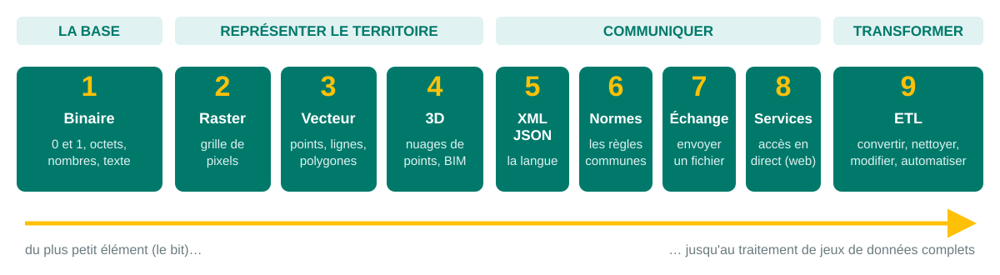
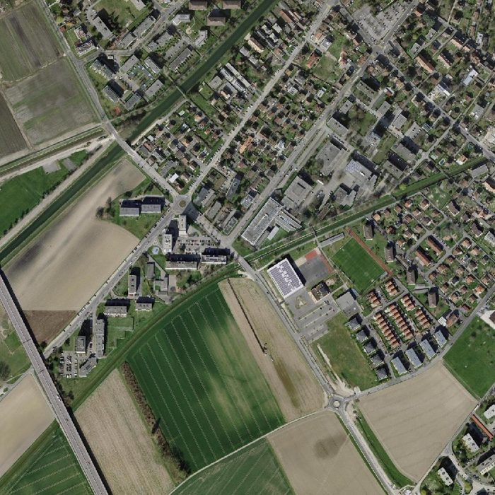
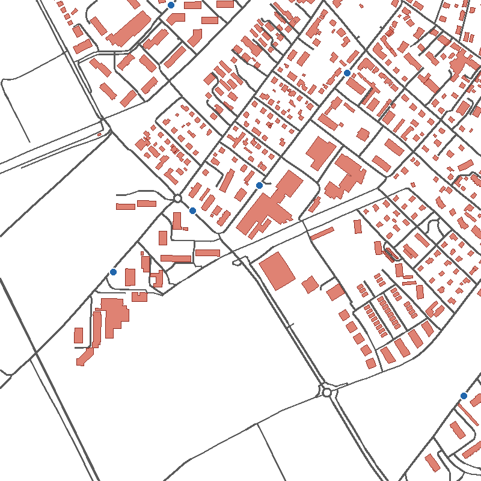
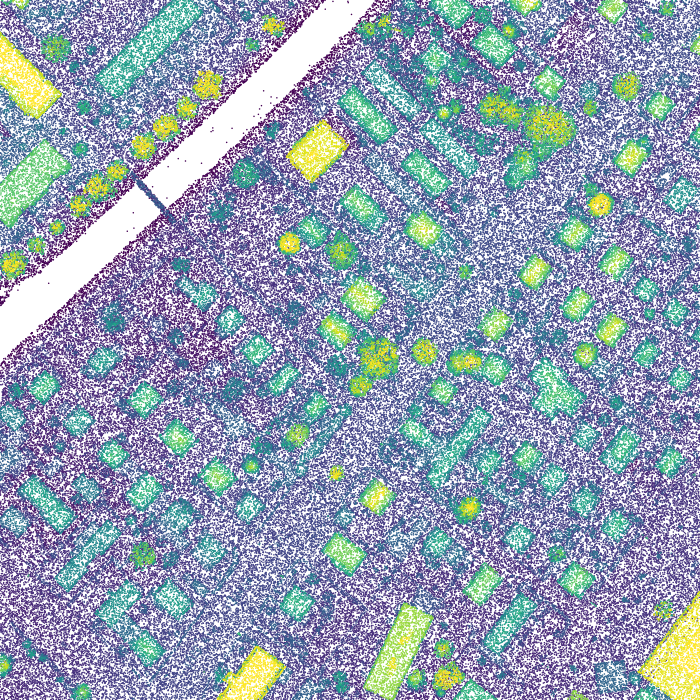

# 0. Introduction

[📽 Slides du chapitre](https://regislon.github.io/cfgeo_B4/formats-interfaces/00-introduction/slides.html) · [📄 Version PDF](slides.pdf)

## Objectifs

À la fin de cette introduction, vous savez :

- Ce que vous allez apprendre dans le cours B4c, et dans quel ordre
- Pourquoi le cours commence par le **binaire**, et pas directement par les formats
- Distinguer en une phrase les trois grandes familles de géodonnées : **raster**, **vecteur**, **nuage de points**
- Comment se déroulent les trois journées de cours et les examens

## Le métier en une phrase

Un géomaticien passe une grande partie de son temps à **faire passer des données d'un système à un autre** : un relevé GNSS vers un SIG, un plan cadastral vers un bureau d'ingénieurs, une orthophoto vers une application web, un modèle de bâtiment vers un architecte…

À chaque passage, les mêmes questions reviennent :

- **Qu'y a-t-il dans ce fichier ?** Comment est-il codé, et comment le lire ?
- **Quel format choisir ?** Pour stocker, pour échanger, pour diffuser ?
- **Comment l'autre système va-t-il le comprendre ?** Avec quelles règles communes ?
- **Comment le transformer ?** Changer de format, de structure, de système de coordonnées, sans perdre d'information ?

Ce cours, c'est **« les géodonnées pour les nuls »** : le b.a.-ba pour répondre à ces questions sans se perdre dans la jungle des formats.

## Le parcours : du bit à l'ETL

Le cours monte une marche après l'autre : on part du **plus petit élément** (le bit) pour arriver au **traitement de jeux de données complets**. Chaque chapitre s'appuie sur le précédent.

### 1. La base : tout n'est que 0 et 1

**Pourquoi commencer par le binaire ?** Parce que tout fichier, quel qu'il soit (une orthophoto, un shapefile, un fichier INTERLIS, une page web), n'est au fond qu'**une longue suite de 0 et de 1**. Un **format**, c'est simplement la **convention** qui dit comment lire ces 0 et ces 1 : comme des couleurs, des coordonnées, des lettres…

Comprendre cette base explique beaucoup de problèmes concrets que vous rencontrerez :

| Problème rencontré | Explication… binaire |
|---|---|
| « Pourquoi ce fichier est-il si gros ? » | Chaque valeur occupe un nombre d'octets précis |
| « Mes coordonnées MN95 ont perdu leurs centimètres ! » | Stockées sur 4 octets (Float32) au lieu de 8 : précision insuffisante |
| « Les accents s'affichent comme `é` » | Le texte a été écrit dans un encodage (UTF-8) et relu dans un autre (Latin-1) |
| « Je ne peux pas ouvrir ce fichier dans un éditeur de texte » | C'est un fichier **binaire**, pas un fichier texte |

➡ [Chapitre 1 : Codage binaire](../01-codage-binaire/README.md)

### 2. Représenter le territoire : trois familles de données

Pour décrire le territoire dans un ordinateur, il existe trois grandes manières de faire. Voici le même quartier d'Yverdon-les-Bains vu des trois façons :

{ width="230" } { width="230" } { width="230" }

| Famille | L'image à retenir | Exemples | Chapitre |
|---|---|---|---|
| **Raster** | Une **mosaïque** : le territoire découpé en petits carrés (pixels), chacun portant une valeur | Orthophoto, modèle numérique de terrain, image satellite | [2. Données raster](../02-raster/README.md) |
| **Vecteur** | Un **dessin au trait** : des objets (points, lignes, polygones) avec leurs attributs | Bâtiments, routes, parcelles, arrêts de bus | [3. Données vectorielles](../03-vecteur/README.md) |
| **Nuage de points** (et 3D) | Une **poussière de points** mesurés en X, Y, Z, souvent des millions | Relevé LiDAR, scanner laser, photogrammétrie ; modèles 3D de villes et de bâtiments (BIM) | [4. 3D et nuages de points](../04-3d-nuages-de-points/README.md) |

Aucune famille n'est « meilleure » : chacune répond à un besoin. On choisit le raster pour ce qui varie en continu (altitude, couleur, température), le vecteur pour les objets bien délimités (un bâtiment, une parcelle), le nuage de points pour capter la réalité telle que mesurée, en 3D.

### 3. Communiquer : échanger les données

Avoir des données ne suffit pas : il faut pouvoir les **transmettre** à quelqu'un d'autre, qui utilise un autre logiciel. C'est comme une conversation entre deux personnes qui ne parlent pas la même langue :

| Chapitre | Dans une conversation, c'est… |
|---|---|
| [5. XML et JSON](../05-xml-json/README.md) | **l'écriture** : une manière lisible et structurée de mettre l'information sur papier |
| [6. Interopérabilité et normes](../06-interoperabilite-normes/README.md) | **le dictionnaire et la grammaire communs** : les règles sur lesquelles tout le monde s'est mis d'accord (ISO, OGC, INTERLIS) |
| [7. Échange de données](../07-echange-de-donnees/README.md) | **la lettre envoyée** : on prépare un fichier, on l'envoie, le destinataire l'intègre dans son système |
| [8. Géoservices (GeoWeb)](../08-geoservices/README.md) | **le coup de téléphone** : on n'envoie plus de fichier, on interroge directement la source sur le web (WMS, WFS, tuiles…) |

### 4. Transformer : manipuler et modifier

Dernière marche : **reformater**. Les données reçues ne sont presque jamais dans la forme dont on a besoin. Il faut les convertir d'un format à l'autre, changer de système de coordonnées, filtrer, renommer des attributs, contrôler… et si possible **automatiser** tout cela pour pouvoir le refaire demain.

C'est le rôle des outils **ETL** (*Extract, Transform, Load* : extraire, transformer, charger) : FME, GDAL, les modèles QGIS, ou un simple script.

➡ [Chapitre 9 : Reformatage et ETL](../09-reformatage-etl/README.md)

## Le fil rouge : un kilomètre carré à Yverdon

Pour que les chapitres se répondent, ils travaillent tous sur **le même territoire** : la tuile **2538-1180**, un kilomètre carré d'Yverdon-les-Bains (les trois images ci-dessus). Vous la verrez :

- en **0 et 1** au chapitre 1 (la couleur d'un pixel, une altitude, le nom d'un arrêt de bus),
- en **pixels** au chapitre 2 (orthophoto SWISSIMAGE, MNT swissALTI3D),
- en **objets** au chapitre 3 (bâtiments, routes, arrêts de bus),
- en **nuage de points** au chapitre 4 (swissSURFACE3D),
- écrite en **cinq formats texte** au chapitre 5 (un arrêt de bus en GML, KML, GPX, INTERLIS/XTF et GeoJSON),
- transformée par **schema mapping** au chapitre 7 (les bâtiments de swissBUILDINGS3D),
- diffusée par **géoservices** au chapitre 8.

Le message est toujours le même : **l'information ne change pas, seul l'emballage change.**

## Quelques mots de vocabulaire

| Terme | En clair |
|---|---|
| **Géodonnée** | Une donnée qui a une position sur la Terre (directement par des coordonnées, ou indirectement par une adresse, un numéro de parcelle…) |
| **Format** | La convention qui dit comment les informations sont rangées dans un fichier |
| **Format ouvert / propriétaire** | Spécification publique, ou contrôlée par un éditeur |
| **Métadonnées** | Les données sur les données : qui, quand, comment, quelle précision, quel système de coordonnées |
| **Système de coordonnées** | Le repère qui donne un sens aux nombres X et Y (en Suisse : **MN95**, EPSG:2056) |
| **Interface** | Le point de contact entre deux systèmes, qui leur permet d'échanger |
| **Interopérabilité** | La capacité de systèmes différents à travailler ensemble sans effort particulier |

Ces termes sont repris et approfondis dans les chapitres.

## Planning du cours B4c

Le cours « Formats, interfaces » compte **trois journées de 8 périodes** (24 périodes), données par Régis Longchamp.

| Journée | Date | Lieu | Chapitres | Exercices |
|---|---|---|---|---|
| **1** | Lundi 7 décembre 2026 | **Centre Venoge (TCS), Cossonay** | 0. Introduction · 1. Codage binaire · 2. Données raster · 3. Données vectorielles | Ex. 1 à 5 |
| **2** | Lundi 14 décembre 2026 | **Visioconférence (Teams)** | 4. 3D et nuages de points · 5. XML et JSON · 6. Interopérabilité et normes | Ex. 6 et 7 |
| **3** | Lundi 25 janvier 2027 | **Visioconférence (Teams)** | 7. Échange de données · 8. Géoservices · 9. Reformatage et ETL | Ex. 8 à 12 |

Horaire des journées : **08:30 – 16:30**, avec des pauses de 10:00 à 10:15, de 11:45 à 13:15 (repas) et de 14:45 à 15:00.

!!! info "Pratique"

    - Venez avec un **PC portable** (prévoyez une rallonge pour la journée en présentiel).
    - Pour les journées en visioconférence, installez **QGIS** à l'avance et vérifiez que Teams fonctionne avec micro et partage d'écran.
    - Places de parc gratuites au Centre Venoge (TCS), Route de Dizy 4, 1304 Cossonay.

### Examens

| Date | Horaire | Contenu | Lieu |
|---|---|---|---|
| Mardi 2 février 2027 | 08:30 – 11:45 | Préparation de l'examen oral (tous les enseignants du module) | Centre Venoge (Cossonay) |
| Vendredi 19 février 2027 | Selon horaire spécial | **Examens oraux**, présentations par groupes, puis examen à blanc en fin d'après-midi | Centre Venoge (Cossonay) |
| Vendredi 16 avril 2027 | 08:30 – 12:00 | **Examen du module B4** | Centre Venoge (Cossonay) |

Le planning complet du module B4 (cours B4a à B4e) se trouve sur la [page d'accueil](../../README.md#le-module-b4-geomatique-ti).

## Comment utiliser ce support

- Chaque chapitre a une **page de cours** (à lire, avec démonstrations interactives et quiz) et des **slides** (📽, projetées en classe). Chaque slide renvoie à la section correspondante du cours (lien 📖 en bas de page).
- Les **exercices** sont annoncés dans les slides au moment où on les fait. Leurs données se téléchargent en un seul fichier zip.
- Les rubriques **« À retenir »** en fin de chapitre résument l'essentiel pour l'examen.

## À retenir

- Le cours suit un fil logique : **coder** (binaire) → **représenter** (raster, vecteur, nuage de points) → **communiquer** (XML/JSON, normes, échange, géoservices) → **transformer** (ETL).
- On part du binaire parce qu'**un fichier n'est qu'une suite de 0 et de 1** : le format est la convention qui permet de les lire.
- **Raster** = mosaïque de pixels ; **vecteur** = objets dessinés ; **nuage de points** = millions de points mesurés en 3D.
- Échanger, c'est se mettre d'accord sur une **langue commune** (formats et normes), puis choisir entre **envoyer un fichier** et **interroger un service**.
- Les données ne sont jamais dans la bonne forme : l'**ETL** les transforme, et l'automatisation permet de refaire le travail.
