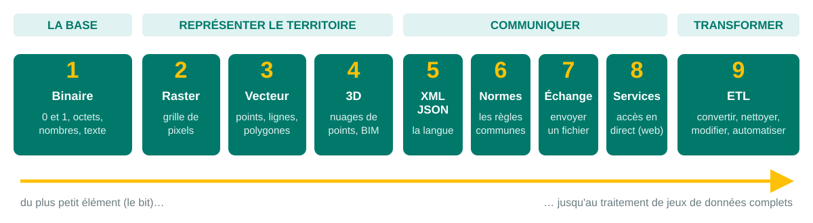
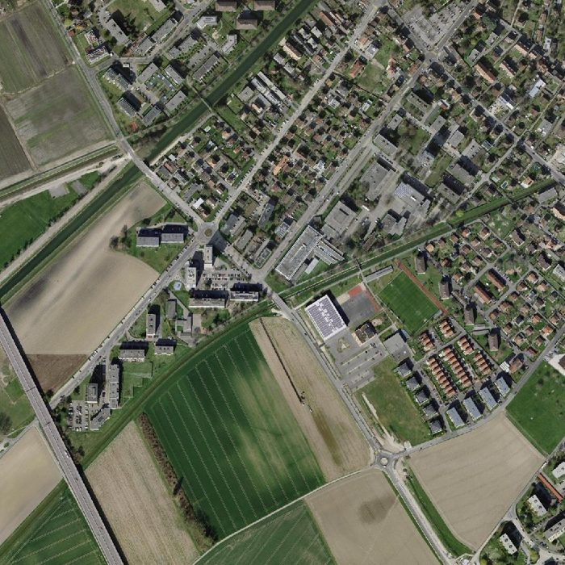
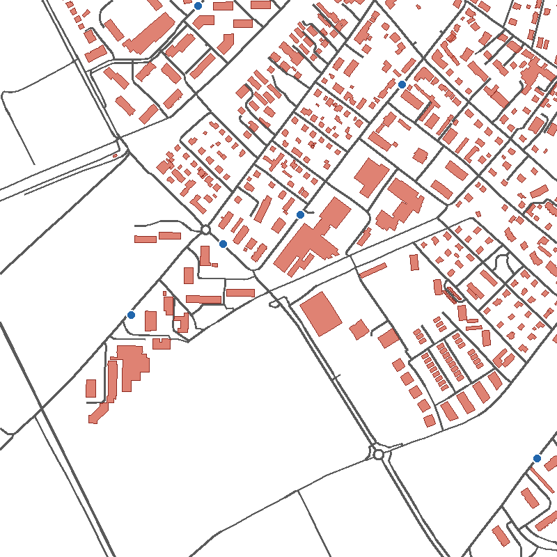
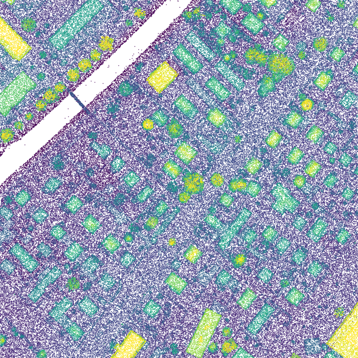

<!-- _footer: 'CFGéo B4 · 0. Introduction · [📖 Lire le chapitre](./)' -->
<!-- _class: lead -->
<!-- _paginate: false -->

# 0. Introduction

Module B4 « Géomatique & TI » — Formats, interfaces

Les géodonnées pour les nuls : du bit à l'ETL

---

<!-- _footer: 'CFGéo B4 · 0. Introduction · [📖 Objectifs](./#objectifs)' -->
## Objectifs

- Savoir **ce qu'on va apprendre**, et dans quel ordre
- Comprendre **pourquoi on commence par le binaire**
- Distinguer **raster**, **vecteur** et **nuage de points** en une phrase
- Connaître le **planning** des trois journées et des examens

---

<!-- _footer: 'CFGéo B4 · 0. Introduction · [📖 Le métier en une phrase](./#le-metier-en-une-phrase)' -->
## Le métier en une phrase

Le géomaticien **fait passer des données d'un système à un autre**.

À chaque passage, quatre questions :

- **Qu'y a-t-il dans ce fichier ?** Comment le lire ?
- **Quel format choisir ?** Stocker, échanger, diffuser
- **Comment l'autre système va-t-il le comprendre ?**
- **Comment le transformer** sans rien perdre ?

---

<!-- _footer: 'CFGéo B4 · 0. Introduction · [📖 Le parcours : du bit à l’ETL](./#le-parcours-du-bit-a-letl)' -->
## Le parcours : du bit à l'ETL

Une marche après l'autre : chaque chapitre s'appuie sur le précédent

---

<!-- _footer: 'CFGéo B4 · 0. Introduction · [📖 La base : tout n’est que 0 et 1](./#1-la-base-tout-nest-que-0-et-1)' -->
## 1. Pourquoi partir du binaire ?

Tout fichier n'est qu'**une suite de 0 et de 1**. Le **format** = la convention pour les lire.

| Problème rencontré | Explication binaire |
|---|---|
| Fichier énorme | Chaque valeur occupe un nombre d'octets précis |
| Centimètres MN95 perdus | Float32 (4 octets) au lieu de Float64 |
| `é` au lieu de `é` | UTF-8 relu en Latin-1 |
| Illisible dans le bloc-notes | Fichier **binaire**, pas texte |

---

<!-- _footer: 'CFGéo B4 · 0. Introduction · [📖 Représenter le territoire](./#2-representer-le-territoire-trois-familles-de-donnees)' -->
## 2. Représenter le territoire : trois familles

  

**Raster** : une mosaïque de pixels · **Vecteur** : un dessin d'objets · **Nuage de points** : une poussière de points XYZ

---

<!-- _footer: 'CFGéo B4 · 0. Introduction · [📖 Représenter le territoire](./#2-representer-le-territoire-trois-familles-de-donnees)' -->
## Quelle famille pour quoi ?

| Famille | Pour… | Exemples |
|---|---|---|
| **Raster** (ch. 2) | ce qui varie en continu | orthophoto, MNT, satellite |
| **Vecteur** (ch. 3) | les objets bien délimités | bâtiments, routes, parcelles |
| **Nuage de points, 3D** (ch. 4) | la réalité mesurée en 3D | LiDAR, scanner, BIM |

Aucune n'est « meilleure » : chacune répond à un besoin

---

<!-- _footer: 'CFGéo B4 · 0. Introduction · [📖 Communiquer](./#3-communiquer-echanger-les-donnees)' -->
## 3. Communiquer : comme une conversation

| Chapitre | Dans une conversation, c'est… |
|---|---|
| 5. XML et JSON | **l'écriture** structurée |
| 6. Normes | **le dictionnaire et la grammaire** communs |
| 7. Échange de données | **la lettre** envoyée (un fichier) |
| 8. Géoservices | **le coup de téléphone** (accès direct sur le web) |

---

<!-- _footer: 'CFGéo B4 · 0. Introduction · [📖 Transformer](./#4-transformer-manipuler-et-modifier)' -->
## 4. Transformer : manipuler et modifier

Les données reçues ne sont **jamais** dans la bonne forme :

- changer de **format**
- changer de **système de coordonnées**
- filtrer, renommer, restructurer, **contrôler**
- **automatiser** pour pouvoir refaire demain

**ETL** = *Extract, Transform, Load* · FME, GDAL, modèles QGIS, scripts (ch. 9)

---

<!-- _footer: 'CFGéo B4 · 0. Introduction · [📖 Le fil rouge](./#le-fil-rouge-un-kilometre-carre-a-yverdon)' -->
## 🧵 Fil rouge : un km² à Yverdon

Tous les chapitres travaillent sur la tuile **2538-1180**

- ch. 1 : en **0 et 1** · ch. 2 : en **pixels** · ch. 3 : en **objets**
- ch. 4 : en **nuage de points** · ch. 5 : un arrêt de bus en **5 formats**
- ch. 7 : bâtiments par **schema mapping** · ch. 8 : diffusés par **géoservices**

**L'information ne change pas, seul l'emballage change.**

---

<!-- _footer: 'CFGéo B4 · 0. Introduction · [📖 Vocabulaire](./#quelques-mots-de-vocabulaire)' -->
## Quelques mots de vocabulaire

| Terme | En clair |
|---|---|
| **Géodonnée** | donnée qui a une position sur la Terre |
| **Format** | convention de rangement dans un fichier |
| **Métadonnées** | données sur les données |
| **Système de coordonnées** | repère des X, Y (MN95, EPSG:2056) |
| **Interface** | point de contact entre deux systèmes |
| **Interopérabilité** | travailler ensemble sans effort particulier |

---

<!-- _footer: 'CFGéo B4 · 0. Introduction · [📖 Planning du cours B4c](./#planning-du-cours-b4c)' -->
## Planning du cours B4c

| Jour | Date | Lieu | Chapitres |
|---|---|---|---|
| **1** | lu 7 déc. 2026 | Cossonay | 0 · 1 · 2 · 3 (ex. 1–5) |
| **2** | lu 14 déc. 2026 | Teams | 4 · 5 · 6 (ex. 6–7) |
| **3** | lu 25 janv. 2027 | Teams | 7 · 8 · 9 (ex. 8–12) |

08:30 – 16:30 · pauses 10:00, 11:45 – 13:15 (repas), 14:45
**PC portable** · QGIS installé · rallonge

---

<!-- _footer: 'CFGéo B4 · 0. Introduction · [📖 Les séances en ligne : bonnes pratiques](./#les-seances-en-ligne-bonnes-pratiques)' -->
## Séances en ligne : bonnes pratiques

- 📷 **Caméra allumée** (sauf courte absence : pause, toilettes…)
- 🎙️ **Micro coupé** quand on ne parle pas
- 🙋 **Participez** : une question n'est jamais bête
- ✋ **Levez la main** pour une question… l'enseignant ne la voit **pas toujours** : sans réaction, ouvrez le micro ou écrivez dans le **chat**
- 🎧 Endroit calme, casque, PC sur secteur, **à l'heure** après les pauses
- 🤝 On laisse finir celui qui parle, on respecte toutes les questions

---

<!-- _footer: 'CFGéo B4 · 0. Introduction · [📖 Examens](./#examens)' -->
## Examens

| Date | Contenu |
|---|---|
| ma 2 févr. 2027, matin | Préparation de l'examen oral |
| ve 19 févr. 2027 | **Examens oraux** par groupes + examen à blanc |
| ve 16 avril 2027, 08:30 – 12:00 | **Examen du module B4** |

Tous au Centre Venoge (TCS), Cossonay

---

<!-- _footer: 'CFGéo B4 · 0. Introduction · [📖 À retenir](./#a-retenir)' -->
## À retenir

- **Coder** → **représenter** → **communiquer** → **transformer**
- Un fichier = une suite de **0 et 1** ; le format = la convention pour les lire
- **Raster** = pixels · **vecteur** = objets · **nuage de points** = XYZ mesurés
- Échanger = une **langue commune** + **fichier** ou **service**
- L'**ETL** remet les données dans la bonne forme, et l'automatise
