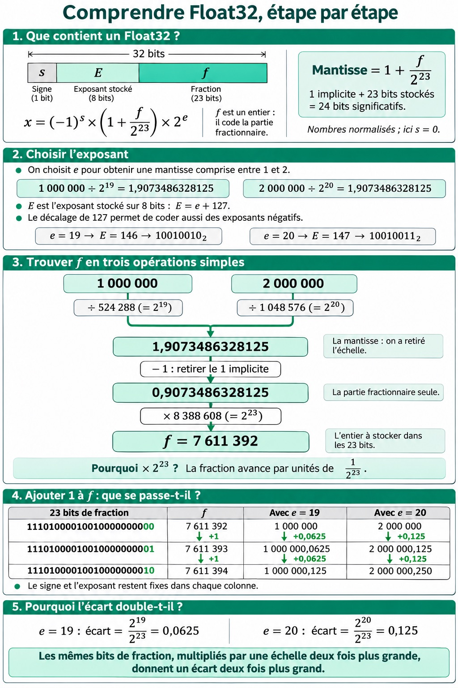

<!-- _footer: 'CFGéo B4 · 1. Codage binaire · [📖 Lire le chapitre](./)' -->
<!-- _class: lead -->
<!-- _paginate: false -->

# 1. Codage binaire

Module B4 « Géomatique & TI » — Formats, interfaces

---

<!-- _footer: 'CFGéo B4 · 1. Codage binaire · [📖 Objectifs](./#objectifs)' -->
## Objectifs

- Expliquer pourquoi l'ordinateur travaille en **base 2**
- Convertir entre **binaire** et **décimal** ; *n* bits = **2ⁿ** valeurs
- Lire et écrire en **hexadécimal**
- Entiers signés, **nombres à virgule** : pourquoi pas de MN95 en Float32
- **Codage du texte** (ASCII, Latin-1, UTF-8), reconnaître un problème d'encodage
- Unités : **ko / Kio**, Mo / Mio…
- **Fichier texte** ou **fichier binaire** ?

---

<!-- _footer: 'CFGéo B4 · 1. Codage binaire · [📖 Introduction : qu’est-ce qu’un format ?](./#introduction-quest-ce-quun-format)' -->
## Qu'est-ce qu'un format ?

- **Format de données** : manière d'encoder l'information pour qu'un logiciel puisse l'exploiter
- **Format d'échange** : format compris par plusieurs systèmes
- **Format ouvert** : spécification publique
- **Format fermé / propriétaire** : spécification secrète ou contrôlée par un éditeur
- Pour comparer les formats, il faut comprendre comment l'ordinateur code l'information

---

<!-- _footer: 'CFGéo B4 · 1. Codage binaire · [📖 Fil rouge : Yverdon en 0 et 1](./#fil-rouge-yverdon-en-0-et-1)' -->
## 🧵 Fil rouge : Yverdon en 0 et 1

| Information | Stockée comme |
|---|---|
| Pixel (toit de voiture) R 204, V 211, B 230 | `CC D3 E6` (3 octets) |
| Altitude 433,17 m | `C3 95 D8 43` (Float32) |
| Coordonnée E 2'538'500,12 | `F6 28 5C 0F 02 5E 43 41` (Float64) |
| Arrêt « Faïencerie » | 11 octets en UTF-8 |
| Tuile SWISSIMAGE | 65'004'150 octets |

Un fichier = une suite d'**octets** · un **format** = la convention pour les lire

---

<!-- _footer: 'CFGéo B4 · 1. Codage binaire · [📖 Système décimal et système binaire](./#systeme-decimal-et-systeme-binaire)' -->
<!-- _class: lead -->

# Décimal et binaire

---

<!-- _footer: 'CFGéo B4 · 1. Codage binaire · [📖 Pourquoi la base 2 ?](./#pourquoi-la-base-2)' -->
## Pourquoi la base 2 ?

- Nous comptons en base 10… parce que nous avons 10 doigts
- L'ordinateur ne connaît que **deux états** :
  - courant / pas de courant
  - allumé / éteint, vrai / faux
  - **1 / 0**
- Deux états = faciles à produire, stocker et lire de manière fiable (tension, aimantation, creux d'un DVD, mémoire flash)

---

<!-- _footer: 'CFGéo B4 · 1. Codage binaire · [📖 Le système décimal (base 10)](./#le-systeme-decimal-base-10)' -->
## Le système décimal (base 10)

- 10 symboles : 0 à 9 ; chaque position = une **puissance de 10**
- **Représentation positionnelle** : le 3 de **1934** vaut 30, celui de **3008** vaut 3'000

**Forme canonique** de 3'528 :

3'528 = 3·10³ + 5·10² + 2·10¹ + 8·10⁰

---

<!-- _footer: 'CFGéo B4 · 1. Codage binaire · [📖 Le système binaire (base 2)](./#le-systeme-binaire-base-2)' -->
## Le système binaire (base 2)

- Même principe positionnel, mais **2 symboles : 0 et 1**
- Chaque position = une **puissance de 2** : 1, 2, 4, 8, 16…
- Deux écritures **du même nombre** :

**10101₍₂₎ = 21₍₁₀₎**

- La base se note en indice pour éviter les confusions

---

<!-- _footer: 'CFGéo B4 · 1. Codage binaire · [📖 Bits et octets](./#bits-et-octets)' -->
<!-- _class: lead -->

# Bits et octets

---

<!-- _footer: 'CFGéo B4 · 1. Codage binaire · [📖 Le bit](./#le-bit)' -->
## Le bit

- **bit** = *binary digit* = 0 ou 1 (noté **b**)
- Plus petite unité d'information

| Bits | Valeurs possibles |
|---|---|
| 1 | 2 |
| 2 | 4 |
| 3 | 8 (de 000 = 0 à 111 = 7) |
| *n* | **2ⁿ** |

---

<!-- _footer: 'CFGéo B4 · 1. Codage binaire · [📖 L’octet](./#loctet)' -->
## L'octet

- **Octet** (o) = *byte* (B) = **8 bits**
- 2⁸ = **256** valeurs : de `00000000` = 0 à `11111111` = **255**
- 1 octet ≈ 1 caractère ASCII, 1 pixel en niveaux de gris, 1 bande RVB
- 2 octets → 65'536 valeurs ; 4 octets → ~4,3 milliards
- ⚠️ **b** = bit, **B** = byte : 100 Mb/s = 12,5 Mo/s

---

<!-- _footer: 'CFGéo B4 · 1. Codage binaire · [📖 L’octet](./#loctet)' -->
<!-- _class: demo -->
## ▶ À vous : allumer les bits

<div class="todo">

1. Allumez les bits pour obtenir **42**, puis **255**, puis **128**
2. Quelle est la plus grande valeur possible ? Pourquoi ?

</div>

<a class="go" href="./#demo-octet"><small>Démo sur la page du cours ↗</small>▶ Les bits d'un octet</a>

---

<!-- _footer: 'CFGéo B4 · 1. Codage binaire · [📖 L’octet](./#loctet)' -->
<!-- _class: exo -->
## ✏️ À vous : décoder un octet

`0` `1` `0` `0` `0` `0` `1` `1` = **?**

<div class="todo">

1. Retrouvez la valeur décimale de cet octet
2. Bonne réponse → « Octet suivant » : d'autres octets tirés au hasard
3. Bloqué ? « Afficher les poids » (2⁷ = 128 … 2⁰ = 1)

</div>

<!-- Réponse : 64 + 2 + 1 = 67 -->

<a class="go exo" href="./#demo-decoder"><small>Exercice sur la page web ↗</small>▶ Décoder un octet</a>

---

<!-- _footer: 'CFGéo B4 · 1. Codage binaire · [📖 Conversions](./#conversions)' -->
<!-- _class: lead -->

# Conversions

---

<!-- _footer: 'CFGéo B4 · 1. Codage binaire · [📖 Du binaire vers le décimal](./#du-binaire-vers-le-decimal)' -->
## Binaire → décimal

Somme des puissances de 2 là où il y a un 1 :

10101₍₂₎ = 1·2⁴ + 0·2³ + 1·2² + 0·2¹ + 1·2⁰ = 16 + 4 + 1 = **21**

| 2⁷ | 2⁶ | 2⁵ | 2⁴ | 2³ | 2² | 2¹ | 2⁰ | |
|---|---|---|---|---|---|---|---|---|
| 128 | 64 | 32 | 16 | 8 | 4 | 2 | 1 | |
| 0 | 0 | 1 | 0 | 1 | 0 | 1 | 0 | **= 42** |

Le bit de poids faible (2⁰) est **à droite**

---

<!-- _footer: 'CFGéo B4 · 1. Codage binaire · [📖 Du décimal vers le binaire](./#du-decimal-vers-le-binaire)' -->
## Décimal → binaire

Divisions successives par 2, lecture des restes **de bas en haut**

| 156 | 78 | 39 | 19 | 9 | 4 | 2 | 1 |
|---|---|---|---|---|---|---|---|
| reste 0 | 0 | 1 | 1 | 1 | 0 | 0 | 1 |

156₍₁₀₎ = **10011100₍₂₎** (128 + 16 + 8 + 4)

---

<!-- _footer: 'CFGéo B4 · 1. Codage binaire · [📖 Entraînez-vous](./#entrainez-vous)' -->
<!-- _class: exo -->
## ✏️ À vous : conversions

<div class="todo">

1. 11001000₍₂₎ = ? en décimal
2. 77₍₁₀₎ = ? en binaire sur 8 bits
3. Combien de bits pour coder les 26 lettres ? les 26 cantons ? les 2'136 communes ?

</div>

<!-- Réponses : 200 ; 01001101 ; 5, 5 et 12 bits -->

Puis : exercices tirés au hasard, **corrigés pas à pas**, autant que vous voulez

<a class="go exo" href="./#demo-exercices"><small>Exercice sur la page web ↗</small>▶ Exercices de conversion à volonté</a>

---

<!-- _footer: 'CFGéo B4 · 1. Codage binaire · [📖 L’hexadécimal](./#lhexadecimal)' -->
## L'hexadécimal (base 16)

- 16 symboles : **0–9 puis A–F** (A = 10 … F = 15)
- **1 chiffre hexa = 4 bits** → **1 octet = 2 chiffres** (`00` à `FF`)

| | Rouge | Vert | Bleu |
|---|---|---|---|
| Décimal | 204 | 211 | 230 |
| Binaire | 1100 1100 | 1101 0011 | 1110 0110 |
| Hexa | **CC** | **D3** | **E6** |

→ couleur **`#CCD3E6`** · aussi : couleurs KML, WKB, éditeurs hexadécimaux

---

<!-- _footer: 'CFGéo B4 · 1. Codage binaire · [📖 L’hexadécimal](./#lhexadecimal)' -->
<!-- _class: demo -->
## ▶ À vous : une couleur = trois octets

<div class="todo">

1. Bouton 🧵 : retrouvez `#CCD3E6`, le toit de voiture du fil rouge
2. Fabriquez un **rouge pur** : quels bits ? quel code hexadécimal ?
3. Et le blanc ? le noir ? un gris moyen ?

</div>

<a class="go" href="./#demo-rvb"><small>Démo sur la page du cours ↗</small>▶ Bits, hexadécimal et couleur</a>

---

<!-- _footer: 'CFGéo B4 · 1. Codage binaire · [📖 Nombres négatifs et nombres à virgule](./#nombres-negatifs-et-nombres-a-virgule)' -->
<!-- _class: lead -->

# Nombres négatifs et à virgule

---

<!-- _footer: 'CFGéo B4 · 1. Codage binaire · [📖 Les nombres entiers signés](./#les-nombres-entiers-signes)' -->
## Entiers signés

- La moitié des combinaisons sert aux **négatifs** (complément à deux) : autant de valeurs, mais décalées

| Type | Octets | Plage |
|---|---|---|
| UInt8 | 1 | 0 à 255 |
| Int8 | 1 | −128 à 127 |
| UInt16 | 2 | 0 à 65'535 |
| Int16 | 2 | −32'768 à 32'767 |
| Int32 | 4 | ± 2,1 milliards |

Mêmes noms dans les rasters et les tables attributaires

---

<!-- _footer: 'CFGéo B4 · 1. Codage binaire · [📖 Les nombres à virgule](./#les-nombres-a-virgule)' -->
## Nombres à virgule (IEEE 754)

- Signe + **mantisse** (chiffres) + **exposant** (position de la virgule)
- **Float32** : 4 octets, ~**7** chiffres · **Float64** : 8 octets, ~**15–16** chiffres
- Nombre de chiffres **fixe** : plus il y en a avant la virgule, moins il en reste après → l'espacement **double** quand le nombre double

| 🧵 Valeur | En Float32 | Pas |
|---|---|---|
| Altitude 433,17 | 433,170013 | 0,03 mm ✅ |
| E 2'538'500,12 | 2'538'500,000 | **25 cm** ❌ |

→ coordonnées MN95 en **Float64** (Shapefile, GeoPackage, PostGIS)

---

<!-- _footer: 'CFGéo B4 · 1. Codage binaire · [📖 Les nombres à virgule](./#les-nombres-a-virgule)' -->
## Pourquoi l'écart double ?



- 32 bits = **signe** (1) + **exposant** (8) + **fraction** (23)
- x = (−1)ˢ × (1 + f / 2²³) × 2ᵉ
- 1'000'000 et 2'000'000 : **même fraction**, exposant 19 ou 20
- Fraction + 1 → + **0,0625** (e = 19) ou + **0,125** (e = 20)
- ➜ exposant + 1 : valeurs **et** espacement doublent

---

<!-- _footer: 'CFGéo B4 · 1. Codage binaire · [📖 Les nombres à virgule](./#les-nombres-a-virgule)' -->
<!-- _class: demo -->
## ▶ À vous : Float32 ou Float64 ?

<div class="todo">

1. Boutons 🧵 : comparez l'**altitude** 433,17 et la coordonnée **E** 2'538'500,12
2. Quelle valeur est réellement stockée ? Quelle **erreur** ?
3. Essayez votre propre coordonnée MN95, puis une longitude WGS84 (6,634257)

</div>

<a class="go" href="./#demo-float"><small>Démo sur la page du cours ↗</small>▶ Décortiquer un nombre à virgule</a>

---

<!-- _footer: 'CFGéo B4 · 1. Codage binaire · [📖 Unités informatiques](./#unites-informatiques)' -->
<!-- _class: lead -->

# Unités informatiques

---

<!-- _footer: 'CFGéo B4 · 1. Codage binaire · [📖 Préfixes décimaux (SI)](./#prefixes-decimaux-si)' -->
## Deux familles de préfixes

| SI (décimal) | Valeur | CEI (binaire) | Valeur |
|---|---|---|---|
| ko | 1'000 o | **Kio** | 1'024 o |
| Mo | 10⁶ o | **Mio** | 2²⁰ = 1'048'576 o |
| Go | 10⁹ o | **Gio** | 2³⁰ o |
| To | 10¹² o | **Tio** | 2⁴⁰ o |

- SI : comme km, kg → pas de **1'000**
- CEI (depuis 1998) : kibi, mébi, gibi… → pas de **1'024**

---

<!-- _footer: 'CFGéo B4 · 1. Codage binaire · [📖 Préfixes binaires (CEI/IEC)](./#prefixes-binaires-ceiiec)' -->
## Dans la pratique

- Fabricants de disques : préfixes **décimaux** (1 To = 10¹² o)
- Windows : calcule en 2¹⁰ mais affiche « Go »
  → le disque de 1 To apparaît comme **931 Go** (en fait 931 Gio)
- Écart : 2,4 % (kilo) · 7,4 % (giga) · 10 % (téra)
- Image 4'000 × 3'000 px × 3 octets = **36 Mo ≈ 34,3 Mio**
- 🧵 Tuile SWISSIMAGE : 65'004'150 o = **65,0 Mo** = « 62,0 Mo » sous Windows (62,0 **Mio**)

---

<!-- _footer: 'CFGéo B4 · 1. Codage binaire · [📖 Préfixes binaires (CEI/IEC)](./#prefixes-binaires-ceiiec)' -->
<!-- _class: demo -->
## ▶ À vous : Mo ou Mio ?

<div class="todo">

1. 🧵 Tuile SWISSIMAGE : pourquoi Windows affiche-t-il 62 Mo au lieu de 65 ?
2. Un disque « 1 To » : combien de Gio ? Une clé USB « 64 Go » ?
3. Quelle est la taille de votre dernier fichier téléchargé, en Mo **et** en Mio ?

</div>

<a class="go" href="./#demo-unites"><small>Démo sur la page du cours ↗</small>▶ Convertisseur ko / Kio</a>

---

<!-- _footer: 'CFGéo B4 · 1. Codage binaire · [📖 Le codage du texte](./#le-codage-du-texte)' -->
<!-- _class: lead -->

# Le codage du texte

---

<!-- _footer: 'CFGéo B4 · 1. Codage binaire · [📖 ASCII](./#ascii)' -->
## ASCII

- Un ordinateur ne connaît que des nombres → chaque **caractère** reçoit un **numéro** (*encoding*, *charset*)
- **ASCII** (1963) : **128 caractères** sur 7 bits
- Lettres latines **sans accents**, chiffres, ponctuation, retour à la ligne…
- `A` = 65 = `41` · `a` = 97 = `61` · `0` = 48 = `30`
- Suffisant pour l'anglais ; il manque é, è, à, ç, ä, ö, ü…

---

<!-- _footer: 'CFGéo B4 · 1. Codage binaire · [📖 Latin-1 et Windows-1252](./#latin-1-et-windows-1252)' -->
## Latin-1 et Windows-1252

- Un octet entier = **256** numéros : 128 de l'ASCII + **128 caractères accentués**
- Problème : **une table par région** du monde
- Europe occidentale : **Latin-1** (ISO 8859-1) ou **Windows-1252** (`ANSI_1252` dans un DXF)
- Le même octet `EF` = « ï » ici… mais un autre caractère en cyrillique ou en grec

---

<!-- _footer: 'CFGéo B4 · 1. Codage binaire · [📖 Unicode et UTF-8](./#unicode-et-utf-8)' -->
## Unicode et UTF-8

- **Unicode** : un numéro pour chaque caractère de toutes les écritures (> 150'000)
- **UTF-8** : ASCII sur **1 octet**, accents sur **2**, autres écritures et émojis sur 3 ou 4
- Standard du web, de XML, de JSON

| 🧵 « Faïencerie » | Octets du « ï » | Total |
|---|---|---|
| ASCII | impossible | — |
| Latin-1 | `EF` | 10 octets |
| UTF-8 | `C3 AF` | 11 octets |

---

<!-- _footer: 'CFGéo B4 · 1. Codage binaire · [📖 Unicode et UTF-8](./#unicode-et-utf-8)' -->
## Le problème d'encodage

UTF-8 lu comme du Latin-1 (*mojibake*) :

- « Faïencerie » → **« Faïencerie »**
- « Genève » → **« Genève »**

Causes typiques : `.cpg` oublié (Shapefile), `encoding` absent (XML), mauvais choix à l'import d'un CSV

---

<!-- _footer: 'CFGéo B4 · 1. Codage binaire · [📖 Unicode et UTF-8](./#unicode-et-utf-8)' -->
<!-- _class: demo -->
## ▶ À vous : un texte, trois codages

<div class="todo">

1. Tapez **« Genève »** : combien d'octets en ASCII, Latin-1, UTF-8 ?
2. Observez le texte UTF-8 **lu comme du Windows-1252**
3. Tapez votre nom, un mot en grec (« Αθήνα ») ou un émoji 🙂 : que se passe-t-il ?

</div>

<a class="go" href="./#demo-texte"><small>Démo sur la page du cours ↗</small>▶ Inspecteur de texte</a>

---

<!-- _footer: 'CFGéo B4 · 1. Codage binaire · [📖 Fichiers texte et fichiers binaires](./#fichiers-texte-et-fichiers-binaires)' -->
<!-- _class: lead -->

# Fichiers texte et fichiers binaires

---

<!-- _footer: 'CFGéo B4 · 1. Codage binaire · [📖 Les fichiers texte](./#les-fichiers-texte)' -->
## Fichier texte : des caractères

```text
  0          ← code 0 : nouvelle entité
POINT
 10          ← code 10 : coordonnée X
2538235      ← 7 caractères = 7 octets
 20
1180434
```

- 🧵 Un arrêt de bus dans un **DXF**
- **Lisible** dans un éditeur… mais seul le logiciel **comprend** les codes
- Codage déclaré : `ANSI_1252` (DXF 2004) · **UTF-8** depuis DXF 2007

---

<!-- _footer: 'CFGéo B4 · 1. Codage binaire · [📖 Les fichiers binaires](./#les-fichiers-binaires)' -->
## Fichier binaire : des nombres

```text
00 00 27 0A ...       → 9'994 : « je suis un shapefile »
05 00 00 00           → 5 = polygone
70 34 80 D7 3D 5D 43 41 → X min = 2'538'107,68 (Float64)
```

- 🧵 En-tête de `batiments.shp`
- Éditeur de texte : `··'···Îžè···p4€×=]CA u·šr·2AX±¿Œ` 🤯
- Le fichier n'est **pas abîmé** : QGIS connaît la **spécification**

---

<!-- _footer: 'CFGéo B4 · 1. Codage binaire · [📖 Les fichiers binaires](./#les-fichiers-binaires)' -->
<!-- _class: demo -->
## ▶ À vous : un fichier, trois vues

<div class="todo">

1. `batiments.shp` : survolez les octets → retrouvez le **9'994** et l'**emprise** de la tuile
2. Passez à `arrets.dxf` : comment la coordonnée X est-elle stockée ?
3. Combien d'octets pour X dans chaque fichier ? Lequel est le plus **précis** ?

</div>

<a class="go" href="./#demo-fichier"><small>Démo sur la page du cours ↗</small>▶ Éditeur de texte, hexadécimal, logiciel</a>

---

<!-- _footer: 'CFGéo B4 · 1. Codage binaire · [📖 Texte ou binaire : que choisir ?](./#texte-ou-binaire-que-choisir)' -->
## Texte ou binaire ?

| | Texte | Binaire |
|---|---|---|
| Éditeur de texte | ✅ lisible | ❌ symboles |
| Taille / vitesse | plus gros, plus lent | compact, rapide |
| Précision | décimales écrites | fixée par le type |
| Risque | **encodage** | il faut la **spécification** |
| Exemples | DXF, CSV, GeoJSON, KML, XTF | SHP, GPKG, GeoTIFF, Parquet |

---

<!-- _footer: 'CFGéo B4 · 1. Codage binaire · [📖 Testez-vous](./#testez-vous)' -->
<!-- _class: quiz -->
## ❓ Testez-vous

7 questions : octets, hexadécimal, UTF-8, « Genève », Float32, fichier .shp « illisible », disque de 931 Go

<a class="go quiz" href="./#testez-vous"><small>Quiz sur la page du cours ↗</small>❓ Faire le quiz</a>

---

<!-- _footer: 'CFGéo B4 · 1. Codage binaire · [📖 À retenir](./#a-retenir)' -->
## À retenir

- L'ordinateur code tout avec des **0 et des 1**
- *n* bits → **2ⁿ** valeurs ; 1 octet = 8 bits = 256 valeurs (0–255)
- Binaire ↔ décimal : somme des puissances de 2 / divisions par 2
- **ko = 1'000 o**, **Kio = 1'024 o** : préciser l'unité !
- **Hexa** : 1 octet = 2 chiffres (`CC`) · coordonnées en **Float64**
- Texte : **UTF-8** ; « Genève » = mauvais encodage
- Fichier **texte** = caractères · fichier **binaire** = nombres, lisible grâce à la **spécification**
- Un format = une convention pour coder l'information en binaire
