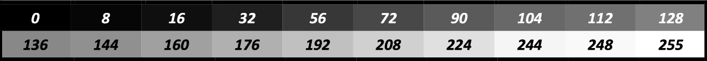
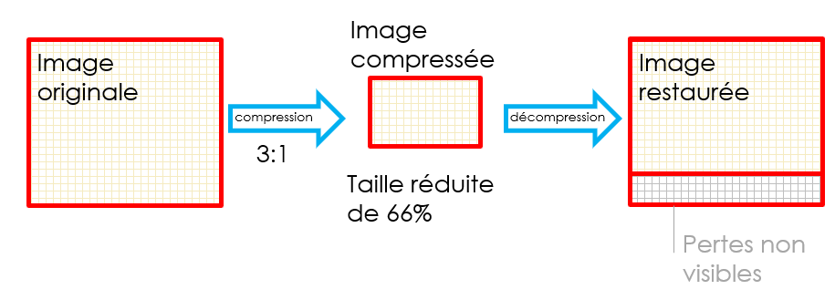
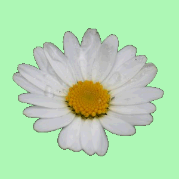

# 2. Données raster

[📽 Slides du chapitre](https://regislon.github.io/cfgeo_B4/formats-interfaces/02-raster/slides.html)

## Objectifs

À la fin de ce chapitre, vous êtes capables de :

- Décrire la structure d'une image raster (pixel, résolution, bandes, profondeur de codage)
- Expliquer comment une image raster est géoréférencée (world file, GeoTIFF)
- Calculer la taille d'un fichier raster non compressé
- Distinguer format et algorithme de compression, compression avec et sans perte
- Choisir un format raster adapté à un usage

## Raster ou vecteur ?

En géomatique, on distingue deux grandes manières de représenter le territoire, qui se codent, se traitent et s'évaluent de façon très différente :

| | Mode **raster** (matriciel) | Mode **vectoriel** |
|---|---|---|
| Principe | Le territoire est découpé en une grille régulière de cellules, les **pixels** | Les objets sont décrits par les coordonnées de **points**, **lignes** et **polygones** |
| Une forêt… | … est un ensemble de pixels portant la valeur « forêt » | … est un polygone avec un attribut « forêt » |
| Une route… | … est une suite de pixels voisins | … est une polyligne |
| Exemples | Orthophoto, MNT, image satellite, carte scannée | Mensuration officielle, réseau routier, limites communales |

Ce chapitre traite du mode raster ; le mode vectoriel fait l'objet du [chapitre 3](../03-vecteur/README.md), qui se termine par une comparaison des deux approches.

Dans le mode raster, le territoire est divisé en petits éléments d'image **de taille régulière**, indépendants les uns des autres, et qui portent **chacun une seule valeur**. Ce mode se prête particulièrement bien à la description de **phénomènes continus** (altitude, température, réflectance…) et garantit que la totalité du territoire est couverte.

## Valeur du pixel et résolution

### La valeur du pixel

Chaque cellule (pixel) porte **une et une seule valeur** par bande. Cette valeur peut être :

- **une couleur** : codée selon un modèle de couleur (RVB par exemple). C'est le cas des prises de vue aériennes ou satellitaires ;
- **une classe (valeur discrète)** : par exemple un code d'occupation du sol déterminé à partir d'images satellite (1 = forêt, 2 = eau, 3 = bâti…) ;
- **une mesure (valeur continue)** : par exemple une altitude. Un modèle numérique de terrain (MNT) raster n'est rien d'autre qu'une image dont chaque pixel contient l'altitude moyenne de la cellule.

Une image raster est donc un **tableau de nombres** (une matrice). Une image en niveaux de gris est un tableau de valeurs de luminance allant de 0 (noir) à 255 (blanc) : chaque pixel nécessite 8 bits, soit 1 octet.


*Chaque pixel d'une image en niveaux de gris est un nombre entre 0 et 255. Source : [5]*

### Bandes et types de données

Une image peut contenir **plusieurs bandes** (ou canaux) : 3 bandes pour une image couleur RVB, 4 pour une orthophoto RVB + proche infrarouge, 13 pour une image Sentinel‑2. Chaque bande est une matrice de même taille.

Selon ce qu'on veut stocker, chaque valeur occupe plus ou moins de bits (voir [chapitre 1](../01-codage-binaire/README.md)) :

| Type | Taille | Plage | Usage typique |
|---|---|---|---|
| Byte (UInt8) | 1 octet | 0 à 255 | Photo, orthophoto, classes |
| UInt16 / Int16 | 2 octets | 0 à 65'535 / −32'768 à 32'767 | Images satellite, altitudes en dm |
| Float32 | 4 octets | nombres à virgule | MNT (altitude en m avec décimales), indices |

Les cellules sans information (hors du périmètre, nuages…) reçoivent une valeur conventionnelle dite **NoData** (par exemple −9999 ou 0), déclarée dans les métadonnées du fichier.

### Résolution d'une image

Le terme « résolution » recouvre plusieurs notions :

- **Nombre de pixels** : un appareil photo est caractérisé par le nombre total de pixels de son capteur. Une image de 4'320 × 3'240 pixels contient 13'996'800 pixels, vendue comme « 14 mégapixels ».
- **Densité (dpi)** : lors d'une numérisation (scanner) ou d'une impression, on parle de points par pouce (*dots per inch*, dpi ; 1 pouce = 25,4 mm). Plus la densité est élevée, plus les détails fins sont capturés.

### Résolution géographique

En géomatique, la **résolution** désigne la **taille d'un pixel sur le terrain** (en anglais *Ground Sample Distance*, GSD).

| Produit | Résolution |
|---|---|
| SWISSIMAGE 10 cm (swisstopo) | 0,10 m |
| swissALTI3D (swisstopo) | 0,5 m ou 2 m |
| Sentinel‑2 (bandes visibles) | 10 m |
| Landsat 8/9 | 30 m |

!!! example "🔎 Carte scannée"

    Une carte au 1:25'000 numérisée à 400 dpi : un pixel mesure 25,4 mm / 400 = 0,0635 mm sur le papier, soit 0,0635 mm × 25'000 ≈ **1,6 m sur le terrain**.

!!! tip "Images gratuites"

    - Orthophotos suisses : [SWISSIMAGE 10 cm](https://www.swisstopo.admin.ch/fr/orthophotos-swissimage-10-cm), en données ouvertes depuis 2021
    - Images satellite : [liste de fournisseurs d'images gratuites (GIS Geography)](https://gisgeography.com/free-satellite-imagery-data-list/)

### Plus petit objet visible

Contrairement à une idée répandue, la résolution **n'est pas** la taille du plus petit objet visible.

La valeur d'un pixel est attribuée soit en fonction de ce qui domine dans la cellule, soit par la mesure en un point précis (par exemple le centre). Pour qu'un objet soit identifiable, il doit couvrir **plusieurs pixels**. Il est donc faux de dire qu'une image à 5 m de résolution permet de voir une voiture : celle-ci sera au mieux une tache d'un ou deux pixels.

### Résolution et taille de fichier

Une meilleure résolution améliore la lisibilité et la précision… au détriment de la **taille des fichiers**. Diviser la taille du pixel par 2 multiplie le nombre de pixels par **4** (la taille croît avec le **carré** de la résolution).

!!! example "🔎 Quelques ordres de grandeur"

    - Une scène Pléiades couvre 20 × 20 km à 70 cm de résolution : 28'571 × 28'571 ≈ **816 millions de pixels** par bande.
    - La même surface à 1 m de résolution : 20'000 × 20'000 = **400 millions de pixels**.
    - La Suisse (41'285 km²) à 10 cm de résolution, comme SWISSIMAGE : environ 4 · 10¹² pixels, soit plus de **12 To** non compressés en RVB.

### L'affinage panchromatique (*pan-sharpening*)

Les capteurs couleur (multispectraux) ont souvent une résolution plus faible que le capteur noir-blanc (**panchromatique**). En combinant les deux, on obtient une image couleur ayant la résolution de l'image panchromatique : l'image couleur sert en quelque sorte à « coloriser » les pixels noir-blanc plus fins.


*Principe de l'affinage panchromatique. Source : [6]*

Il existe différents algorithmes de combinaison ; leur détail dépasse le cadre de ce cours.

## Géoréférencement (world file, GeoTIFF)

Les pixels d'une image sont repérés dans le système propre à l'image : **lignes et colonnes**. Pour utiliser l'image dans un SIG, il faut une transformation entre ce système et celui du terrain (par exemple MN95, EPSG:2056) : c'est le **géoréférencement**.


*Le géoréférencement place l'image dans le système de coordonnées du terrain.*

Dans les cas les plus simples, il s'agit d'une **transformation affine à 6 paramètres**, qui nécessite de connaître :

- les coordonnées d'un point de référence de l'image (le centre du pixel en haut à gauche) ;
- la taille du pixel en unités terrain (en X et en Y) ;
- les éventuels termes de rotation.

### Le world file

Le *world file* (format proposé par ESRI, devenu un standard de fait) est un petit fichier texte qui accompagne l'image. Il porte le même nom que l'image et une extension dérivée : `.tfw` pour `.tif`, `.jgw` pour `.jpg`, `.pgw` pour `.png` (ou `.tifw`, `.wld`…).

!!! example "🔎 World file d'une tuile SWISSIMAGE 10 cm"

    Pour la tuile `swissimage-dop10_2020_2540-1150_0.1_2056.tif`, qui couvre le kilomètre carré dont le coin inférieur gauche est à E = 2'540'000 m, N = 1'150'000 m (MN95), le fichier `swissimage-dop10_2020_2540-1150_0.1_2056.tfw` contient :

    ```text
    0.1
    0.0
    0.0
    -0.1
    2540000.05
    1150999.95
    ```

    | Ligne | Paramètre | Valeur | Signification |
    |---|---|---|---|
    | 1 | A | 0.1 | Taille du pixel en X (m) |
    | 2 | D | 0.0 | Terme de rotation (Y selon la colonne) |
    | 3 | B | 0.0 | Terme de rotation (X selon la ligne) |
    | 4 | E | −0.1 | Taille du pixel en Y, **négative** car les lignes de l'image sont numérotées vers le bas alors que les Y (Nord) croissent vers le haut |
    | 5 | C | 2540000.05 | Coordonnée E du **centre** du pixel en haut à gauche |
    | 6 | F | 1150999.95 | Coordonnée N du **centre** du pixel en haut à gauche |

    La position terrain du centre du pixel (colonne *c*, ligne *l*, numérotées à partir de 0) se calcule par :

    ```text
    X (Est)  = A·c + B·l + C
    Y (Nord) = D·c + E·l + F
    ```

!!! warning "Limite du world file"

    Le world file **ne contient aucune information sur le système de coordonnées**. Rien n'indique si les valeurs sont en MN95, en MN03 ou en UTM ! Il faut le savoir par ailleurs (nom du fichier, métadonnées, fichier `.prj` ou `.aux.xml` complémentaire).

### GeoTIFF

Dans un **GeoTIFF**, les paramètres de géoréférencement **et le système de coordonnées** (par exemple le code EPSG:2056) sont stockés **dans le fichier image lui-même**, sous forme de balises (*tags*) TIFF dédiées. Avantages : un seul fichier, aucune ambiguïté sur le système de référence. Inconvénient : ces informations ne sont pas lisibles dans un simple éditeur de texte ; on les consulte avec un SIG ou avec `gdalinfo`.

GeoTIFF est un standard de l'OGC depuis 2019.

## Codage de la couleur

La valeur stockée dans un pixel est codée sur un certain nombre de bits qui détermine le nombre de couleurs ou d'intensités possibles : c'est la **profondeur de codage** (ou profondeur de couleur).

| Profondeur | Nombre de valeurs | Usage |
|---|---|---|
| 1 bit | 2¹ = 2 | Noir et blanc (plan scanné au trait) |
| 4 bits | 2⁴ = 16 | 16 niveaux de gris ou 16 couleurs |
| 8 bits | 2⁸ = 256 | 256 niveaux de gris ou 256 couleurs (palette) |
| 24 bits (3 × 8) | 2²⁴ ≈ 16,7 millions | Couleurs vraies RVB |
| 32 bits (4 × 8) | 2²⁴ couleurs + transparence | RVB + canal alpha |

 

*À gauche, 16 niveaux de gris (4 bits par pixel) ; à droite, 256 niveaux de gris (8 bits par pixel).*



*Échelle de niveaux de gris sur 8 bits.*

### Couleurs indexées (palette)

Une **palette** (ou table des couleurs, *colormap*) contient la liste des couleurs utilisées, chacune associée à un **indice**. Chaque pixel stocke alors l'indice et non la couleur elle-même. Avec des indices sur 8 bits, on dispose de 256 couleurs. On parle d'image en **couleurs indexées** (formats GIF, PNG 8 bits, TIFF avec palette).

| Indice | R | V | B |
|---|---|---|---|
| 0 | 0 | 0 | 0 |
| 1 | 0 | 255 | 255 |
| 2 | 255 | 0 | 0 |
| 3 | 100 | 100 | 100 |
| … | … | … | … |
| 255 | 255 | 255 | 255 |

### Couleurs vraies (RVB)

En **couleurs vraies** (*true color*), chaque pixel est décrit par ses trois composantes **rouge, vert et bleu** (RVB, en anglais RGB), chacune codée sur un octet : 24 bits par pixel, environ 16,7 millions de couleurs. C'est une **synthèse additive** : le mélange des trois couleurs primaires à pleine intensité donne du blanc.

Une quatrième composante, le canal **alpha**, peut décrire la transparence ; chaque pixel occupe alors 32 bits.

{ width="300" } { width="100" }

*Synthèse additive des couleurs (source : [7]) et décomposition d'une photo en ses canaux R, V et B (source : [8]).*

## Compression

La taille des fichiers raster devient très vite considérable. Réduire la résolution n'est pas une solution acceptable avec les capteurs actuels : on utilise donc des **méthodes de compression**.

!!! warning "Format ≠ compression"

    Il faut bien distinguer le **format** du fichier (la manière dont il est organisé : en-tête, métadonnées, données) de l'**algorithme de compression** qu'il utilise. Un même format peut proposer plusieurs compressions : un fichier TIFF peut par exemple être non compressé, compressé en LZW, en Deflate… ou même en JPEG !

### Ratio et taux de compression

On caractérise une compression par :

- le **ratio de compression** (ou facteur) = taille originale / taille compressée, noté par exemple **4:1** ;
- le **taux de compression** = taille compressée / taille originale, exprimé en pourcentage, par exemple **25 %**. Le **gain** (réduction de taille) vaut alors 1 − taux = 75 %.

Ainsi, une image de 2 Mo compressée avec un ratio de 4:1 donne un fichier de 0,5 Mo : taux de 25 %, gain de 75 %.

!!! note

    Les définitions varient selon les auteurs et les logiciels : certains appellent « taux de compression » ce que nous appelons ici le gain. Indiquez toujours votre formule de calcul.

### Compression avec ou sans perte


Une compression **sans perte** (*lossless*) permet de reconstruire une image **mathématiquement identique** à l'originale. Les ratios obtenus sont modestes, typiquement de l'ordre de 2:1 pour une photo.


Une compression **avec perte** (*lossy*, ou destructive) atteint des ratios beaucoup plus élevés, mais l'image reconstruite a perdu de l'information par rapport à l'originale.



Certaines compressions avec perte éliminent en priorité les informations **non perceptibles par l'œil humain**. C'est le principe de JPEG : l'œil étant plus sensible aux variations de luminosité qu'aux variations de couleur, on sépare l'image en **luminance** et **chrominance** et on sacrifie une partie de la chrominance.

*Schémas : cours CFGéo 2023.*

!!! example "🔎 Le plan A0"

    Transporter un plan A0 à plat est encombrant.

    - On peut le **rouler** : il prend moins de place, mais garde une taille minimale. Une fois déroulé, il ne garde aucune trace de l'opération : c'est une compression **sans perte**.
    - On peut le **plier** : le nombre de plis n'est presque pas limité, on peut le rendre aussi petit que souhaité… mais une fois déplié, il reste marqué par les plis : c'est une compression **avec perte**.

### Exemple : la marguerite


Cette image mesure 300 × 300 pixels, soit **90'000 pixels**. En couleurs vraies (24 bits = 3 octets par pixel), elle occupe :

90'000 × 3 = 270'000 octets ≈ **264 Kio**. Énorme pour une si petite image ! Plusieurs approches permettent de la réduire.

**1) Réduire la profondeur de codage.** L'image ne contient qu'environ 8'000 couleurs différentes, et les nuances subtiles du cœur de la fleur sont imperceptibles. En réduisant à **256 couleurs**, chaque pixel tient sur 1 octet : 90'000 octets ≈ **88 Kio**. Comme plusieurs couleurs ont dû être regroupées, la transformation inverse est impossible : c'est une compression **avec perte**.



*La marguerite en 256 couleurs.*

**2) Utiliser une palette de couleurs indexées.** On décrit l'image par référence à une palette plutôt que par des valeurs RVB absolues :

- **Palette fixe** (non adaptative) : le système impose une palette standard de 256 couleurs, même si elles ne sont pas toutes présentes dans l'image. Les couleurs absentes de la palette sont remplacées par la plus proche : compression **avec perte**.
- **Palette adaptative** : la palette (256 couleurs au maximum) est construite à partir des couleurs réellement présentes dans l'image. Pour une image qui contient peu de couleurs (un plan, un logo, une carte), la palette contient exactement les couleurs utilisées : compression **sans perte**.

**3) Exploiter la répétition.** Le fond de l'image est uniforme. Les 15 premières lignes (15 × 300 = 4'500 pixels) ont toutes la même couleur. Plutôt que de décrire 4'500 fois cette couleur, on peut écrire « 4'500 fois la couleur n° 124 » :

- un compteur sur **2 octets** (valeur maximale 65'535) pour le nombre de répétitions ;
- 1 octet pour l'indice de la couleur répétée.

On décrit ainsi 4'500 pixels avec **3 octets** au lieu de 4'500 ! C'est le principe de l'algorithme RLE (voir ci-dessous).

!!! warning "Attention à la capacité du compteur"

    Un compteur sur **1 seul octet** ne peut pas dépasser **255**. Avec un tel compteur, il faudrait découper la plage en ⌈4'500 / 255⌉ = 18 séquences de 2 octets, soit 36 octets : toujours très efficace, mais moins.

### Quelques algorithmes de compression

#### RLE (*Run Length Encoding*)

Le codage par plages remplace chaque suite de valeurs identiques par le **nombre de répétitions suivi de la valeur**. La chaîne `AAAAAABBBBBCCCC` (15 caractères) devient `6A5B4C` (6 caractères).

RLE est **sans perte** et très efficace sur les images contenant de grandes plages uniformes (plans, cartes, masques). Mais il peut produire l'effet inverse : un échiquier de 64 cases décrit avec 64 octets en nécessite **128** en RLE (1N 1B 1N 1B…), car aucune valeur ne se répète. Les logiciels testent donc s'il est judicieux d'appliquer l'algorithme.

RLE est utilisé notamment dans les formats BMP, TGA et TIFF (variante *PackBits*), ainsi que comme étape de la compression JPEG.

#### LZW et Deflate (compression par dictionnaire)

**LZW** (Lempel‑Ziv‑Welch) est un algorithme **sans perte** très répandu, utilisé notamment dans les formats **TIFF** et **GIF**. Il a longtemps été couvert par un brevet de la société Unisys, ce qui a freiné sa diffusion (les éditeurs devaient payer des redevances). Le brevet a expiré au début des années 2000 et l'algorithme est désormais libre.

Sans entrer dans les détails, LZW construit un **dictionnaire** au fil de la lecture : chaque fois qu'une séquence d'octets déjà rencontrée réapparaît, on écrit seulement sa référence dans le dictionnaire au lieu de la répéter. Plus les données sont répétitives, plus la compression est efficace ; sur des données aléatoires, elle est quasi nulle. Pour plus de détails : [10].

**Deflate** combine une autre méthode par dictionnaire (**LZ77**) avec un **codage de Huffman** (les valeurs fréquentes reçoivent des codes courts). C'est l'algorithme des archives **ZIP** (et donc des fichiers KMZ, DOCX…), du format **PNG**, et une option courante de TIFF/GeoTIFF. Des algorithmes plus récents (ZSTD, LERC pour les MNT) suivent les mêmes principes avec de meilleures performances.

#### JPEG

La compression **JPEG** est une compression **avec perte** très répandue, optimisée pour les photographies. Elle enchaîne plusieurs étapes, en exploitant les caractéristiques de l'œil humain :

1. Conversion des couleurs RVB en **luminance + chrominance** (YCbCr).
2. **Sous-échantillonnage de la chrominance** : l'œil ne distingue pas les différences de couleur au sein d'un carré de 2 × 2 pixels.
3. Découpage de l'image en **blocs de 8 × 8 pixels** et décomposition de chaque bloc en une somme de fréquences (transformée en cosinus discrète, DCT).
4. **Quantification** : selon le facteur de qualité choisi, les hautes fréquences (détails fins) sont atténuées ou supprimées. C'est l'étape où l'information est perdue.
5. Parcours de chaque bloc en zigzag, codage **RLE** puis **Huffman** (sans perte).

JPEG est très efficace sur les images photographiques (orthophotos), avec des ratios de l'ordre de **10:1 à 25:1** sans dégradation gênante. En revanche, sur des images géométriques (plans, cartes, texte), les artefacts autour des contours nets sont très visibles : on préfère alors une compression sans perte (LZW, Deflate) ou une palette.

!!! warning "Pas de ré-enregistrements successifs"

    Chaque enregistrement en JPEG applique à nouveau la quantification : les pertes **s'accumulent**. Ré-enregistrer en qualité 100 une image déjà dégradée ne restaure pas l'information perdue, mais augmente la taille du fichier. Travaillez sur un original sans perte et n'exportez en JPEG qu'à la fin.

#### La compression par ondelettes

La compression par **ondelettes** (*wavelets*) repose sur des notions avancées de traitement du signal ; on se limite ici au principe.

Imaginons qu'on doive construire la pyramide de Gizeh en Lego. Avec uniquement de toutes petites briques, il faudrait décrire un nombre immense d'éléments, alors que le cœur de la pyramide est un gros bloc homogène. On peut plutôt construire le cœur avec quelques **grosses briques** (des Duplo) et n'utiliser des **petites briques** que là où il faut des détails, en surface. Le nombre d'éléments à décrire diminue fortement, sans perte notable de qualité.

La compression par ondelettes procède de manière similaire : elle décrit l'image à plusieurs niveaux de détail, en utilisant des éléments aussi grands que possible. Le seuil à partir duquel on renonce aux petits détails détermine à la fois le ratio de compression et la perte de qualité.

Les résultats sont excellents, tant en qualité qu'en ratio. Cette compression est utilisée dans les formats **JPEG 2000** et **ECW** (et MrSID). Une décomposition multi-résolution permet en outre d'afficher rapidement une vue d'ensemble, puis d'affiner. À titre d'exemple, une orthophoto couvrant tout le canton de Neuchâtel (environ 20 milliards de pixels) a pu être stockée sur un seul DVD.

## Métadonnées

Un fichier raster devrait être accompagné de **métadonnées** qui décrivent les conditions de sa production, par exemple :

- le modèle d'appareil ou de capteur ;
- la date et l'heure de la prise de vue ;
- la position de la prise de vue (grâce à un GNSS intégré) et l'orientation ;
- les paramètres de prise de vue et la résolution.

Les appareils photo, smartphones et drones enregistrent ces informations au format **EXIF** (*Exchangeable Image File Format*), directement dans les fichiers JPEG ou TIFF. Les logiciels de photogrammétrie s'en servent pour estimer la position des images.

!!! warning "EXIF et vie privée"

    Une photo prise avec un smartphone contient souvent les coordonnées GPS du lieu de prise de vue. Pensez-y avant de la publier !

Pour les géodonnées, les métadonnées décrivent aussi le jeu de données dans son ensemble (producteur, emprise, système de référence, date de mise à jour, conditions d'utilisation). Elles suivent la norme ISO 19115 et sont publiées en Suisse dans le catalogue [geocat.ch](https://www.geocat.ch).

## Formats raster

Sur le plan informatique, un fichier raster est une image numérique : on retrouve donc les formats de la photographie (BMP, GIF, PNG, JPEG, TIFF…), complétés par des formats propres aux géodonnées. Ce qui suit donne des éléments pour juger du bien-fondé d'un format ou d'un autre, sans entrer dans les détails techniques.

### Formats d'image courants

- **BMP** (*Bitmap*, Microsoft/IBM, 1990) : un des formats les plus simples. En-tête, palette éventuelle, puis les pixels écrits ligne par ligne en commençant en bas à gauche. Généralement non compressé (RLE possible). Très largement lu, mais volumineux.
- **GIF** : 256 couleurs au maximum (palette), compression LZW, transparence simple et animation. Adapté aux logos et pictogrammes, pas aux photos.
- **PNG** : compression **sans perte** (Deflate), couleurs indexées ou vraies, 8 ou 16 bits par canal, transparence (canal alpha). Idéal pour les cartes, plans et captures d'écran ; utilisé pour les tuiles de cartes web.
- **JPEG** : compression **avec perte**, idéal pour les photos et orthophotos destinées à l'affichage. Pas de transparence.

### TIFF et GeoTIFF

Le format **TIFF** (*Tagged Image File Format*) décrit les éléments d'une image sous forme de **balises** (*tags*). Cette flexibilité permet d'inclure de nombreuses informations dans le fichier : plusieurs bandes, différents types de données (8, 16, 32 bits, nombres à virgule), différentes compressions (aucune, LZW, Deflate, JPEG…), des pyramides de résolution. Revers de la médaille : tous les logiciels ne gèrent pas toutes les balises, et un fichier lisible dans un logiciel peut ne pas l'être dans un autre.

Le TIFF classique est limité à 4 Gio ; l'extension **BigTIFF** lève cette limite pour les très grandes images.

**GeoTIFF** ajoute des balises de géoréférencement et de système de coordonnées (voir plus haut). C'est **le format de référence** pour l'échange de rasters géographiques ; swisstopo diffuse par exemple SWISSIMAGE et swissALTI3D en GeoTIFF.

### Cloud Optimized GeoTIFF (COG)

Un **COG** est un GeoTIFF ordinaire, mais organisé d'une manière particulière :

- l'image est découpée en **tuiles** (par exemple 512 × 512 pixels) ;
- elle contient des **aperçus** (*overviews*), versions à résolution réduite ;
- l'en-tête est placé au début du fichier.

Un logiciel peut ainsi lire **uniquement la partie dont il a besoin** (une zone, un niveau de zoom) directement sur un serveur web, grâce à des requêtes HTTP partielles, sans télécharger tout le fichier. Tout logiciel qui lit le GeoTIFF lit aussi un COG. COG est un standard OGC depuis 2023 et devient le format courant de diffusion des rasters dans le cloud ; les données raster de swisstopo sur [data.geo.admin.ch](https://data.geo.admin.ch) sont par exemple livrées sous cette forme.

### JPEG 2000 et ECW

Formats à **compression par ondelettes**, avec ou sans perte, adaptés aux très grandes mosaïques d'orthophotos :

- **JPEG 2000** (`.jp2`) : norme ISO ouverte, peut contenir le géoréférencement (GeoJP2/GMLJP2). Utilisé par exemple pour la distribution des images Sentinel‑2.
- **ECW** (`.ecw`, Hexagon) : format **propriétaire**, très performant, mais dont l'écriture nécessite une licence.

### ASCII Grid

Le format **ASCII Grid** (`.asc`, défini par ESRI) décrit une grille de valeurs, souvent un MNT, **en texte**. Il est lisible dans un simple éditeur et facile à produire ou à lire par programme, mais il est volumineux et lent à lire (chaque valeur est écrite en caractères).

!!! example "🔎 Début d'un fichier ASCII Grid (MNT à 1 m, MN95)"

    ```text
    ncols        4375
    nrows        3000
    xllcorner    2550000
    yllcorner    1167000
    cellsize     1
    NODATA_value -9999
    770.74 770.59 770.56 770.54 770.46 770.31 770.25 770.22 770.18 770.12 ...
    769.83 769.73 769.57 769.46 769.34 769.09 768.96 768.89 768.85 768.72 ...
    ...
    ```

    L'en-tête donne le nombre de colonnes et de lignes, les coordonnées du **coin inférieur gauche** de la grille, la taille des cellules et la valeur NoData. Suivent les altitudes, ligne par ligne, en commençant par la ligne du haut. Ici aussi, le système de coordonnées n'est pas indiqué.

### NetCDF

**NetCDF** (*Network Common Data Form*) est un format ouvert pour stocker et partager des **données scientifiques multidimensionnelles** : par exemple une température selon la longitude, la latitude, l'altitude **et le temps**. Un seul fichier contient plusieurs variables, leurs dimensions et leurs métadonnées (unités, système de coordonnées, conventions CF). Il est très utilisé en météorologie, climatologie et océanographie ; MétéoSuisse diffuse par exemple ses grilles climatiques dans ce format.


*Données multidimensionnelles stockées dans un fichier NetCDF. Source : [9]*

### Zarr

**Zarr** stocke, comme NetCDF, des tableaux multidimensionnels, mais découpés en de nombreux petits blocs (*chunks*) enregistrés séparément. Il est conçu pour le **cloud** : plusieurs programmes peuvent lire et écrire des blocs différents en parallèle. On le rencontre surtout dans les grands projets d'observation de la Terre et de climatologie (avec Python et la bibliothèque xarray).

### Quel format choisir ?

| Besoin | Format conseillé |
|---|---|
| Échanger une orthophoto ou un MNT géoréférencé | GeoTIFF (compression LZW ou Deflate) |
| Diffuser de gros rasters sur le web / dans le cloud | COG |
| Archiver ou diffuser une très grande mosaïque compacte | JPEG 2000 (ou ECW si les logiciels le permettent) |
| Afficher une photo sur le web, sans exigence d'exactitude | JPEG |
| Plan, carte ou capture d'écran, transparence | PNG |
| Échanger une grille simple lisible par un humain | ASCII Grid |
| Données climatiques ou météorologiques multidimensionnelles | NetCDF (ou Zarr pour le cloud) |

!!! tip "Bonne pratique"

    Pour toute donnée destinée à être analysée (MNT, classification, image à traiter), utilisez une compression **sans perte** : une compression avec perte modifie les valeurs des pixels et fausse les calculs.

## Sources

- \[5\] [Les images – Apprendre (Modulo informatique)](https://dev-apprendre.modulo-info.ch/rep-info/images.html)
- \[6\] [Notions de base de l'amélioration de la netteté panchromatique – Aide ArcGIS for Desktop](https://desktop.arcgis.com/fr/arcmap/10.3/manage-data/raster-and-images/fundamentals-of-panchromatic-sharpening.htm)
- \[7\] [File:AdditiveColorMixing.png – Wikimedia Commons](https://commons.wikimedia.org/wiki/File:AdditiveColorMixing.png)
- \[8\] [File:Barn grand tetons rgb separation.jpg – Wikimedia Commons](https://commons.wikimedia.org/wiki/File:Barn_grand_tetons_rgb_separation.jpg)
- \[9\] [NetCDF-family serving basics – GeoServer Training](https://docs.geoserver.geo-solutions.it/edu/en/multidim/netcdf/netcdf_basics.html)
- \[10\] [Rapport sur la compression d'images (webfractales)](http://webfractales.free.fr/site_fractale/fichier/rapport-images.pdf)
- [Cloud Optimized GeoTIFF – cogeo.org](https://cogeo.org/)

## Exercices

- [Formats d'images et compression](../exercices/ex01-images-compression/README.md)
- [Compression par dictionnaire](../exercices/ex02-compression-dictionnaire/README.md)

---

← [Codage binaire](../01-codage-binaire/README.md) · [Données vectorielles](../03-vecteur/README.md) →
