<!-- _class: lead -->
<!-- _paginate: false -->

# 2. Données raster

Module B4 « Géomatique & TI » — Formats, interfaces

---

## Objectifs

- Décrire la structure d'une image raster (pixel, résolution, bandes)
- Distinguer les **4 résolutions** : spatiale, spectrale, radiométrique, temporelle
- Choisir un **type de données**, gérer **NoData**
- Comprendre une image **multispectrale** et le **NDVI**
- Expliquer le géoréférencement (world file, GeoTIFF)
- Calculer la taille d'un fichier raster
- Distinguer format et algorithme de compression
- Choisir un format raster adapté à un usage

---

## Raster ou vecteur ?

| | Raster | Vecteur |
|---|---|---|
| Principe | Grille régulière de **pixels** | Points, lignes, polygones |
| Une forêt | Pixels « forêt » | Polygone + attribut |
| Exemples | Orthophoto, MNT, satellite | Mensuration officielle, routes |

- Raster : idéal pour les **phénomènes continus**, couverture complète

---

## 🧵 Fil rouge : 1 km² à Yverdon (tuile 2538-1180)

| | SWISSIMAGE | swissALTI3D | Sentinel‑2 |
|---|---|---|---|
| Contenu | Orthophoto | MNT | Satellite multispectral |
| Pixel | 0,10 m | 0,50 m | 10 m |
| Bandes | 3 (RVB) | 1 (altitude) | 13 |
| Type | Byte | Float32 | UInt16 |
| Fichier | 65 Mo | 15,5 Mo | mosaïque CH |

Données ouvertes swisstopo : **data.geo.admin.ch**

---

## 🧵 Même territoire, autres pixels

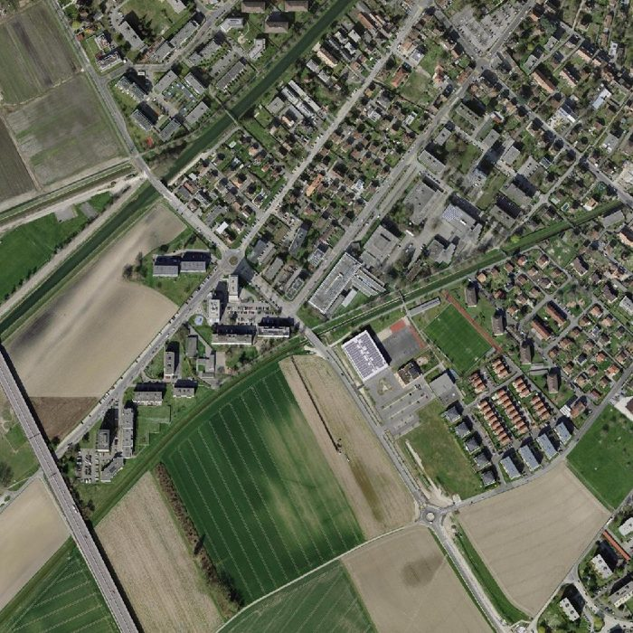 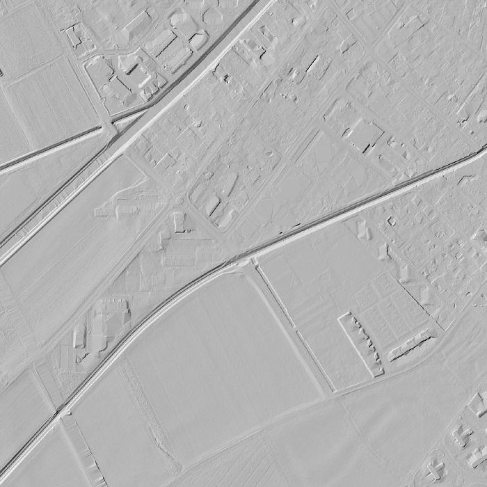

Une **couleur**… ou une **altitude** · *© swisstopo*

---

## Sans installation : GeoLibre

- SIG libre **dans le navigateur** : `web.geolibre.app`
- *Add Data › Raster Layer* → coller l'URL du COG → *Load*
- *Inspect pixel values* : valeur d'un pixel (433,17 m)
- Lit COG, GeoParquet, GeoPackage, WMS, WMTS, STAC…

⚠️ Affichage en **Web Mercator**, coordonnées **jamais en MN95**
→ QGIS / GDAL restent la référence pour le travail précis

---

<!-- _class: lead -->

# Pixel et résolution

---

## Une image = un tableau de nombres

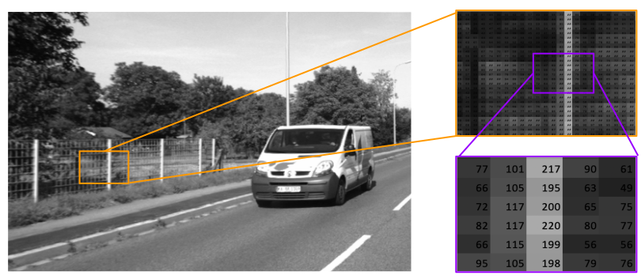

- 1 pixel = **1 valeur** par bande : couleur, classe ou mesure (altitude)
- Niveaux de gris : 0 (noir) à 255 (blanc) = 1 octet

---

## Bandes et types de données

- **Bandes** : 1 (gris, MNT), 3 (RVB), 4 (RVB + infrarouge), 13 (Sentinel‑2)
- **Type** = ce qu'on peut stocker **et** la taille du fichier

| Type | Octets | Fil rouge |
|---|---|---|
| Byte (0–255) | 1 | SWISSIMAGE : couleurs |
| UInt16 (0–65'535) | 2 | Sentinel‑2 : mesures sur 12 bits |
| Float32 | 4 | swissALTI3D : 432,77 m |

⚠️ MNT en Byte → écrêté à 255 · décimales en entier → perdues

---

## Mise à l'échelle et NoData

`valeur réelle = valeur stockée × échelle + décalage`

- Sentinel‑2 (swissEO) : échelle 0,0001, décalage −0,1
- 3'500 → 3'500 × 0,0001 − 0,1 = **0,25** de réflectance

**NoData** = « pas d'information », **déclaré** dans le fichier

- swissALTI3D : −9999 · Sentinel‑2 : 0
- ⚠️ Non déclaré → moyenne fausse, « falaise » de 10 km sur la pente

---

## Les 4 résolutions d'un capteur

| Résolution | Question | 🧵 SWISSIMAGE | 🧵 Sentinel‑2 |
|---|---|---|---|
| **Spatiale** | Taille du pixel ? | 0,10 m | 10 m |
| **Spectrale** | Quelles bandes ? | 3 visibles | 13, jusqu'à l'infrarouge |
| **Radiométrique** | Combien de niveaux ? | 8 bits | 12 bits |
| **Temporelle** | Tous les combien ? | ~3 ans | 3 à 5 jours |

→ Toujours un **compromis** : aucun capteur n'est « le meilleur »

---

## Résolution spatiale

= **taille du pixel sur le terrain** (GSD)

| Produit | Résolution |
|---|---|
| SWISSIMAGE | 10 cm |
| swissALTI3D | 0,5 m / 2 m |
| Sentinel‑2 | 10 m |
| Landsat | 30 m |

Carte 1:25'000 scannée à 400 dpi → pixel ≈ 1,6 m

---

## Résolution ≠ plus petit objet visible

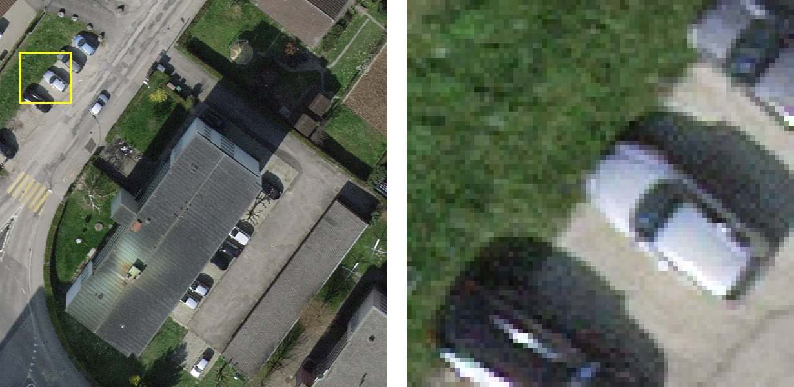

- Un objet doit couvrir **plusieurs pixels** : à 10 cm, une voiture ≈ 18 × 45 pixels
- À 10 m (Sentinel‑2), elle est **invisible**

---

## Combien pèse un raster ?

`colonnes × lignes × bandes × octets par valeur`

| 🧵 1 km² | Brut | Fichier |
|---|---|---|
| SWISSIMAGE : 10'000² × 3 × 1 | 300 Mo | 65 Mo (JPEG) |
| swissALTI3D : 2'000² × 1 × 4 | 16 Mo | 15,5 Mo (LZW) |

- Pixel 2 × plus fin → **4 × plus** de pixels
- Suisse à 10 cm ≈ **12 To** en RVB non compressé

---

## Affinage panchromatique

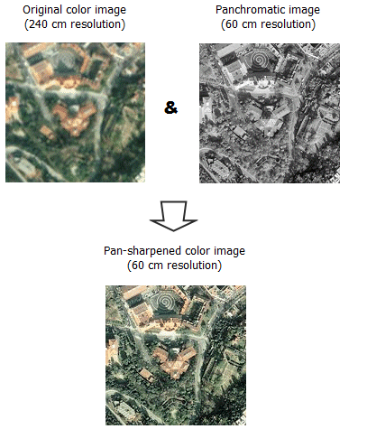

Image couleur basse résolution + image panchromatique fine → couleur fine

*Source : ArcGIS [6]*

---

<!-- _class: lead -->

# Géoréférencement

---

## Du pixel au terrain

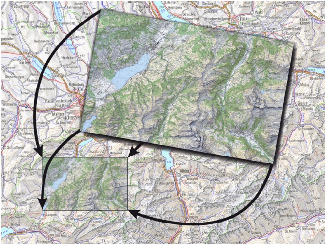

- Image : **lignes / colonnes** → terrain : **MN95 (EPSG:2056)**
- Transformation affine à **6 paramètres**

---

## Le world file (`.tfw`, `.jgw`, `.pgw`)

```text
0.1          A : taille du pixel en X
0.0          D : rotation
0.0          B : rotation
-0.1         E : taille du pixel en Y (négative !)
2540000.05   C : X du centre du pixel en haut à gauche
1150999.95   F : Y du centre du pixel en haut à gauche
```

- Tuile SWISSIMAGE 10 cm, km 2540-1150
- ⚠️ **Aucune indication du système de coordonnées**

---

## GeoTIFF

- Géoréférencement **et** système de coordonnées (EPSG) **dans** le fichier
- Un seul fichier, pas d'ambiguïté
- Non lisible avec un éditeur de texte → SIG ou `gdalinfo`
- Standard OGC, format de référence pour l'échange de rasters

---

<!-- _class: lead -->

# Codage de la couleur

---

## Profondeur de codage

| Bits / pixel | Valeurs | Usage |
|---|---|---|
| 1 | 2 | Noir / blanc |
| 4 | 16 | 16 gris ou couleurs |
| 8 | 256 | Gris ou palette |
| 24 | 16,7 millions | Couleurs vraies RVB |
| 32 | RVB + alpha | Transparence |

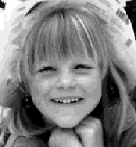  ▶ [Démo interactive : pixels et profondeur](https://regislon.github.io/cfgeo_B4/formats-interfaces/02-raster/#codage-de-la-couleur)

---

## Palette ou couleurs vraies

- **Couleurs indexées** : chaque pixel = un indice dans une palette (≤ 256 couleurs)
- **Couleurs vraies** : 3 octets R, V, B par pixel — synthèse additive

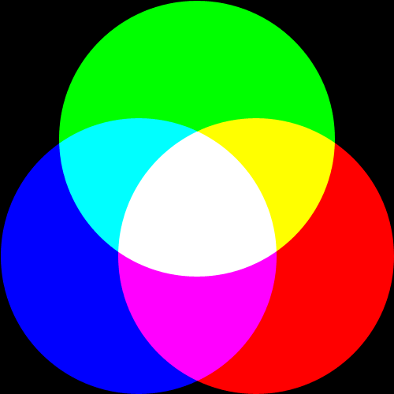 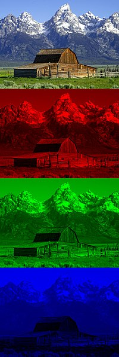

*Sources : Wikimedia Commons [7] [8]*

---

<!-- _class: lead -->

# Au-delà du visible

---

## Un raster est une **mesure**

- Chaque bande = **réflectance** (0 à 1) dans une plage de longueurs d'onde

| Bande Sentinel‑2 | Domaine | Pixel |
|---|---|---|
| B02 · B03 · B04 | Bleu · Vert · Rouge | 10 m |
| B08 | **Proche infrarouge** (842 nm) | 10 m |
| B11 · B12 | Infrarouge moyen | 20 m |

- Écran = 3 canaux → on **choisit 3 bandes** : composition colorée

---

## Vraies et fausses couleurs

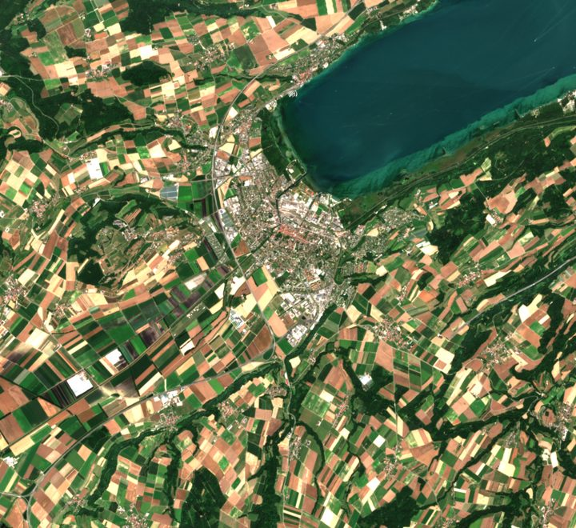 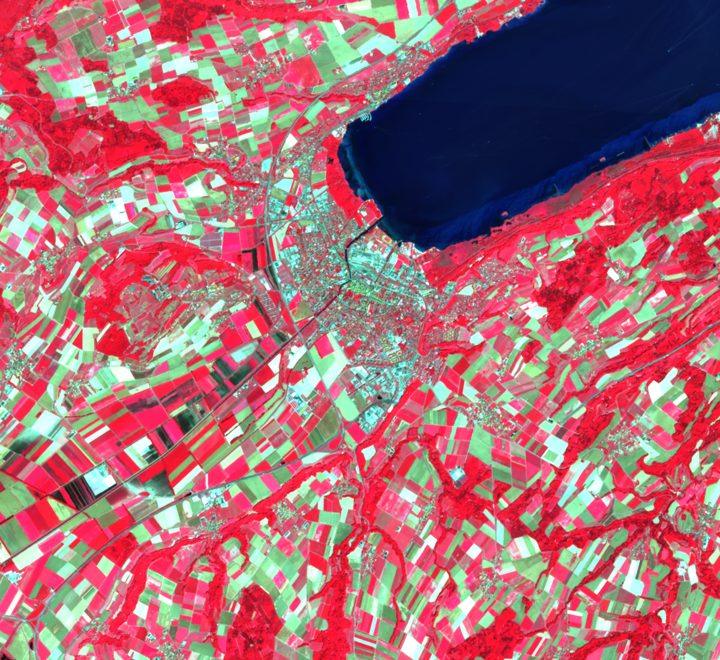

R‑V‑B = B04‑B03‑B02 · R‑V‑B = **B08**‑B04‑B03 → végétation en **rouge**

*🧵 Yverdon, 12.07.2025 · swissEO S2‑SR © swisstopo, Copernicus*

---

## NDVI : indice de végétation

`NDVI = (PIR − Rouge) / (PIR + Rouge)` → entre −1 et +1

- Plante saine : absorbe le **rouge**, réfléchit le **proche infrarouge**
- < 0 eau · 0–0,2 sol nu, bâti · > 0,5 végétation dense

🧵 Maïs : B04 = 1'500, B08 = 5'200
→ Rouge 0,05 · PIR 0,42 → **NDVI = 0,79**
⚠️ Sans échelle/décalage : 0,55 (faux !)

---

## NDVI : le résultat

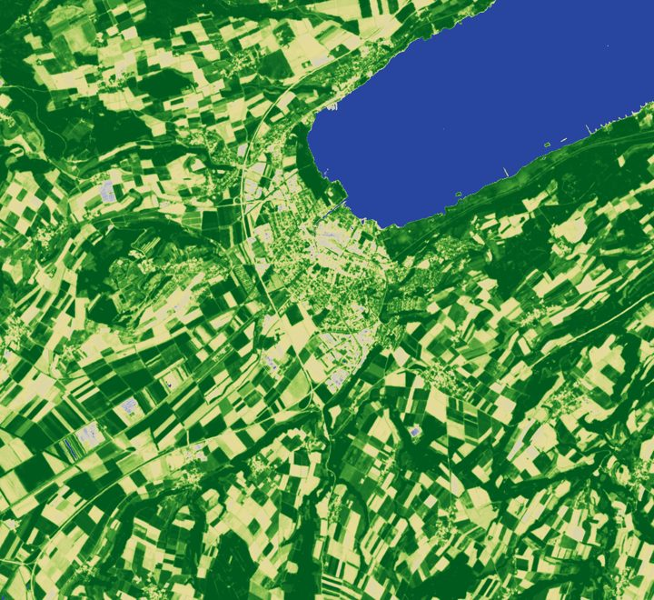

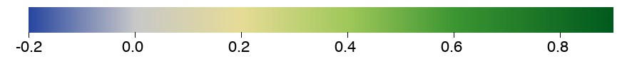

- Forêt, cultures : vert foncé
- Ville, champs récoltés : beige
- Raster **calculé** → Float32
- QGIS : *Calculatrice raster*

---

<!-- _class: lead -->

# Compression

---

## Format ≠ compression

- **Format** : organisation du fichier (en-tête, métadonnées, données)
- **Compression** : algorithme qui réduit la taille des données
- Un TIFF peut être : non compressé, LZW, Deflate… ou **JPEG** !

---

## Ratio et taux

- **Ratio** = taille originale / taille compressée → **4:1**
- **Taux** = taille compressée / taille originale → **25 %**
- **Gain** = 1 − taux → 75 %
- 2 Mo compressés à 4:1 → 0,5 Mo
- Les définitions varient : toujours **indiquer sa formule**

---

## Avec ou sans perte

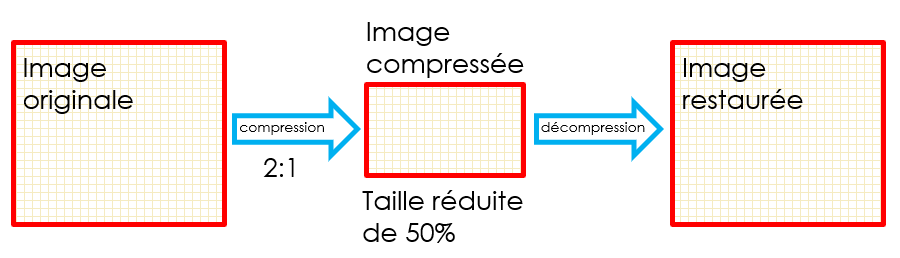
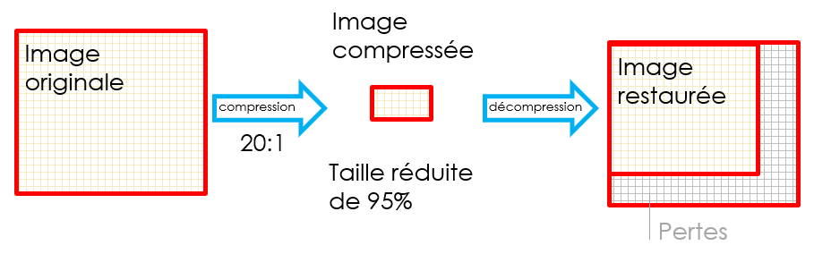

- **Sans perte** : image restaurée identique (≈ 2:1)
- **Avec perte** : ratios élevés, information perdue
- Plan A0 **roulé** (sans perte) ou **plié** (avec perte)

---

## Exemple : la marguerite

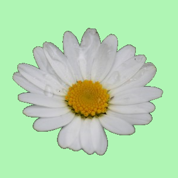

- 300 × 300 = 90'000 pixels × 3 octets = 270'000 o ≈ **264 Kio**
- **256 couleurs** : 1 octet/pixel → 88 Kio (avec perte)
- **Palette adaptative** : sans perte si peu de couleurs
- **Répétition** : 4'500 pixels de fond = compteur (2 octets) + couleur (1 octet) = **3 octets**
- ⚠️ Un compteur d'1 octet ne dépasse pas **255**

---

## RLE — *Run Length Encoding*

- Nombre de répétitions + valeur
- `AAAAAABBBBBCCCC` → `6A5B4C`
- Sans perte, efficace sur les grandes plages uniformes
- ⚠️ Échiquier : 64 octets → **128** octets en RLE !
- Utilisé dans BMP, TGA, TIFF (PackBits), JPEG

---

## Compression par dictionnaire

- **LZW** : dictionnaire des séquences déjà vues → TIFF, GIF
  - brevet Unisys, libre depuis le début des années 2000
- **Deflate** = LZ77 + codage de Huffman → **ZIP**, KMZ, **PNG**, TIFF
- Sans perte
- Données répétitives → bonne compression ; aléatoires → presque rien

---

<!-- _class: exercice -->

# Exercice : Compression par dictionnaire

[Consignes et données](https://regislon.github.io/cfgeo_B4/formats-interfaces/exercices/ex02-compression-dictionnaire/)


---

## JPEG

1. RVB → luminance + chrominance
2. Sous-échantillonnage de la chrominance
3. Blocs 8 × 8 → fréquences (DCT)
4. **Quantification** (perte, selon la qualité)
5. Zigzag + RLE + Huffman

- Ratio 10:1 à 25:1 sur les photos ; artefacts sur plans et textes
- ⚠️ Les pertes **s'accumulent** à chaque ré-enregistrement

▶ [Démo interactive : qualité JPEG / WebP](https://regislon.github.io/cfgeo_B4/formats-interfaces/02-raster/#jpeg)

---

## Ondelettes

- Image décrite à **plusieurs niveaux de détail** : vue grossière + corrections fines
- On renonce aux corrections les plus fines → ratio ↑, qualité ↓
- Vue d'ensemble disponible immédiatement
- Formats **JPEG 2000** (norme ISO) et **ECW** (propriétaire, en recul)

---

## Compressions modernes dans GeoTIFF

- **Prédicteur** : stocker la **différence avec le voisin** → petites valeurs répétitives
  `PREDICTOR=2` (entiers), `PREDICTOR=3` (virgule) · sans perte
- **ZSTD** : comme Deflate, mais **beaucoup plus rapide**
- **LERC** : perte **contrôlée**, on fixe l'**erreur maximale** (ex. 1 cm) → MNT
- **WebP** : remplaçant du JPEG, avec ou sans perte

⚠️ Pour l'**échange** : LZW / Deflate restent les plus compatibles

---

## 🧵 Mesures réelles : swissALTI3D (2'000 × 2'000, Float32, 16 Mo)

| Compression | Taille | Ratio | Erreur max. |
|---|---|---|---|
| LZW (fichier swisstopo) | 11,8 Mo | 1,4:1 | 0 |
| Deflate + prédicteur | 6,9 Mo | 2,3:1 | 0 |
| ZSTD + prédicteur | 6,7 Mo | 2,4:1 | 0 |
| **LERC + ZSTD, 1 cm** | **2,1 Mo** | **7,8:1** | 1 cm |
| LERC + ZSTD, 10 cm | 0,6 Mo | 25:1 | 10 cm |

SWISSIMAGE : sans perte ≤ 2:1 · JPEG 95 → 5,8:1 · WebP 75 → 18:1

---

<!-- _class: exercice -->

# Exercice : Formats d'images et compression

[Consignes et données](https://regislon.github.io/cfgeo_B4/formats-interfaces/exercices/ex01-images-compression/)


---

## Séries temporelles et cubes de données

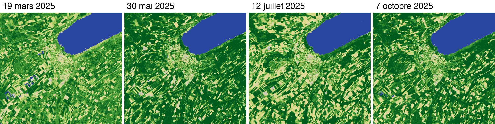

- Cube = **X, Y, bande, temps** : chaque pixel devient une courbe
- Volumes énormes → on calcule **là où sont les données** : COG + **STAC**, Zarr, openEO, Swiss Data Cube

---

## Métadonnées

- Capteur, date, position, orientation, résolution…
- **EXIF** : enregistré dans le JPEG/TIFF par l'appareil photo, le smartphone, le drone
- ⚠️ Coordonnées GPS dans les photos publiées !
- Jeux de géodonnées : ISO 19115, catalogue **geocat.ch**

---

<!-- _class: lead -->

# Formats raster

---

## Formats d'image courants

- **BMP** : historique, non compressé, volumineux
- **GIF** : 256 couleurs, LZW, animation
- **PNG** : sans perte (Deflate), transparence → cartes, tuiles web
- **JPEG** : avec perte → photos
- **WebP, AVIF, JPEG XL** : successeurs de JPEG/PNG sur le web
- **TIFF** : balises, multi-bandes, toutes compressions, BigTIFF > 4 Gio
- **GeoTIFF** : TIFF + géoréférencement + SCR

---

## Cloud Optimized GeoTIFF (COG)

- Un GeoTIFF **tuilé** avec **aperçus** (*overviews*)
- Lecture **partielle** par HTTP : seulement la zone et le zoom utiles
- Lisible par tout logiciel qui lit le GeoTIFF
- Standard OGC (2023), diffusion dans le cloud (data.geo.admin.ch)

🧵 SWISSIMAGE : blocs 256 × 256, aperçus 5000² → 313², `LAYOUT=COG`
→ QGIS lit l'aperçu 625² pour afficher toute la tuile

---

## Diffuser des rasters

- **Tuiles raster** (PNG, JPEG, WebP) par niveau de zoom → WMTS
  - **MBTiles** : tuiles dans une base SQLite (cartes hors ligne)
  - **PMTiles** : un fichier lu **par morceaux** sur le web
  - **GeoPackage** : tuiles + vecteur
- **VRT** : raster **virtuel** (mosaïque) décrit en XML, sans copie
- **`/vsicurl/`** : GDAL/QGIS lit un fichier **directement sur le web**

---

<!-- _class: exercice -->

# Exercice : Compresser et diffuser un GeoTIFF

[Consignes](https://regislon.github.io/cfgeo_B4/formats-interfaces/exercices/ex03-compression-geotiff/)

---

## Grilles et cubes de données

- **ASCII Grid** (`.asc`) : MNT en texte, lisible, volumineux
- **NetCDF** : données **multidimensionnelles** (x, y, z, temps), météo, climat
- **Zarr** : cubes découpés en blocs, pensé pour le cloud

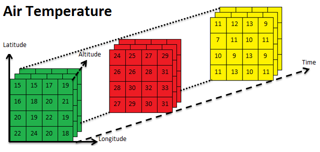

---

## ▶ Démo : un cube Zarr

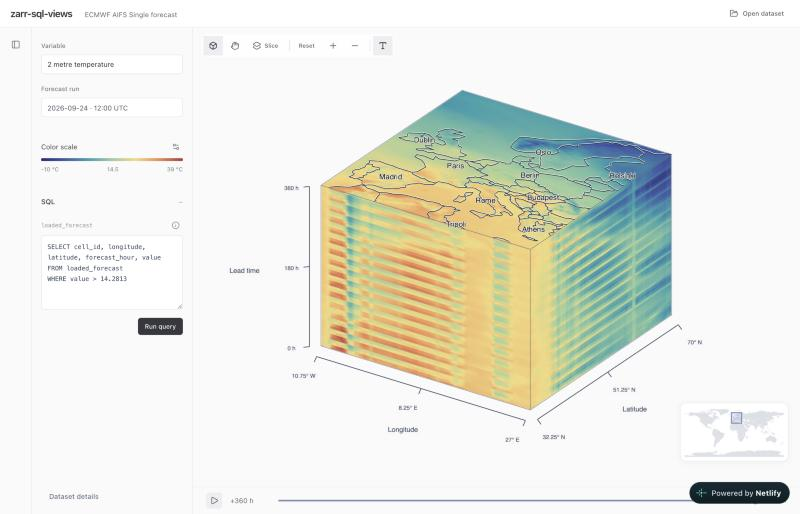

- Prévision ECMWF AIFS : X, Y + **échéance** (0–360 h) en hauteur
- Seuls les **blocs** utiles sont téléchargés · requêtes **SQL** (DuckDB) dans le navigateur
- Démo *zarr-sql-views* (G. Milevski) · données dynamical.org

---

## Quel format choisir ?

| Besoin | Format |
|---|---|
| Échange orthophoto / MNT | GeoTIFF (LZW, Deflate) |
| MNT pour ses analyses | ZSTD/Deflate + prédicteur, LERC |
| Diffusion web / cloud | COG + STAC |
| Fond de carte web / hors ligne | WMTS, PMTiles, MBTiles |
| Photo pour affichage | JPEG, WebP, AVIF |
| Plan, carte, transparence | PNG, WebP |
| Climat, météo | NetCDF, Zarr |

---

## À retenir

- Raster = grille de pixels, **1 valeur par pixel et par bande** : une **mesure**
- 4 résolutions : spatiale, spectrale, radiométrique, temporelle
- Type de données, échelle/décalage, **NoData déclaré**
- Proche infrarouge → fausses couleurs, **NDVI**
- Taille brute = colonnes × lignes × bandes × octets
- World file : 6 paramètres **sans SCR** ; GeoTIFF : SCR inclus
- **Format ≠ compression** ; avec perte (JPEG, ondelettes) / sans perte (RLE, LZW, Deflate)
- Données à analyser → **sans perte** (ou LERC à erreur maîtrisée), jamais JPEG
- GeoTIFF / COG = choix par défaut en géomatique
