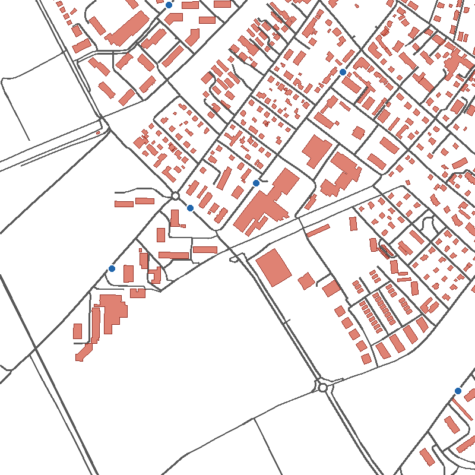
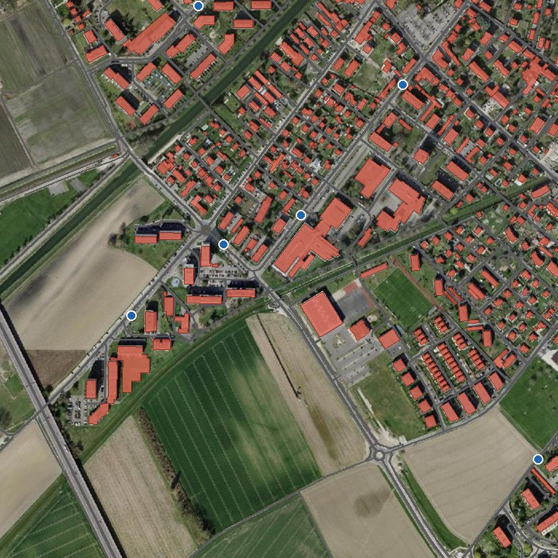

<!-- _class: lead -->
<!-- _paginate: false -->

# 3. Données vectorielles

Module B4 « Géomatique & TI » — Formats, interfaces

---

## Objectifs

- Primitives, modèle **Simple Features**, WKT / WKB
- Familles de stockage, codage binaire / texte / XML-JSON
- Principaux formats, leurs limites, **qui les définit**
- **GDAL** : quels formats sont lisibles et écrits
- Anticiper les **pertes** lors d'une conversion

---

## 🧵 Fil rouge : le même km², en vecteur

 

Tuile 2538-1180 (Yverdon) · chapitre 2 : des **pixels** → ici : des **objets**

---

## 🧵 Un GeoPackage, cinq couches

| Couche | Primitive | Objets | Attributs |
|---|---|---|---|
| `arrets_tp` | point | 6 | nom, moyen de transport |
| `routes` | ligne | 309 | nom de rue, type |
| `batiments` | surface | 405 | genre, nom, **hauteur** |
| `commune` | surface | 1 | n° OFS, habitants |
| `tuile` | surface | 1 | nom |

`yverdon_2538-1180.gpkg` · 440 Ko · en Shapefile : **20 fichiers**

---

<!-- _class: lead -->

# Géométries et attributs

---

## Primitives géométriques

- **Point**, **ligne** (polyligne), **surface** (polygone, avec trous)
- Variantes : arcs de cercle, courbes, **multi-géométries**
- Coordonnées 2D, + **Z** (altitude), + **M** (mesure)
- Il n'y a pas « un » format vecteur, mais **des dizaines**

---

## Un modèle commun : *Simple Features*


OGC / ISO 19125 · repris par presque tous les formats et logiciels

---

## WKT et WKB

🧵 Centre de la tuile d'Yverdon (MN95)

```text
WKT : POINT (2538500 1180500)
WKB : 010100000000000000025E43410000000054033241
```

- **WKT** : texte → CSV, SQL, échanges
- **WKB** : binaire → GeoPackage, GeoParquet, PostGIS
- Modèle commun = conversions possibles · hors modèle (arcs, topologie) = **pertes**

---

## Au-delà de la géométrie

- **Topologie** : voisinage, limites partagées, pas de recouvrement
- **Réseaux** : connectivité, sens d'écoulement
- **Objets multiples** : plusieurs parties pour un objet
- ⚠️ Format cible plus pauvre → **perte** (arcs → segments, topologie perdue)

---

## Attributs : familles de stockage

| Catégorie | Exemples |
|---|---|
| Fichier simple | DXF, KML, GeoJSON, INTERLIS |
| Fichiers multiples | Shapefile |
| Base de données fichier | GeoPackage, SpatiaLite |
| BD + intergiciel | ArcSDE, Topobase |
| BD spatiale native | **PostGIS**, Oracle Spatial |

Complexité et possibilités (relations, multi-utilisateurs) croissantes ↓

---

## Binaire, texte, XML/JSON

- **Binaire** : compact, rapide, illisible → Shapefile, GeoPackage
- **Texte (ASCII)** : lisible, structure convenue (colonnes, codes) → DXF, ITF, CSV + WKT
- **XML / JSON** : balises ou clés nommées, verbeux mais auto-descriptif → GML, KML, XTF, GeoJSON

---

## Qui définit les formats ?

- **OGC** : GML, KML, GeoPackage, Simple Features
- **ISO** TC 211 : GML (19136), Simple Features (19125), IFC (16739)
- **IETF** : GeoJSON (RFC 7946)
- **SNV / eCH** : INTERLIS
- **Éditeurs** (de facto) : DXF (Autodesk), Shapefile, File Geodatabase (Esri)
- **Communautés libres** : FlatGeobuf, PMTiles · GeoParquet (OGC, en cours)

---

## GDAL, le moteur caché des logiciels

- Bibliothèque libre qui lit et écrit **200+ formats**
- **Intégrée** dans : QGIS · GRASS · SAGA · ArcGIS Pro (en partie) · GeoLibre · MapServer · GeoServer · PostGIS · GeoPandas · R…
- → ces logiciels lisent **les mêmes formats**
- Format géré par GDAL = s'ouvre **presque partout**
- INTERLIS : lecture seule → écriture avec **ili2db**
---

<!-- _class: lead -->

# Les principaux formats

---

## DXF

```text
  0
SECTION
  2
HEADER
  9
$ACADVER
  1
AC1018
```

- Autodesk, échange DAO/CAO — couples **code / valeur**
- ASCII ou binaire (−25 % de taille, ×5 en vitesse)
- ⚠️ Pas de SCR, pas de vraie table d'attributs : sémantique = **calques**

---

## Shapefile

- ESRI (ArcView, années 1990) — **standard de fait**
- `.shp` géométrie · `.shx` index · `.dbf` attributs · `.prj` SCR · `.cpg` encodage
- ⚠️ Plusieurs fichiers (oubli du `.prj` !)
- ⚠️ Noms de champs **≤ 10 caractères**, max **2 Go**
- ⚠️ Un seul type de géométrie, **pas de topologie**, pas d'arcs

---

<!-- _class: exercice -->

# Exercice : Du fichier de base de données au shapefile

[Consignes et données](https://regislon.github.io/cfgeo_B4/formats-interfaces/exercices/ex04-shapefile/)


---

## GeoPackage

- Standard **OGC**, ouvert, une base **SQLite** dans **un seul fichier**
- Plusieurs couches vecteur **et** raster (tuiles)
- Pas de limites de noms de champs, types variés
- Index spatial (RTree), styles, projet QGIS
- Format par défaut de QGIS — remplaçant naturel du Shapefile

---

<!-- _class: exercice -->

# Exercice : Shapefile, GeoPackage et raster

[Consignes et données](https://regislon.github.io/cfgeo_B4/formats-interfaces/exercices/ex05-geopackage/)


---

## GeoJSON

```json
{ "type": "Feature",
  "geometry": { "type": "Point", "coordinates": [7.4386, 46.9511] },
  "properties": { "nom": "Palais fédéral" } }
```

- JSON, norme IETF RFC 7946 — roi du **web** et des API
- Norme : **WGS84, ordre longitude, latitude**
- Pas d'index spatial : lent pour de gros volumes

---

## KML / KMZ

- XML, Google Earth → standard **OGC** (2008)
- Géométrie **+ style** + temps
- Uniquement **WGS84** degrés décimaux, `lon,lat,alt`
- Couleurs **`aabbggrr`** : `73ff0000` = bleu semi-transparent
- **KMZ** = KML + images dans une archive **ZIP** (Deflate)

---

## GML et INTERLIS

- **GML** : XML de l'OGC, **ISO 19136** (2007)
  - boîte à outils pour schémas d'application (WFS, INSPIRE, CityGML)
- **INTERLIS** : standard suisse, modèle (`.ili`) + données
  - INTERLIS 1 : `.itf` (ASCII) · INTERLIS 2 : `.xtf` (XML)
  - → cours dédiés

---

## Formats récents

- **FlatGeobuf** (`.fgb`) : binaire, **index spatial**, lu par morceaux · non modifiable
- **GeoParquet** (`.parquet`) : **par colonnes**, très compressé → analyses (DuckDB, GeoPandas) · OGC en cours
- **PMTiles** (`.pmtiles`) : **tuiles vectorielles** dans un fichier → cartes web
  ⚠️ visualisation, pas données : géométries **découpées et simplifiées**

→ Formats *cloud-native* : diffusion sur le web au **chapitre 8**

---

## ▶ Démo : le fil rouge en PMTiles

- Carte interactive sur le site : **grille des tuiles** visible
- Journal : chaque **tuile** demandée, chaque **requête HTTP partielle**
- Mode ralenti : les tuiles arrivent **par lots**
- À l'ouverture : ~50 Ko lus sur 465 Ko (**11 %** du fichier)

▶ [Ouvrir la démo](https://regislon.github.io/cfgeo_B4/formats-interfaces/03-vecteur/#formats-recents-flatgeobuf-geoparquet-et-pmtiles)

---

## 🧪 Un jeu de données, plusieurs formats

300 communes vaudoises (swissBOUNDARIES3D 2026)

| Format | Système | Taille | Format | Système | Taille |
|---|---|---|---|---|---|
| GeoParquet | MN95 | 2,1 Mo | CSV + WKT | MN95 | 3,7 Mo |
| PMTiles | 3857 | 2,1 Mo | GML | MN95 | 4,0 Mo |
| FlatGeobuf | MN95 | 2,6 Mo | GeoJSON | **WGS84** | 4,3 Mo |
| Shapefile | MN95 | 2,6 Mo | KML | **WGS84** | 5,5 Mo |
| GeoPackage | MN95 | 2,9 Mo | | | |

Shapefile : `einwohnerzahl` → `einwohnerz` · À ouvrir dans QGIS ou **GeoLibre**

---

## Synthèse : GDAL et OGC

| Format | GDAL | OGC | Format | GDAL | OGC |
|---|---|---|---|---|---|
| Shapefile | ✅ | ❌ | GeoJSON | ✅ | ❌ (IETF) |
| File Geodatabase | ✅ | ❌ | GPX | ✅ | ❌ |
| DXF | ✅ | ❌ | INTERLIS | ⚠️ lecture | ❌ (SNV) |
| GeoPackage | ✅ | ✅ | FlatGeobuf | ✅ | ❌ |
| GML | ✅ | ✅ | GeoParquet | ✅ | 🟡 en cours |
| KML | ✅ | ✅ | PMTiles | ✅ | ❌ |

---

## Pièges de conversion

- Noms de champs **tronqués** (Shapefile : 10 caractères)
- **Système de coordonnées** perdu : `.prj` oublié, DXF, GeoJSON/KML en WGS84
- **Encodage** : « Genève » si le `.cpg` manque
- **Arcs** → segments · **topologie** et relations perdues
- **Types** : dates, booléens, `NULL`
- Tuiles (PMTiles) → géométries **simplifiées** : pas des données de référence

---

## Quel format choisir ?

| Besoin | Format |
|---|---|
| Travail SIG courant | **GeoPackage** |
| Échange DAO | DXF |
| Web, API | GeoJSON |
| Google Earth | KML / KMZ |
| Géodonnées de base suisses | INTERLIS |
| Gros volumes web / analyse | FlatGeobuf / GeoParquet |
| Carte web sans serveur | PMTiles |
| Multi-utilisateurs | PostGIS |

---

## ❓ Quiz : quel format choisir ?

8 situations concrètes : architecte, collègue QGIS, site web, mensuration officielle, carte de 3 millions de bâtiments, analyse SQL, Google Earth, ancien logiciel…

▶ [Faire le quiz sur le site](https://regislon.github.io/cfgeo_B4/formats-interfaces/03-vecteur/#quel-format-choisir)

---

<!-- _class: lead -->

# Vecteur vs raster

---

## Vecteur vs raster

| Vecteur | Raster |
|---|---|
| Objets discrets, limites nettes | Phénomènes continus |
| Précis, indépendant de l'échelle | Précision = résolution |
| Nombreux attributs, topologie | 1 valeur par pixel |
| Compact | Volumineux (∝ résolution²) |
| Superposition complexe | Superposition / algèbre simple |
| Saisie coûteuse | Acquisition par capteurs, économique |

---

## À retenir

- Primitives : **point, ligne, surface** (+ multi, arcs, Z/M)
- Stockage : fichier simple → fichiers multiples → base de données
- Codage : **binaire** (rapide) / **texte** (lisible) / **XML-JSON** (auto-descriptif)
- Modèle commun **Simple Features** (WKT / WKB) · **GDAL** lit presque tout
- Shapefile = standard de fait mais **limité** → préférer **GeoPackage**
- Conversion vers un format plus pauvre = **perte d'information**
- Vecteur et raster sont **complémentaires**
