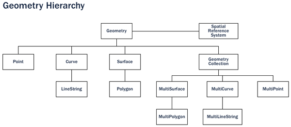
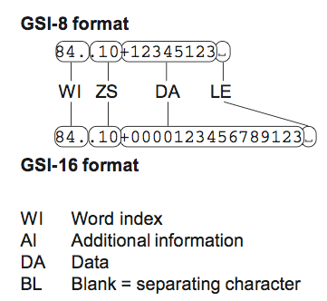

<!-- _class: lead -->
<!-- _paginate: false -->

# 3. Données vectorielles

Module B4 « Géomatique & TI » — Formats, interfaces

---

## Objectifs

- Connaître les primitives géométriques et les notions de topologie
- Comparer les familles de stockage (fichier simple, multiple, base de données)
- Distinguer codage binaire, texte et XML/JSON
- Connaître les principaux formats et leurs limites
- Choisir entre vecteur et raster selon le besoin

---

<!-- _class: lead -->

# Géométries et attributs

---

## Primitives géométriques

- **Point**, **ligne** (polyligne), **surface** (polygone, avec trous)
- Variantes : arcs de cercle, courbes, **multi-géométries**
- Coordonnées 2D, + **Z** (altitude), + **M** (mesure)
- Il n'y a pas « un » format vecteur, mais **des dizaines**

---

## Hiérarchie *Simple Features*



*Types de géométries de PostGIS. Source : [11]*

---

## Au-delà de la géométrie

- **Topologie** : voisinage, limites partagées, pas de recouvrement
- **Réseaux** : connectivité, sens d'écoulement
- **Objets multiples** : plusieurs parties pour un objet
- ⚠️ Format cible plus pauvre → **perte** (arcs → segments, topologie perdue)

---

## Attributs : familles de stockage

| Catégorie | Exemples |
|---|---|
| Fichier simple | DXF, KML, GeoJSON, INTERLIS |
| Fichiers multiples | Shapefile, MIF/MID |
| Base de données fichier | GeoPackage, SpatiaLite |
| BD + intergiciel | ArcSDE, Topobase |
| BD spatiale native | **PostGIS**, Oracle Spatial |

Complexité et possibilités (relations, multi-utilisateurs) croissantes ↓

---

## Binaire, texte, XML/JSON

- **Binaire** : compact, rapide, illisible → Shapefile, GeoPackage
- **Texte (ASCII)** : lisible, structure convenue (colonnes, codes) → DXF, GSI, ITF
- **XML / JSON** : balises ou clés nommées, verbeux mais auto-descriptif → GML, KML, XTF, GeoJSON

---

## Formats d'échange

- Description **simple** (souvent sans topologie)
- Codage **texte** (ASCII, XML, JSON)
- **De jure** (normalisés) : INTERLIS, GML (ISO 19136), KML (OGC), GeoPackage (OGC), GeoJSON (RFC 7946), IFC
- **De facto** (imposés par le marché) : DXF, Shapefile, MIF/MID

---

<!-- _class: lead -->

# Les principaux formats

---

## DXF

```text
  0
SECTION
  2
HEADER
  9
$ACADVER
  1
AC1018
```

- Autodesk, échange DAO/CAO — couples **code / valeur**
- ASCII ou binaire (−25 % de taille, ×5 en vitesse)
- ⚠️ Pas de SCR, pas de vraie table d'attributs : sémantique = **calques**

---

## Leica GSI : de l'ASCII structuré



```text
*110002+0000000000005303
81..00+0000000075781205
82..00+0000000070718513
```

- **WI** : 11 = n° de point, 81 = Est, 82 = Nord, 83 = altitude
- Point 5303 : E = 75'781,205 m, N = 70'718,513 m
- Dans le fichier, ces 3 mots forment **une seule ligne**

---

## Shapefile

- ESRI (ArcView, années 1990) — **standard de fait**
- `.shp` géométrie · `.shx` index · `.dbf` attributs · `.prj` SCR · `.cpg` encodage
- ⚠️ Plusieurs fichiers (oubli du `.prj` !)
- ⚠️ Noms de champs **≤ 10 caractères**, max **2 Go**
- ⚠️ Un seul type de géométrie, **pas de topologie**, pas d'arcs

---

<!-- _class: exercice -->

# Exercice : Du fichier de base de données au shapefile

[Consignes et données](https://regislon.github.io/cfgeo_B4/formats-interfaces/exercices/ex04-shapefile/)


---

## GeoPackage

- Standard **OGC**, ouvert, une base **SQLite** dans **un seul fichier**
- Plusieurs couches vecteur **et** raster (tuiles)
- Pas de limites de noms de champs, types variés
- Index spatial (RTree), styles, projet QGIS
- Format par défaut de QGIS — remplaçant naturel du Shapefile

---

<!-- _class: exercice -->

# Exercice : Shapefile, GeoPackage et raster

[Consignes et données](https://regislon.github.io/cfgeo_B4/formats-interfaces/exercices/ex05-geopackage/)


---

## GeoJSON

```json
{ "type": "Feature",
  "geometry": { "type": "Point", "coordinates": [7.4386, 46.9511] },
  "properties": { "nom": "Palais fédéral" } }
```

- JSON, norme IETF RFC 7946 — roi du **web** et des API
- Norme : **WGS84, ordre longitude, latitude**
- Pas d'index spatial : lent pour de gros volumes

---

## KML / KMZ

- XML, Google Earth → standard **OGC** (2008)
- Géométrie **+ style** + temps
- Uniquement **WGS84** degrés décimaux, `lon,lat,alt`
- Couleurs **`aabbggrr`** : `73ff0000` = bleu semi-transparent
- **KMZ** = KML + images dans une archive **ZIP** (Deflate)

---

## GML et INTERLIS

- **GML** : XML de l'OGC, **ISO 19136** (2007)
  - boîte à outils pour schémas d'application (WFS, INSPIRE, CityGML)
- **INTERLIS** : standard suisse, modèle (`.ili`) + données
  - INTERLIS 1 : `.itf` (ASCII) · INTERLIS 2 : `.xtf` (XML)
  - → cours dédiés

---

## Formats « cloud » récents

- **FlatGeobuf** (`.fgb`)
  - binaire, index spatial, lecture en flux sur le web
  - diffusion de gros volumes, lecture seule
- **GeoParquet** (`.parquet`)
  - stockage **par colonnes**, très compressé
  - analyses sur des millions d'objets (DuckDB, GeoPandas)

---

## Quel format choisir ?

| Besoin | Format |
|---|---|
| Travail SIG courant | **GeoPackage** |
| Échange DAO | DXF |
| Web, API | GeoJSON |
| Google Earth | KML / KMZ |
| Géodonnées de base suisses | INTERLIS |
| Gros volumes web / analyse | FlatGeobuf / GeoParquet |
| Multi-utilisateurs | PostGIS |

---

<!-- _class: lead -->

# Vecteur vs raster

---

## Vecteur vs raster

| Vecteur | Raster |
|---|---|
| Objets discrets, limites nettes | Phénomènes continus |
| Précis, indépendant de l'échelle | Précision = résolution |
| Nombreux attributs, topologie | 1 valeur par pixel |
| Compact | Volumineux (∝ résolution²) |
| Superposition complexe | Superposition / algèbre simple |
| Saisie coûteuse | Acquisition par capteurs, économique |

---

## À retenir

- Primitives : **point, ligne, surface** (+ multi, arcs, Z/M)
- Stockage : fichier simple → fichiers multiples → base de données
- Codage : **binaire** (rapide) / **texte** (lisible) / **XML-JSON** (auto-descriptif)
- Shapefile = standard de fait mais **limité** → préférer **GeoPackage**
- Conversion vers un format plus pauvre = **perte d'information**
- Vecteur et raster sont **complémentaires**
