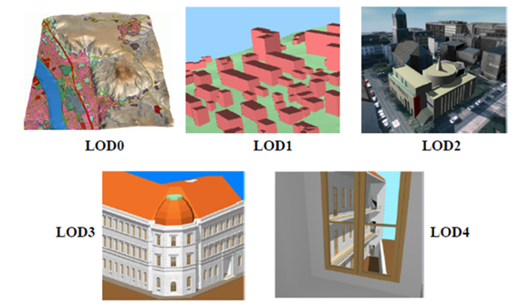
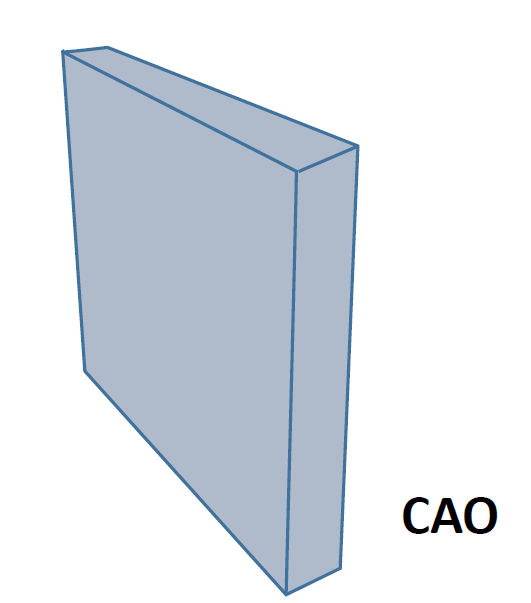
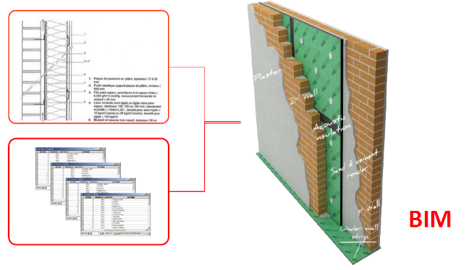
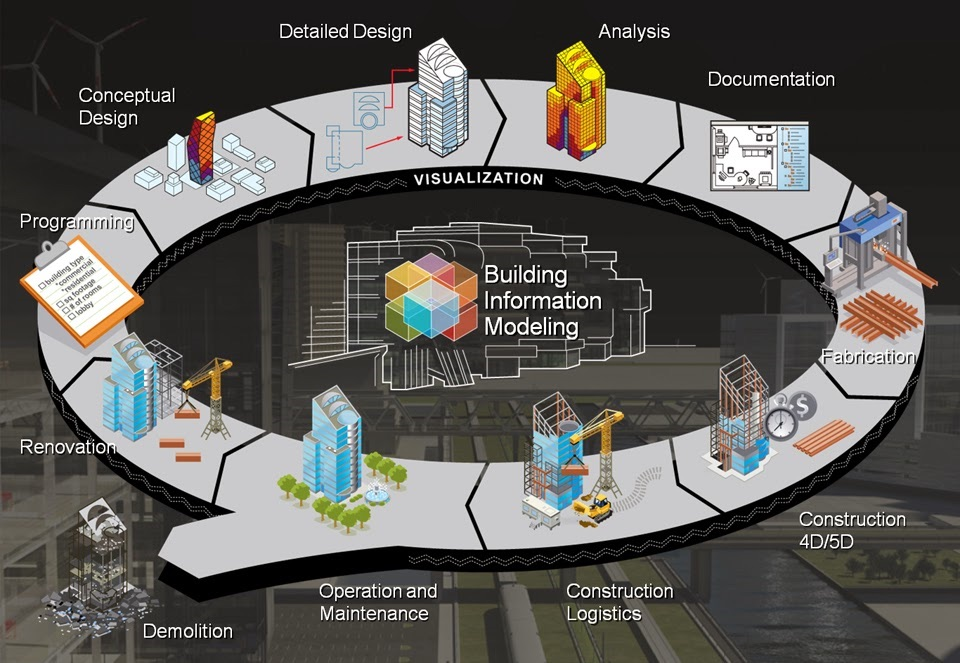

# 4. 3D et nuages de points

[📽 Slides du chapitre](https://regislon.github.io/cfgeo_B4/formats-interfaces/04-3d-nuages-de-points/slides.html)

## Objectifs

À la fin de ce chapitre, vous êtes capables de :

- Distinguer 2D, 2.5D et 3D
- Citer des applications de la 3D en géomatique
- Connaître les formats de nuages de points (LAS/LAZ, COPC, E57) et un exemple suisse (swissSURFACE3D)
- Connaître les standards 3D du territoire (CityGML, CityJSON) et du bâtiment (BIM, IFC)
- Expliquer comment la 3D est diffusée sur le web (3D Tiles)

## 2D, 2.5D, 3D

Les bases de données géographiques et les fichiers DAO sont encore majoritairement en **2D**, parfois complétés par des altitudes. On distingue :

| | Principe | Exemples |
|---|---|---|
| **2D** | Les objets n'ont que des coordonnées planimétriques (E, N). | Plan cadastral, carte nationale |
| **2.5D** | Chaque position (E, N) reçoit **une seule** altitude : Z = f(E, N). L'altitude est un attribut, pas une vraie dimension. | Modèle numérique de terrain (MNT), courbes de niveau, points cotés |
| **3D** | Les objets sont de vrais volumes : plusieurs altitudes possibles pour une même position (E, N). | Bâtiment avec toit en surplomb, pont, tunnel, réseau souterrain |

!!! note "La limite du 2.5D"
    Un MNT en 2.5D ne peut pas représenter un surplomb rocheux, un pont et la rivière qui passe dessous, ni les étages d'un bâtiment : en un point (E, N), il n'a qu'**une** valeur Z. Dès qu'il faut plusieurs Z pour une même position, on a besoin d'un modèle **3D**.

Les nouvelles méthodes d'acquisition (LiDAR aérien ou terrestre, photogrammétrie par drone) produisent des données nativement 3D, ce qui exige des structures de données plus riches que les tables 2D classiques.

### Applications de la 3D

La 3D sert d'abord à la **visualisation** (maquettes numériques, présentation de projets d'architecture ou d'urbanisme), mais aussi à des **analyses** :

- études de visibilité (impact visuel d'un projet, d'une antenne) ;
- analyse d'ensoleillement et d'ombrage, potentiel solaire des toitures ;
- études de propagation (bruit, ondes électromagnétiques, inondations) ;
- visualisation de la propriété par étages (p. ex. PPE dans le canton de Genève) ;
- représentation des réseaux souterrains, de plus en plus denses dans les agglomérations ;
- calculs de volumes (déblais/remblais, gravières), contrôle d'ouvrages.

!!! warning "Un coût à ne pas sous-estimer"
    La saisie **et la mise à jour** de données 3D représentent une masse de travail considérable. Beaucoup de maquettes 3D ne sont d'ailleurs pas de véritables SIG : elles servent à la visualisation, sans base de données associée ni outils d'analyse spatiale. Le défi est de rendre les sources 3D **interopérables** entre elles et avec les données 2D.

### Les outils

La plupart des logiciels SIG travaillent encore surtout en 2.5D, mais la 3D progresse : QGIS dispose d'une vue 3D et lit les nuages de points, ArcGIS Pro gère des scènes 3D. Autour d'eux gravitent des outils spécialisés :

- **CityEngine** (Esri) : génération procédurale de modèles urbains à partir de règles ; issu d'une spin-off de l'ETH Zurich, racheté par Esri en 2011 ;
- **SketchUp** (Trimble depuis 2012, auparavant Google) : outil de dessin 3D, pas un SIG ;
- **Revit**, **Archicad**, etc. : logiciels de modélisation BIM ;
- **CloudCompare**, **PDAL**, **LAStools** : traitement de nuages de points ;
- **Blender**, 3ds Max : modélisation et rendu issus du monde du cinéma et du jeu vidéo ;
- **FME** : conversion entre formats 3D (voir chapitre 9).

## Nuages de points : LAS/LAZ, COPC, E57

Un **nuage de points** est un ensemble de points mesurés en 3D, sans topologie : chaque point a des coordonnées X, Y, Z et des attributs. Il est produit par **LiDAR** (balayage laser aérien, mobile ou terrestre) ou par **photogrammétrie** (corrélation d'images, p. ex. par drone). Un relevé compte facilement des centaines de millions de points : la taille des fichiers et l'efficacité d'accès sont donc des enjeux majeurs.

### Attributs d'un point

Outre X, Y, Z, un point LiDAR porte typiquement :

- l'**intensité** du signal retour ;
- le **numéro du retour** et le **nombre de retours** (une impulsion laser peut traverser la végétation et produire plusieurs échos) ;
- la **classe** (sol, végétation, bâtiment, eau…) ;
- l'**heure GPS** de la mesure ;
- éventuellement une **couleur** RVB (et proche infrarouge) issue d'images.

Les classes standardisées par l'ASPRS sont utilisées par la plupart des producteurs, par exemple :

| Code | Classe |
|---|---|
| 1 | Non classé |
| 2 | Sol |
| 3 / 4 / 5 | Végétation basse / moyenne / haute |
| 6 | Bâtiment |
| 7 | Bruit (point bas) |
| 9 | Eau |
| 17 | Tablier de pont |

### Les formats

| Format | Description |
|---|---|
| **LAS** (`.las`) | Format **binaire** ouvert de l'ASPRS (*American Society for Photogrammetry and Remote Sensing*), version actuelle 1.4. Un en-tête (système de coordonnées, emprise, nombre de points) suivi des enregistrements de points. C'est le format d'échange de référence pour le LiDAR. |
| **LAZ** (`.laz`) | LAS compressé **sans perte** avec LASzip. Les fichiers sont typiquement 5 à 10 fois plus petits que le LAS, pour un contenu identique. |
| **COPC** (`.copc.laz`) | *Cloud Optimized Point Cloud* : un fichier LAZ 1.4 normal, mais dont les points sont organisés en **octree** (arbre spatial hiérarchique). Un client peut lire via HTTP uniquement la zone et le niveau de détail dont il a besoin, sans télécharger tout le fichier. Même idée que le COG (*Cloud Optimized GeoTIFF*) pour les rasters. |
| **E57** (`.e57`) | Format ouvert (norme ASTM E2807) conçu pour les **scanners laser terrestres** : il peut contenir plusieurs stations de scan, leurs positions et les images associées. |
| ASCII (`.xyz`, `.txt`, `.pts`) | Une ligne par point, lisible mais très volumineux et lent ; à réserver aux petits jeux de données. |
| PLY, formats propriétaires | PLY est courant en photogrammétrie ; chaque fabricant de scanner a en outre son format natif (à convertir pour l'échange). |

!!! tip "Exemple suisse : swissSURFACE3D"
    swisstopo diffuse **swissSURFACE3D**, un nuage de points LiDAR **classifié** couvrant toute la Suisse, en libre accès sur [swisstopo.admin.ch](https://www.swisstopo.admin.ch/fr/modele-altimetrique-swisssurface3d). Les données sont livrées en **LAZ**, en dalles de 1 km × 1 km, dans le système **MN95 (EPSG:2056)** avec altitudes NF02. Elles servent notamment à dériver le modèle de terrain swissALTI3D et le modèle de surface swissSURFACE3D Raster.

    Selon la documentation de swisstopo, la densité moyenne est de **15 à 20 points/m²**, et une dalle de 1 km² pèse environ **450 Mo en LAS**. Les classes utilisées sont 1 (non classé, objets temporaires comme les véhicules ou les grues), 2 (sol), 3 (végétation, tous étages confondus), 6 (bâtiments), 9 (eau) et 17 (ponts et viaducs).

### 🧵 Fil rouge : le kilomètre carré d'Yverdon en nuage de points

Pour la tuile **2538-1180** des chapitres précédents, swisstopo diffuse le millésime 2025 de swissSURFACE3D au format **COPC** : 18,4 millions de points, soit environ 18 points/m², pour **113 Mo** (compressé). C'est trop lourd pour une page web : nous en avons extrait un carré de **300 m × 300 m**, réduit à 260'000 points tirés au hasard, et l'avons enregistré en **LAS** non compressé ([`yverdon_extrait.las`](donnees/yverdon_extrait.las), 5,2 Mo).

*Visionneuse écrite pour ce cours : elle lit **elle-même** le fichier LAS octet par octet, selon la spécification de l'ASPRS (voir l'en-tête détaillé sous la vue). Comparez les trois colorations : par **classe** (on reconnaît immédiatement bâtiments, arbres et sol), par **altitude** et par **intensité** du retour laser (les marquages routiers et les toits réfléchissent davantage). Masquez le sol pour ne garder que bâtiments et végétation. Données : swissSURFACE3D, © swisstopo.*

!!! note "Lien avec le chapitre 1"
    Un fichier LAS est un fichier **binaire** : ouvert dans un éditeur de texte, il est illisible, mais ses 4 premiers octets forment la signature `LASF`, et chaque point est un enregistrement de taille fixe (ici 20 octets : X, Y, Z en entiers 32 bits, intensité, retours, classe…). Les coordonnées sont stockées comme des **entiers** multipliés par une **échelle** (0,01 m) et augmentés d'un **décalage** (2'538'000 / 1'180'000) : une astuce qui évite les problèmes de précision des nombres à virgule vus au [chapitre 1](../01-codage-binaire/README.md#les-nombres-a-virgule).

## CityGML et niveaux de détail (LOD)

### CityGML

**CityGML** est un standard de l'**OGC** pour le stockage, l'échange et la représentation des **modèles 3D de villes et de paysages**. Il est né de la rencontre entre le monde SIG et celui de la gestion du patrimoine bâti. La version 1.0 date de 2008, la 2.0 de 2012 et la version actuelle **3.0** a été adoptée en **2021**. Le standard définit à la fois un **modèle conceptuel** (UML) et un **encodage** en GML (donc en XML, voir chapitre 5).

Ses caractéristiques clés :

1. **Modélisation thématique** : bâtiments, réseaux de transport, hydrographie, végétation, relief, occupation du sol, mobilier urbain, ponts, tunnels…
2. **Modularité** : chaque thème est un module séparé ; une application n'utilise que les modules dont elle a besoin.
3. **Multi-échelle** grâce aux **niveaux de détail** (LOD, *Level of Detail*) : un même objet peut avoir une géométrie différente à chaque niveau.
4. **Sémantique** : les surfaces sont classées (toit, mur, sol…) et pas seulement dessinées. On peut ainsi calculer la surface de toiture d'un bâtiment.
5. **Références externes** : un objet peut pointer vers une autre base de données (p. ex. le bien-fonds de la mensuration officielle ou le registre des bâtiments).
6. **Extensibilité** par des ADE (*Application Domain Extensions*) : bruit, énergie, réseaux, etc.

### Les niveaux de détail

*Les niveaux de détail de CityGML 1.0/2.0 (source : IGG Uni Bonn, extrait de la spécification OGC CityGML). Le LOD4 n'existe plus dans CityGML 3.0.*

| LOD | Contenu typique | Usage |
|---|---|---|
| **LOD0** | Empreinte au sol ou contour du toit (2.5D), terrain | Vue régionale |
| **LOD1** | Bâtiments en **blocs** à toit plat (extrusion de l'emprise) | Vue d'ensemble urbaine, simulations simples |
| **LOD2** | Bâtiments avec **forme du toit** et surfaces classées (toit, mur, sol) | Quartier, potentiel solaire, projets |
| **LOD3** | Modèle **architectural** détaillé : fenêtres, portes, balcons, textures | Visualisation fine, patrimoine |

!!! note "Ce qui a changé avec CityGML 3.0"
    Dans CityGML 1.0 et 2.0, un **LOD4** était réservé aux **intérieurs** (pièces, escaliers, mobilier). CityGML 3.0 a **supprimé le LOD4** : l'intérieur et l'extérieur sont désormais modélisés indépendamment, chacun dans les niveaux LOD0 à LOD3. On peut ainsi avoir un extérieur LOD2 avec des étages en LOD1. CityGML 3.0 ajoute aussi la gestion des **versions** et des **valeurs variant dans le temps** (*Dynamizer*), ainsi qu'un lien vers les nuages de points.

### CityJSON

Les fichiers CityGML sont très verbeux. **CityJSON** est un **encodage JSON** du modèle CityGML (voir chapitre 5), beaucoup plus compact et plus simple à programmer. Il est devenu un *Community Standard* de l'OGC et est de plus en plus utilisé pour la diffusion de modèles de villes.

### Exemple suisse : swissBUILDINGS3D

swisstopo produit **swissBUILDINGS3D**, le modèle 3D de tous les bâtiments de Suisse (avec toits détaillés, proche d'un LOD2), dérivé notamment des données LiDAR et de la stéréophotogrammétrie. Il est téléchargeable gratuitement dans plusieurs formats, dont CityGML, et visible dans la vue 3D de [map.geo.admin.ch](https://map.geo.admin.ch).

## BIM et IFC

### Le BIM

**BIM** signifie *Building Information Modelling* (ou *Model*). On peut le voir à la fois comme une **technologie** (formats, modèles, logiciels), des **processus** (métrés, détection de conflits ou *clash detection*…) et une **méthode de travail** collaborative. Ce cours aborde la partie technologique.

Le BIM est un ensemble structuré d'informations sur un ouvrage, existant ou en projet. Il contient les **objets** qui le composent, leurs **caractéristiques** et les **relations** entre ces objets. La composition détaillée d'un mur ou la position d'un équipement dans une pièce font partie du BIM. Ces informations complètent la simple géométrie produite par la CAO.

{ width="180" }
{ width="420" }

*En CAO, un mur n'est qu'un volume ; en BIM, c'est un objet avec ses couches, matériaux et propriétés (source : cours CFGéo 2023).*

L'intérêt du BIM est que les données sont structurées pour servir **tout au long du cycle de vie** de l'ouvrage, et non seulement pendant la construction :

| Méthode traditionnelle | Méthode BIM |
|---|---|
| L'architecte dessine des plans, éventuellement en plusieurs variantes. | L'architecte constitue une base de données qui permet de visualiser rapidement l'impact des variantes. |
| Les cubages et métrés sont calculés à la main pour les commandes. | Les quantités sont obtenues par des **requêtes** sur la maquette, faciles à refaire après une modification. |
| En fin de chantier, on dessine les plans conformes à l'exécution. | On met à jour la maquette « *as built* ». |
| Le gestionnaire numérise ou ressaisit les données pour l'exploitation. | L'exploitation et la maintenance s'appuient directement sur la maquette. |
| Avant démolition, on doit sonder le bâtiment (amiante, réseaux…). | Idéalement, la maquette est la « carte d'identité » du bâtiment, avec tous les travaux et matériaux. |

*Le BIM accompagne l'ouvrage de la conception à la démolition (source : objectif-bim.com, repris du cours CFGéo 2023).*

En Suisse, le BIM gagne aussi les procédures administratives : le canton de Genève, par exemple, permet de déposer des demandes d'autorisation de construire sous forme de maquettes numériques BIM [[14]](https://www.ge.ch/node/28252).

### openBIM et closedBIM

- **closedBIM** : tous les partenaires utilisent la même suite logicielle (p. ex. Autodesk Revit et son espace de collaboration en ligne). Simple, mais on dépend d'un éditeur.
- **openBIM** : les partenaires utilisent des logiciels différents et échangent via des **standards ouverts**, en premier lieu **IFC**. C'est une application directe de l'interopérabilité (chapitre 6).

### IFC

**IFC** (*Industry Foundation Classes*) est le format standard d'échange de maquettes BIM. Il est maintenu par **buildingSMART International** et normalisé comme **ISO 16739**. La version **IFC 4.3** étend le modèle, jusqu'ici centré sur le bâtiment, aux **infrastructures** : routes, voies ferrées, ponts, ouvrages hydrauliques.

- Chaque objet appartient à une **classe** prédéfinie : un mur est un `IfcWall`, une porte un `IfcDoor`, un espace un `IfcSpace` (voir la [documentation de IfcDoor](https://standards.buildingsmart.org/IFC/RELEASE/IFC4/FINAL/HTML/link/ifcdoor.htm)).
- Chaque objet porte sa **géométrie** (s'il en a une) et ses **propriétés** (matériau, coût, fabricant, résistance au feu…).
- Les objets sont reliés entre eux : un étage contient des espaces, un mur contient une ouverture qui contient une porte.
- Le fichier `.ifc` est un fichier **texte** (encodage STEP) ; il existe aussi une variante XML (ifcXML) et une version compressée (ifcZIP).

!!! example "▶ Démo : une maquette IFC dans le navigateur"
    Le modèle ci-dessous est un exemple officiel de **buildingSMART** ([licence CC BY 4.0](https://github.com/buildingSMART/Sample-Test-Files)) : une maison individuelle en **IFC 4.3**, de 142 Ko ([`maison-buildingsmart.ifc`](donnees/maison-buildingsmart.ifc)). Le fichier est lu directement par votre navigateur avec la bibliothèque libre [web-ifc](https://github.com/ThatOpen/engine_web-ifc).

    **Cliquez sur un élément** : la visionneuse affiche sa **classe IFC** (`IfcWall`, `IfcSlab`, `IfcRoof`, `IfcChimney`…), son nom, son identifiant unique `GlobalId`, et la **ligne correspondante dans le fichier texte**. Utilisez les cases pour masquer une classe (par exemple les dalles `IfcSlab`, dont fait partie le toit) et voir l'intérieur ; la zone spatiale (`IfcSpatialZone`), un volume virtuel, est masquée au départ.

    Observez aussi le fichier : il contient un objet `IfcMapConversion` qui **géoréférence** la maquette (ici dans le système UTM 60 Sud, EPSG:32760). C'est ce même mécanisme qui permet de placer une maquette en **MN95 (EPSG:2056)**.

!!! warning "Un modèle contraignant"
    Le nombre de classes IFC est limité. Il n'existe par exemple pas de classe `IfcTree` : un objet sans classe adaptée doit être placé dans une classe générique (p. ex. `IfcBuildingElementProxy`), ce qui fait perdre une partie de sa sémantique.

### Rapprocher SIG et BIM

CityGML (le territoire, vu « de l'extérieur ») et IFC (le bâtiment, vu « de l'intérieur ») se complètent. Les relier n'est pas trivial : les systèmes de coordonnées (coordonnées locales de chantier en BIM, MN95 en SIG), les géométries (volumes paramétriques vs surfaces) et les niveaux de détail diffèrent. Le géoréférencement correct des maquettes IFC en **MN95 (EPSG:2056)** est une tâche typique du géomaticien.

## Diffusion 3D sur le web (3D Tiles)

Un navigateur ne peut pas charger d'un coup le modèle 3D de tout un pays. Comme pour les tuiles raster des géoservices (chapitre 8), on découpe les données en **tuiles** organisées **hiérarchiquement** : le client ne charge que ce qui est visible, avec un niveau de détail adapté à la distance.

- **3D Tiles** : standard (*Community Standard*) de l'**OGC**, issu de Cesium. Un fichier `tileset.json` décrit l'arbre des tuiles ; le contenu des tuiles est du **glTF**, le format de modèles 3D du web. 3D Tiles convient aux bâtiments, aux maillages photogrammétriques et aux nuages de points.
- **I3S** (*Indexed 3D Scene Layer*) : alternative d'Esri, également publiée par l'OGC.
- Les nuages de points peuvent aussi être diffusés directement en **COPC** ou en format Potree.

!!! tip "En Suisse"
    La vue 3D de [map.geo.admin.ch](https://map.geo.admin.ch) (bouton « 3D ») combine le terrain, les bâtiments swissBUILDINGS3D, la végétation et les noms géographiques, diffusés sous forme de tuiles 3D. On peut y superposer les couches 2D habituelles.

## À retenir

- 2.5D : une seule altitude par position (MNT) ; 3D : vrais volumes, plusieurs Z possibles.
- Nuages de points : **LAS** (binaire, ASPRS), **LAZ** (compressé sans perte), **COPC** (LAZ optimisé pour le web), **E57** (scanner terrestre). Exemple : swissSURFACE3D en LAZ, MN95.
- **CityGML 3.0** (OGC, 2021) : modèle de ville sémantique, LOD0 à LOD3 ; **CityJSON** en est l'encodage JSON.
- **BIM** : maquette numérique d'un ouvrage sur tout son cycle de vie ; **IFC** (ISO 16739) est le format ouvert de l'openBIM.
- Sur le web, la 3D est diffusée en tuiles : **3D Tiles** (OGC) + glTF.

## Sources

- [swissSURFACE3D – information produit (swisstopo)](https://www.swisstopo.admin.ch/dam/fr/sd-web/uIK9XXLTAGiI/swissSURFACE3D-ProdInfo-FR.pdf)
- [Fichiers d'exemple IFC – buildingSMART (CC BY 4.0)](https://github.com/buildingSMART/Sample-Test-Files)
- [web-ifc – That Open Company](https://github.com/ThatOpen/engine_web-ifc)
- [13] *Les GéoBlogs*, GeoRezo — présentation de CityGML : <https://blog.georezo.net/>
- [14] État de Genève, *Comprendre le futur dépôt en BIM de demandes d'autorisation de construire* : <https://www.ge.ch/node/28252>
- [15] *Industry Foundation Classes*, Wikipédia : <https://fr.wikipedia.org/wiki/Industry_Foundation_Classes>
- OGC, *CityGML 3.0 Conceptual Model* : <https://www.ogc.org/standards/citygml/>
- CityJSON : <https://www.cityjson.org/>
- buildingSMART International, IFC : <https://technical.buildingsmart.org/standards/ifc/>
- ASPRS, *LAS Specification 1.4* : <https://www.asprs.org/divisions-committees/lidar-division/laser-las-file-format-exchange-activities>
- COPC : <https://copc.io/>
- OGC, *3D Tiles* : <https://www.ogc.org/standards/3dtiles/>
- swisstopo, swissSURFACE3D : <https://www.swisstopo.admin.ch/fr/modele-altimetrique-swisssurface3d>
- swisstopo, swissBUILDINGS3D : <https://www.swisstopo.admin.ch/fr/modele-du-territoire-swissbuildings3d-3-0-beta>

---

← [Données vectorielles](../03-vecteur/README.md) · [XML et JSON](../05-xml-json/README.md) →
