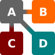
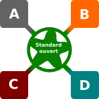

<!-- _class: lead -->
<!-- _paginate: false -->

# 6. Interopérabilité et normes

Module B4 « Géomatique & TI » — Formats, interfaces

---

## Objectifs

- Définir interface et interopérabilité
- Distinguer compatibilité, standard de fait et interopérabilité
- Distinguer norme, standard ouvert et format propriétaire
- Situer les organismes de normalisation (ISO, CEN, SNV, eCH, OGC)

---

## Qu'est-ce qu'une interface ?

- **Interface utilisateur** / **graphique** : humain ↔ machine
- **API** : programme ↔ programme
- **Interface d'échange** : format ou service entre deux systèmes
- Larousse : jonction entre deux systèmes… **par l'adoption de règles communes**

---

## Interopérabilité

- Capacité de systèmes différents à **communiquer sans ambiguïté**
- … **sans dépendre** d'un acteur particulier
- Repose sur des **normes** claires et univoques
- Chaque système évolue librement s'il respecte la norme
- Exemples : Internet, téléphone, échange de géodonnées

---

## L'analogie ferroviaire

- **CFF** : voie normale 1435 mm
- **MOB** : voie métrique 1000 mm
- → pas interopérables : changement de train à Zweisimmen
- La règle commune (écartement) = une **norme**
- GoldenPass Express (2022) : bogies à écartement variable
  = un **convertisseur** coûteux (cf. ETL, chap. 9)

---

## Degrés d'interopérabilité

| Compatibilité | Standard de fait | Interopérabilité |
|:---:|:---:|:---:|
|  |  |  |
| accords deux à deux | tous s'alignent sur le dominant | tous via un **standard ouvert** |

---

## Standard de fait : le shapefile

- Créé par Esri, spécification publiée en 1998
- Lu par tous les SIG… mais règles fixées par **un seul acteur**
- Limites jamais corrigées : champs de 10 caractères, 2 Go
- Alternative ouverte : **GeoPackage** (OGC)

---

## Les 5 niveaux d'interopérabilité

| Niveau | Question |
|---|---|
| **Technique** | Peut-on se connecter, lire le fichier ? |
| **Syntaxique** | La structure est-elle correcte (XML, JSON) ? |
| **Sémantique** | Donne-t-on **le même sens** aux données ? |
| **Organisationnel** | Qui fournit quoi, quand, comment ? |
| **Juridique** | A-t-on le **droit** de les utiliser ? |

D'après le cadre européen d'interopérabilité (EIF)

---

## 🧵 Ce que le fil rouge nous a appris

- **Technique** : swissTLM3D = fichier national de 3 à 5 Go → API REST, 200 objets par requête
- **Technique** : carte nationale en 3857 dans GeoLibre ; IFC en UTM 60 Sud
- **Syntaxique** : DXF en Windows-1252
- **Sémantique** : `Gebaeude Einzelhaus` à traduire, hauteur vide, classes LiDAR 14/15/26/27 inconnues
- **Organisationnel** : MO de Zoug par WFS, pas celle de Vaud
- **Juridique** : © swisstopo, CC BY 4.0 (buildingSMART)

---

## Norme ou standard ?

- **Norme** : organisme **reconnu** (ISO, CEN, SNV), consensus
- **Standard ouvert** : consortium (W3C, OGC, buildingSMART)
- **Standard de fait** : une entreprise dominante
- Anglais : un seul mot, *standard*
- ⚠ Interopérabilité sur un standard **fermé** = risque

---

## Normes ouvertes

- Rédaction **collaborative**, brouillon → tests → recommandation
- Publication **libre** : chacun peut implémenter
- W3C / IETF : XML, PNG, JSON, GeoJSON
- OGC : GML, KML, WMS, WFS, GeoPackage
- buildingSMART : IFC — SNV : INTERLIS
- **PDF** : norme **ISO 32000** depuis 2008

---

## Normes payantes et restreintes

- **Payantes** : ISO, CEN, SNV, AFNOR… publiques mais pas gratuites
- **Distribution restreinte** : une seule entreprise décide
  - shapefile (Esri), RAR, Java (Oracle)
- **Brevets** : redevances (USA, Japon)
  - GIF (LZW) : expiré en 2003-2004 → d'où le PNG
  - MP3 : expiré en 2017

---

## Formats propriétaires fermés

- Connus de leur seul concepteur
- Les autres : **rétro-ingénierie**, risque à chaque version
- Exemples : File Geodatabase (Esri), DWG (Autodesk)
- Anciens `.doc`/`.xls` (les `.docx`/`.xlsx` sont ISO/IEC 29500)
- Formats natifs d'instruments (scanners, GNSS)

---

## ▶ Qui a défini les formats du cours ?

- **32 formats** et services : OGC, ISO, IETF, W3C, ASPRS, buildingSMART, SNV, Esri, Autodesk, communautés…
- Filtre par organisme et par **degré** : norme ouverte · communautaire · standard de fait · fermé
- Exercice : **trier 10 formats**

▶ [Ouvrir le catalogue](https://regislon.github.io/cfgeo_B4/formats-interfaces/06-interoperabilite-normes/#qui-a-defini-les-formats-de-ce-cours)

---

<!-- _class: lead -->

# Normalisation en géoinformation

---

## Qui normalise ?

| Niveau | Organisme | Géoinformation |
|---|---|---|
| Mondial | **ISO** | **ISO/TC 211** |
| Europe | **CEN** | **CEN/TC 287** |
| Suisse | **SNV** | INTERLIS, adresses… |
| Suisse | **eCH** | cyberadministration |
| Consortium | **OGC** | GML, WMS, OGC API… |

---

## ISO/TC 211 : la série 191xx

- ISO 19107 géométrie · 19111 systèmes de coordonnées
- ISO 19115 métadonnées · 19125 Simple Features
- ISO 19128 WMS · 19136 GML
- Processus long : NWIP → WD → CD → DIS/FDIS → **IS**
- La **SNV** représente la Suisse

---

## CEN et SNV

- CEN reprend les normes ISO (→ **EN ISO 191xx**)
- **ISO recommande, CEN oblige** : reprise nationale obligatoire
- SNV membre du CEN → normes suisses contradictoires retirées
- Normes SN : **612030/612031 INTERLIS**, 612040 adresses de bâtiments, 612050 métadonnées GM03

---

## Coordination suisse

- **eCH** : standards de cyberadministration, groupe *Géoinformation*
- **swisstopo / KOGIS** : coordination de l'infrastructure nationale de géodonnées
- **LGéo / OGéo** : modèles de géodonnées minimaux, décrits en **INTERLIS**

---

## Le cadre légal suisse

| Texte | Contenu |
|---|---|
| **LGéo** art. 4 | « échange simple et large utilisation », **normes reconnues** |
| **LGéo** art. 5 | exigences : **modèles**, qualité, **échange** |
| **OGéo** art. 9 | **modèle de géodonnées minimal** (MGDM) par la Confédération |
| **OGéo** art. 10 | langage de description = **norme reconnue** |
| **OGéo-swisstopo** art. 5 | → **INTERLIS** (SN 612030 ou eCH-0031) |

MGDM : **models.geo.admin.ch** · cantons : **geodienste.ch** · UE : **INSPIRE**

---

## OGC : Open Geospatial Consortium

- Fondé en 1994, plus de 500 membres
- Éditeurs, producteurs de données, administrations, universités
- But : SIG **interopérables** grâce à des interfaces ouvertes
- **Abstract Specification** : cadre conceptuel (Simple Features)
- **OGC Standards** : GML, KML, WMS, WMTS, WFS, GeoPackage…
- **Community Standards** : 3D Tiles, CityJSON, I3S

---

## OGC API : la nouvelle génération

- **REST** + **JSON**/GeoJSON + HTML, décrit en OpenAPI
- OGC API – **Features** → succède à WFS
- OGC API – **Tiles** → WMTS
- OGC API – **Maps** → WMS
- Détails au chapitre 8

---

## ▶ Comment naît un standard

| | JSON-FG | STAC |
|---|---|---|
| Origine | groupe de travail OGC | communauté (GitHub) |
| Consultation publique | 2024 | 2023 et 2025 |
| Approbation (vote) | 25 août 2025 | 9 sept. 2025 |
| Publication | 30 avril 2026 | 14 oct. 2025 |

▶ [Frise interactive (et étapes ISO)](https://regislon.github.io/cfgeo_B4/formats-interfaces/06-interoperabilite-normes/#comment-nait-un-standard-json-fg-et-stac)

---

## OGC ↔ ISO

| OGC | ISO |
|---|---|
| Simple Features | 19125 |
| WMS 1.3.0 | 19128 |
| GML 3.2 | 19136 |

→ données **hétérogènes et distribuées** combinables
ex. map.geo.admin.ch, geocat.ch

---

## Licences : le droit d'utiliser

- **OGD swisstopo** (depuis 2021) : gratuit, réutilisable, **mention de la source**
- **Creative Commons** : CC BY (attribution), CC BY-SA, CC0
- **ODbL** (OpenStreetMap) : partage des bases dérivées
- Données **sous conditions** : autorités, émoluments (OGéo art. 40)

⚠️ **Format ouvert ≠ données libres**

---

## ❓ Testez-vous

7 questions : niveaux, standard de fait, INTERLIS dans la loi, licences, CEN, Community Standards

▶ [Faire le quiz](https://regislon.github.io/cfgeo_B4/formats-interfaces/06-interoperabilite-normes/#testez-vous)

---

## À retenir

- **Interface** = jonction fondée sur des règles communes
- **Interopérabilité** = standard **ouvert**, sans dépendance
- Compatibilité < standard de fait < interopérabilité
- **Norme** (ISO, CEN, SNV) ≠ **standard** (consortium ou de fait)
- ISO/TC 211 → CEN/TC 287 (obligatoire) → SNV ; eCH, swisstopo
- **OGC** : GML, WMS, WFS… et **OGC API**
