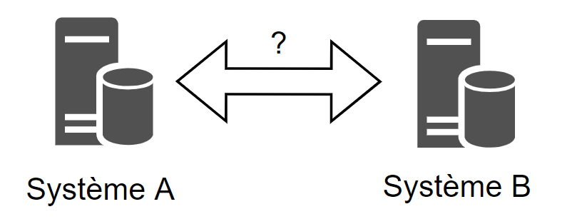
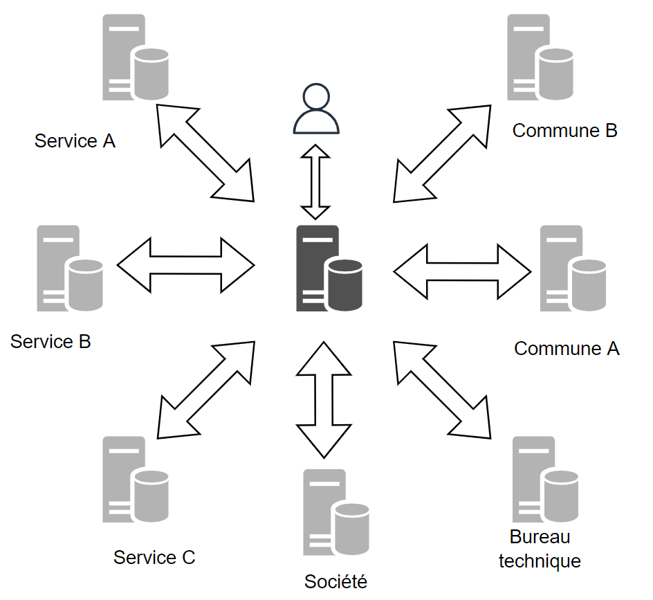
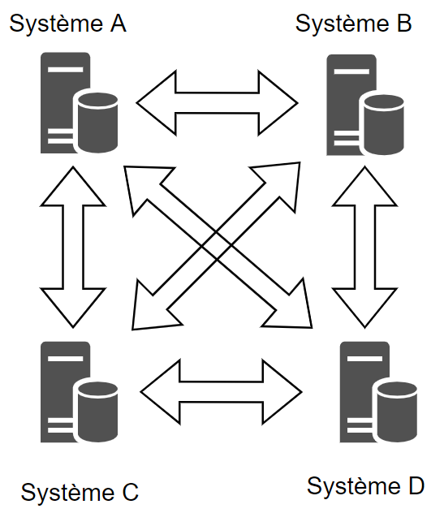
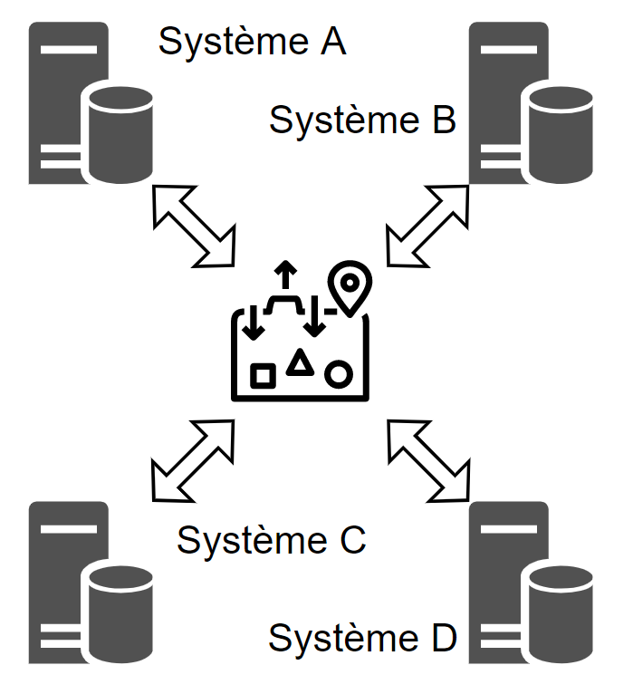

# 7. Échange de données

[📽 Slides du chapitre](https://regislon.github.io/cfgeo_B4/formats-interfaces/07-echange-de-donnees/slides.html)

## Objectifs

À la fin de ce chapitre, vous êtes capables de :

- Distinguer les échanges hors ligne et en ligne et citer leurs avantages et inconvénients
- Expliquer pourquoi un format pivot (INTERLIS) simplifie l'échange entre de nombreux systèmes
- Mener un schema mapping entre deux modèles de données
- Anticiper les incompatibilités courantes (types, géométries, SURFACE/AREA, règles d'intégrité)

## Pourquoi échanger des données ?

En géomatique, et particulièrement en Suisse avec ses 26 cantons et plus de 2000 communes, l'échange de données est un thème central. La mensuration officielle (MO) en est un bon exemple : depuis la réforme REMO, la **liberté des méthodes** permet à chaque bureau de choisir son logiciel, pour autant que la qualité et la fiabilité des données soient garanties. Tôt ou tard, des données produites dans un système A doivent donc être transmises à un système B (canton, commune, gestionnaire de réseaux, swisstopo…).



*Figure : le problème de base de l'échange entre deux systèmes.*

Pour que l'échange fonctionne, les deux systèmes doivent se mettre d'accord sur **ce qui est échangé** (le contenu) et **comment** (le format, le support, le protocole). C'est ce que l'on appelle une **interface d'échange**.

## Échanges hors ligne et en ligne

Les échanges de données prennent des formes très variées. On les classe en deux familles.

### Interfaces « hors ligne » (off-line)

Les données sont **extraites du système source à un instant t**, enregistrées dans un fichier, puis transmises au système cible qui les importe.

Exemples de supports ou de canaux :

- clé USB ou disque externe ;
- pièce jointe d'un e-mail (pour de petits volumes) ;
- stockage en ligne ou plateforme de partage de fichiers (cloud, serveur FTP/SFTP, portail de téléchargement) ;
- et même… le papier (un plan imprimé reste un moyen d'échange !).

| Avantages | Inconvénients |
|---|---|
| Aucun lien permanent entre les systèmes : ils peuvent être totalement déconnectés | **Perte de continuité** : les mises à jour faites dans le système source après l'extraction ne sont pas transmises |
| Simple à mettre en place | Copies multiples des mêmes données, risque de travailler sur une version périmée |
| Le destinataire dispose d'une copie complète, utilisable hors connexion | Gros volumes à transférer, même si seule une petite partie est utile |

!!! note "Stockage en ligne = hors ligne ?"
    Déposer un fichier sur un espace cloud passe bien par Internet, mais l'échange reste **hors ligne** au sens de ce chapitre : on transmet une **copie figée** des données à un instant t. Ce qui compte, c'est la nature de l'échange, pas le support.

### Interfaces « en ligne » (on-line)

Avec Internet sont apparues des interfaces où les systèmes sont **connectés en permanence** : le système cible interroge directement le système source au moment où il a besoin des données. Les géoservices (WMS, WFS, OGC API…, voir [chapitre 8](../08-geoservices/README.md)) en sont l'exemple typique.

| Avantages | Inconvénients |
|---|---|
| Données **toujours à jour** | Dépendance au réseau (disponibilité, débit) |
| Seules les données nécessaires sont transférées (une emprise, une couche…) | Questions de **sécurité** : ouvrir un système sur le réseau crée une surface d'attaque |
| Une seule source de vérité, pas de copies multiples | Dépendance envers le fournisseur du service (pérennité, performance) |

Le transfert direct par câble ou par liaison sans fil entre deux appareils (p. ex. un instrument de terrain et un ordinateur) appartient aussi à cette catégorie.

??? question "Testez-vous : hors ligne ou en ligne ?"
    1. Un bureau envoie un fichier INTERLIS de la MO au canton via une plateforme de dépôt. → **Hors ligne** (copie à un instant t).
    2. QGIS affiche la carte nationale via le WMTS de geo.admin.ch. → **En ligne**.
    3. Un collègue vous partage un GeoPackage sur un espace cloud. → **Hors ligne**.

## Le problème des interfaces multiples et le format pivot

### Interfaces point à point

Un échange entre deux systèmes est une sorte d'**accord bilatéral**. Le problème se complique lorsque de nombreux systèmes doivent collaborer, comme dans un système d'information du territoire (SIT) : services communaux, bureaux techniques, cantons, entreprises…



*Figure : l'échange de données dans le cadre d'un SIT.*

On peut créer une interface de chaque système vers chacun des autres :



*Figure : interfaces point à point entre 4 systèmes (6 interfaces).*

Le nombre d'interfaces bidirectionnelles nécessaires vaut alors :

```text
nombre d'interfaces = n × (n − 1) / 2        (n = nombre de systèmes)
```

| Nombre de systèmes *n* | Interfaces point à point | Interfaces avec un format pivot |
|---:|---:|---:|
| 2 | 1 | 2 |
| 4 | 6 | 4 |
| 10 | **45** | **10** |
| 20 | 190 | 20 |

Avec 10 systèmes, il faut déjà **45 interfaces** à développer et à maintenir. Et si un partenaire change de logiciel, il doit refaire ses 9 interfaces !

<div class="demo" data-demo="pivot"></div>

*Faites varier le nombre de systèmes et comparez les deux architectures : le nombre de liaisons point à point croît avec le carré du nombre de systèmes, celui du format pivot reste égal au nombre de systèmes.*

### Le format pivot : INTERLIS

L'idée d'un **format pivot** (ou format d'échange commun) est que chaque système ne possède qu'**une seule interface**, de et vers ce format. Le nombre d'interfaces devient égal à *n*.



*Figure : chaque système n'a qu'une interface, vers le format pivot.*

En Suisse, ce rôle est joué par **INTERLIS**, à la fois langage de description de modèles de données et format de transfert. La législation sur la géoinformation en fait le langage de référence des modèles de géodonnées de base (LGéo art. 5, OGéo art. 9 et 10, OGéo-swisstopo art. 5 ; voir le [chapitre 6](../06-interoperabilite-normes/README.md#le-cadre-legal-suisse-lgeo-modeles-minimaux-interlis)), notamment pour la MO (modèle DM.01-AV-CH).

!!! tip "Pour aller plus loin"
    INTERLIS fait l'objet d'un cours séparé. Retenez ici seulement l'idée : un **modèle commun et un format commun** remplacent une multitude d'accords bilatéraux.

## Contenu de l'information échangée

L'information à échanger peut aller d'une simple image à une base de données complexe. L'interface à mettre en place sera très différente selon la situation. Trois questions permettent de la caractériser :

1. **Sur quel modèle de données repose le transfert ?** Simples données graphiques (des traits et des points), objets avec attributs, ou classes d'objets avec relations, énumérations et règles d'intégrité ?
2. **Sous quel format les données sont-elles transférées ?** Format propriétaire (ArcGIS, AutoCAD DWG…), format national (INTERLIS, p. ex. DM.01-AV-CH pour la MO) ou format international (GML, GeoPackage…).
3. **Le format est-il un standard *de facto* ou *de jure* ?** Quel standard le destinataire accepte-t-il ?

| | Standard *de facto* | Standard *de jure* |
|---|---|---|
| Définition | Imposé par l'usage, souvent par un éditeur dominant | Défini et publié par un organisme de normalisation ou par la loi |
| Exemples | Shapefile (Esri), DXF/DWG (Autodesk), KML (à l'origine Google) | INTERLIS (norme SN 612030/31, LGéo), GML (OGC/ISO 19136), GeoPackage (OGC) |
| Risque | Spécification pouvant évoluer au gré de l'éditeur | Évolution plus lente, mais stable et documentée |

!!! note
    Une frontière n'est pas toujours nette : KML, standard *de facto* né chez Google, a ensuite été normalisé par l'OGC.

## Schema mapping

Lors de la mise en place d'une interface, les modèles de données source et cible sont presque toujours différents : noms de classes, attributs, types, géométries, découpage en thèmes… Il faut donc établir la **correspondance entre les deux structures**. Cette opération s'appelle le **schema mapping**.

Elle se déroule en étapes, qui se répètent jusqu'à obtenir une interface fiable :

| Étape | Contenu |
|---|---|
| 1. Analyser les structures | Comprendre les modèles source et cible |
| 2. Identifier les règles de transformation | Décider comment chaque objet source devient un objet cible |
| 3. Convertir un jeu de données test | Appliquer les règles sur un extrait représentatif |
| 4. Contrôler le résultat | Valider, inspecter, comparer |
| 5. Itérer | Corriger les règles et recommencer à l'étape 3 |

### 1. Analyser les structures

La structure des données peut être identifiée grâce :

- **aux métadonnées et à la documentation du modèle**. Exemple : le modèle de données de la MO (DM.01-AV-CH), décrit en INTERLIS et publié sur [cadastre.ch](https://www.cadastre.ch/fr) ;
- **à la normalisation** : normes ou modèles reconnus comme GEOBAT, MOpublic ou SIA 405 (cadastre des conduites) ;
- **à l'observation des données** elles-mêmes (ouvrir les fichiers, lister les valeurs réellement présentes dans chaque attribut).

### 2. Identifier les règles de transformation

Chaque type d'objet du système source doit trouver un type d'objet correspondant dans le système cible. On procède typiquement ainsi :

1. **Définir les données à transférer** : filtrer les données source (tout n'est pas forcément utile).
2. **Utiliser des constantes** pour les attributs cibles obligatoires qui n'existent pas dans la source.
3. **Renommer** les classes et les attributs.
4. **Convertir les types de données**, y compris les **énumérations** (table de correspondance des valeurs).
5. **Convertir la géométrie** (type, système de coordonnées, précision).
6. **Gérer les relations** entre objets (clés, identifiants, associations).

Le résultat est souvent une **table de correspondance** :

| Classe / attribut source | Valeur source | Classe / attribut cible | Valeur cible | Remarque |
|---|---|---|---|---|
| `Zone.vd_Designation` | `Zone village` | `Affectation.TYPE_PRINCIPAL` | `Zone centrale` | |
| `Zone.vd_Designation` | `Zone de hameau` | `Affectation.TYPE_PRINCIPAL` | `Zone centrale` | regroupement : perte d'information |
| `Zone.nom` | — | `Affectation.remarque` | — | simple renommage |

*Exemple fictif inspiré de l'exercice ; les valeurs ne correspondent pas forcément au modèle réel.*

### 3. Convertir un jeu de données test et améliorer l'interface

Un transfert complet peut prendre beaucoup de temps. On valide donc l'interface sur un **jeu de données restreint mais représentatif** (qui contient les cas particuliers !), ce qui permet de la « déboguer » rapidement.

L'élaboration complète d'une interface nécessite **plusieurs itérations**. Au terme de chacune, on contrôle les données :

- validation par l'outil de transfert lui-même (messages d'erreur, journaux) ;
- relecture du fichier cible (ouvrir le fichier, vérifier la structure) ;
- contrôle visuel dans un SIG ;
- utilisation d'un **checker**, c'est-à-dire d'un outil de validation indépendant. Pour INTERLIS, l'outil de référence est **[ilivalidator](https://github.com/claeis/ilivalidator)**, qui vérifie qu'un fichier de transfert respecte son modèle (types, cardinalités, géométries, contraintes).

!!! tip "Bon réflexe"
    Comptez les objets avant et après la conversion, par classe. Une différence non expliquée signale presque toujours une règle de transformation oubliée ou un filtre trop strict.

Le schema mapping règle avant tout le niveau **sémantique** de l'interopérabilité (voir le [chapitre 6](../06-interoperabilite-normes/README.md#les-niveaux-dinteroperabilite)) : faire en sorte que les deux systèmes donnent **le même sens** aux mêmes données. En pratique, les règles sont saisies dans un outil : l'algorithme **Refactoriser les champs** de QGIS, une requête `ogr2ogr -sql` ou un projet FME (voir le [chapitre 9](../09-reformatage-etl/README.md)).

### 🧵 Fil rouge : le schema mapping de la couche « bâtiments »

La couche `batiments` du fil rouge (chapitre 3) est elle-même le résultat d'un schema mapping, réalisé pour ce cours à partir de **swissBUILDINGS3D 3.0** (couche `Floor`, feuille de carte 1203 Yverdon). Voici les cinq étapes, appliquées pour de vrai :

**1. Analyser les structures.** En ouvrant les données source, on constate que : les géométries sont des **triangles 3D** (TIN), plusieurs par bâtiment ; les attributs sont en **allemand** ; l'attribut de hauteur `GESAMTHOEHE` est **vide** pour tous les objets ; la feuille couvre bien plus que notre kilomètre carré (3'094 bâtiments).

**2. Identifier les règles de transformation.**

| Source : swissBUILDINGS3D (`Floor`) | Règle | Cible : `batiments` |
|---|---|---|
| `UUID` | renommer | `uuid` |
| `OBJEKTART` : `Gebaeude Einzelhaus` / `Hochhaus` / `Im Bau` | **traduire les valeurs** (énumération) | `genre` : Bâtiment / Immeuble de grande hauteur / En construction |
| `NAME_KOMPLETT` | renommer ; chaîne vide → `NULL` | `nom` |
| `GESAMTHOEHE` (vide) | **calculer** : altitude max − altitude min de la géométrie 3D | `hauteur` |
| altitude min de la géométrie 3D | **calculer** | `altitude_sol` |
| géométrie : triangles 3D | passer en **2D** et **fusionner** les triangles d'un même bâtiment | MultiPolygon 2D, MN95 |
| feuille 1203 entière | **filtrer** sur la tuile 2538-1180 | 405 bâtiments |

**3. Convertir un jeu de données test.** Les règles ont été appliquées avec GDAL (`ogr2ogr` et une requête SQL) ; c'est en voyant le résultat qu'on a découvert que `GESAMTHOEHE` était vide, ce qui a ajouté une règle de calcul.

**4. Contrôler.** 405 objets en sortie ; hauteurs de 4,7 à 47,3 m (plausible pour Yverdon) ; superposition visuelle avec l'orthophoto (figure du chapitre 3).

**5. Itérer.** Les valeurs de `genre` ont d'abord été laissées en allemand, puis traduites dans une seconde passe.

<div class="demo" data-demo="etl"></div>

*À vous : configurez les règles du mapping pour cinq vrais bâtiments de la tuile, puis exécutez. Le mini-ETL signale les erreurs (champ obligatoire vide, valeur non traduite, texte dans un champ numérique). Les valeurs sources sont réelles (swissBUILDINGS3D, © swisstopo).*

## Incompatibilités possibles lors d'un transfert

Il est fréquent de rencontrer des incompatibilités en construisant une interface. Voici les cas les plus typiques.

<div class="demo" data-demo="incompat"></div>

### Texte vs numérique

Un système qui gère un cadastre des conduites prévoit un champ **texte** pour le numéro des chambres (p. ex. `12a`, `K-045`). Si ces données doivent un jour être transférées dans un système qui n'accepte que des **valeurs numériques**, l'interface devra prévoir une astuce pour conserver le numéro d'origine : attribut supplémentaire de type texte, table de correspondance, renumérotation documentée…

L'inverse ne pose pas de problème : un nombre peut toujours être enregistré dans un champ texte (au prix de la perte de son caractère numérique, p. ex. pour les tris et les calculs).

### Polyligne vs surface

Les différences de **type géométrique** sont plus délicates. Un producteur gère un objet sous forme de **ligne**, alors qu'une application en a besoin sous forme de **surface**.

Exemple : dans le modèle topographique de swisstopo (**swissTLM3D**, successeur de VECTOR25), les **routes** sont des **lignes** (axes) avec un attribut de largeur ou de classe. Dans la **MO**, les routes font partie de la **couverture du sol**, où tous les objets sont des **surfaces**. Passer de l'un à l'autre demande une transformation géométrique (p. ex. tampon selon la largeur), qui ne donnera jamais exactement les limites mesurées de la MO. Un travail manuel reste souvent nécessaire pour les cas particuliers (carrefours, ponts, giratoires).

### SURFACE vs AREA (INTERLIS)

INTERLIS distingue clairement deux types géométriques surfaciques :

| Type INTERLIS | Signification | Superpositions |
|---|---|---|
| `SURFACE` | Surfaces indépendantes les unes des autres | Autorisées |
| `AREA` | **Partition du territoire** : les surfaces se touchent sans se chevaucher et sans laisser de trou | **Interdites**, même minimes |

Le thème des **biens-fonds** de la MO est de type `AREA` : deux biens-fonds ne peuvent pas se superposer, sinon deux propriétaires posséderaient légalement la même portion de territoire ! La **couverture du sol** de la MO est aussi une partition (`AREA`).

Exemple (historique, mais toujours parlant) : dans VECTOR25, l'ancien modèle topographique de swisstopo aujourd'hui remplacé par swissTLM3D, la couche « surfaces primaires » (forêt, lac, glacier, vigne, verger, zone d'habitation…) formait une partition du territoire **sans** les bâtiments et les routes, gérés dans d'autres couches. Si l'on transfère ces surfaces **et** les bâtiments et routes dans la couverture du sol de la MO, ils vont se superposer, ce qui est interdit dans un thème `AREA`. L'interface doit donc **découper** les surfaces (soustraire bâtiments et routes) pour respecter les contraintes du système cible.

### Règles d'intégrité et identifiants

Les **règles d'intégrité** peuvent aussi poser problème. Un système A gère les candélabres d'une commune ; chaque candélabre a un numéro, mais ce numéro n'est **pas unique**. Si le système cible exige un numéro **identifiant** (unique), il faut une solution pour les doublons : nouvel identifiant, suffixe, contrôle et correction manuelle…

Certains problèmes demandent des **mesures organisationnelles**. Dans le modèle de la MO, le numéro d'un point fixe planimétrique de catégorie 3 (**PFP3**) doit être unique, en principe à l'intérieur d'une commune. Si l'on agrège les données de toutes les communes dans une base centrale, on retrouvera plusieurs fois le même numéro de PFP3, pour des points situés dans des communes différentes !

La solution de la MO est le **domaine de numérotation** (`NBIdent`) : une zone géographique à l'intérieur de laquelle les numéros doivent être uniques. Le couple *domaine de numérotation + numéro* forme alors un **identifiant unique** à l'échelle de toute la Suisse.

```text
Domaine de numérotation   Numéro PFP3   → Identifiant
VD0100000001              1234          → VD0100000001 / 1234
VD0200000005              1234          → VD0200000005 / 1234   (autre commune, pas de conflit)
```

*Valeurs d'exemple ; la structure exacte des identifiants est définie dans le modèle DM.01-AV-CH.*

## Échanger aujourd'hui : quelques évolutions

Les principes de ce chapitre restent valables, mais les pratiques évoluent :

- **Mises à jour incrémentales** : plutôt que de retransmettre tout un jeu de données, on n'envoie que les objets **créés, modifiés ou supprimés** depuis la dernière livraison. INTERLIS 2 le permet grâce aux identifiants stables des objets et des corbeilles de données (`TID`, `BID`).
- **Téléchargement et API** : de plus en plus de données sont échangées par des **portails de téléchargement**, des **catalogues STAC** et des **API** (voir le [chapitre 8](../08-geoservices/README.md)), qui combinent les avantages des échanges en ligne et hors ligne : on télécharge un fichier à jour au moment où l'on en a besoin.
- **Validation systématique** : à la réception, les données sont contrôlées automatiquement (par exemple avec **ilivalidator** pour INTERLIS) avant d'être intégrées. Un échange sans contrôle n'est pas un échange fiable.

## Testez-vous

<div class="demo" data-demo="quiz" data-quiz="echange"></div>

## À retenir

- On distingue les échanges **hors ligne** (copie figée à un instant t) et **en ligne** (accès direct et à jour, mais dépendant du réseau).
- Avec des interfaces point à point, *n* systèmes demandent **n(n−1)/2** interfaces (45 pour 10 systèmes) ; un **format pivot** comme INTERLIS réduit ce nombre à **n**.
- Une interface se caractérise par le **modèle**, le **format** et le **statut** (*de facto* / *de jure*) des données échangées.
- Le **schema mapping** établit la correspondance entre modèles : analyser, définir les règles, tester sur un extrait, contrôler (p. ex. avec ilivalidator), itérer.
- Les incompatibilités typiques concernent les **types d'attributs**, les **types géométriques**, `SURFACE`/`AREA` et les **règles d'intégrité** (identifiants uniques, domaines de numérotation).
- Le schema mapping règle le niveau **sémantique** : le fil rouge l'a montré (traduction des valeurs, calcul d'un attribut manquant, conversion de la géométrie 3D en 2D).

## Sources

- Cours « Formats, interfaces » CFGéo, versions R. Balanche (2003), J.-L. Miserez (jusqu'en 2019), mise à jour 2023.
- [Loi fédérale sur la géoinformation (LGéo, RS 510.62)](https://www.fedlex.admin.ch/eli/cc/2008/388/fr)
- [cadastre.ch – Mensuration officielle (modèle DM.01-AV-CH)](https://www.cadastre.ch/fr)
- [interlis.ch – INTERLIS](https://www.interlis.ch/fr)
- [ilivalidator (GitHub)](https://github.com/claeis/ilivalidator)
- Norme SN 612020 : Mensuration et information géographique – Modèle de référence de données GEOBAT.

## Exercices

- [Schema mapping](../exercices/ex08-schema-mapping/README.md)

---

← [Interopérabilité et normes](../06-interoperabilite-normes/README.md) · [Géoservices (GeoWeb)](../08-geoservices/README.md) →
