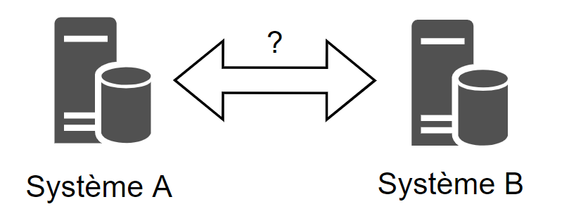
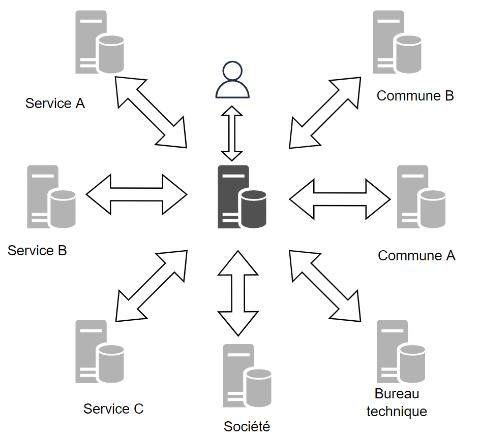
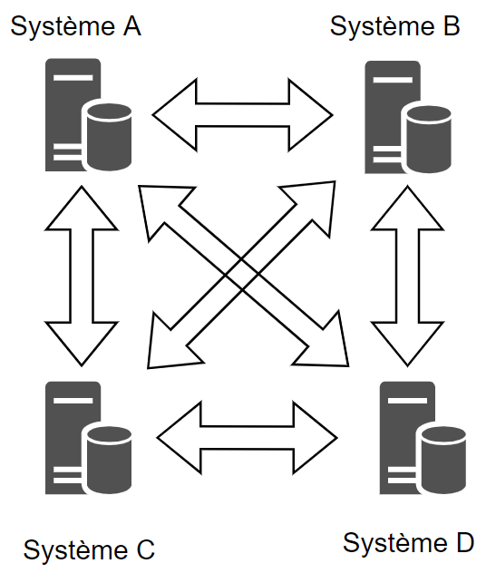
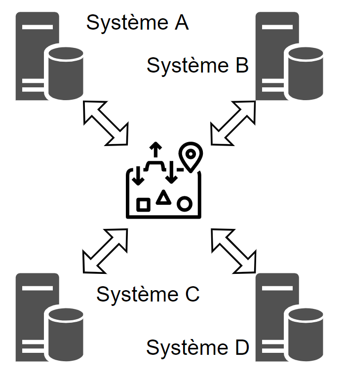
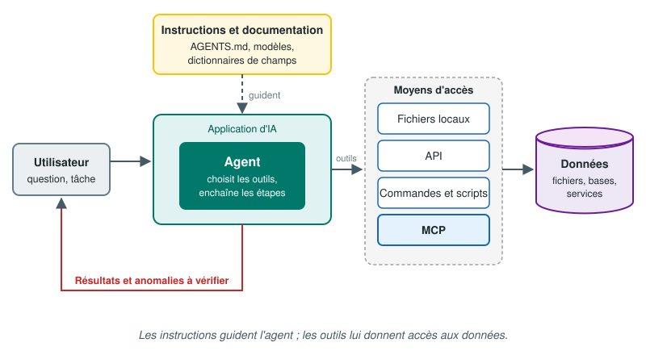

<!-- _footer: 'CFGéo B4 · 7. Échange de données · [📖 Lire le chapitre](./)' -->
<!-- _class: lead -->
<!-- _paginate: false -->

# 7. Échange de données

Module B4 « Géomatique & TI » — Formats, interfaces

---

<!-- _footer: 'CFGéo B4 · 7. Échange de données · [📖 Objectifs](./#objectifs)' -->
## Objectifs

- Distinguer échanges hors ligne et en ligne
- Expliquer l'intérêt d'un format pivot (INTERLIS)
- Mener un schema mapping
- Anticiper les incompatibilités courantes

---

<!-- _footer: 'CFGéo B4 · 7. Échange de données · [📖 Pourquoi échanger des données ?](./#pourquoi-echanger-des-donnees)' -->
## Le problème de base



- Données produites dans un système A, utilisées dans un système B
- En Suisse : 26 cantons, > 2000 communes, liberté des méthodes en MO
- Il faut s'accorder sur **quoi** échanger et **comment** → une **interface**

---

<!-- _footer: 'CFGéo B4 · 7. Échange de données · [📖 Échanges hors ligne et en ligne](./#echanges-hors-ligne-et-en-ligne)' -->
<!-- _class: lead -->

# Hors ligne ou en ligne ?

---

<!-- _footer: 'CFGéo B4 · 7. Échange de données · [📖 Interfaces « hors ligne » (off-line)](./#interfaces-hors-ligne-off-line)' -->
## Interfaces hors ligne (off-line)

- Extraction **à un instant t** → fichier → import dans le système cible
- Supports : clé USB, e-mail, stockage cloud, SFTP, portail de téléchargement… (papier !)
- ✅ Systèmes totalement indépendants, copie utilisable hors connexion
- ❌ **Perte de continuité** : les mises à jour ultérieures ne suivent pas
- ❌ Copies multiples, risque de version périmée

---

<!-- _footer: 'CFGéo B4 · 7. Échange de données · [📖 Interfaces « en ligne » (on-line)](./#interfaces-en-ligne-on-line)' -->
## Interfaces en ligne (on-line)

- Systèmes **connectés en permanence**, accès direct à la source
- Exemple : géoservices (WMS, WFS, OGC API… → chapitre 8)
- ✅ Données **toujours à jour**, seules les données utiles transitent
- ❌ Dépendance au réseau et au fournisseur
- ❌ Questions de **sécurité**

> Un fichier déposé sur le cloud reste un échange **hors ligne** : c'est une copie figée.

---

<!-- _footer: 'CFGéo B4 · 7. Échange de données · [📖 Le problème des interfaces multiples et le format pivot](./#le-probleme-des-interfaces-multiples-et-le-format-pivot)' -->
<!-- _class: lead -->

# Combien d'interfaces ?

---

<!-- _footer: 'CFGéo B4 · 7. Échange de données · [📖 Le problème des interfaces multiples et le format pivot](./#le-probleme-des-interfaces-multiples-et-le-format-pivot)' -->
## Le SIT et ses partenaires



---

<!-- _footer: 'CFGéo B4 · 7. Échange de données · [📖 Interfaces point à point](./#interfaces-point-a-point)' -->
## Interfaces point à point



```text
interfaces = n × (n − 1) / 2
```

- 4 systèmes → 6 interfaces
- 10 systèmes → **45 interfaces**
- Un partenaire change de logiciel → il refait **9 interfaces**

---

<!-- _footer: 'CFGéo B4 · 7. Échange de données · [📖 Le format pivot : INTERLIS](./#le-format-pivot-interlis)' -->
## Le format pivot : INTERLIS



- Chaque système : **une seule** interface, de et vers le format commun
- 10 systèmes → **10 interfaces**
- En Suisse : **INTERLIS** (LGéo), p. ex. DM.01-AV-CH pour la MO
- Détails : cours INTERLIS séparé

---

<!-- _footer: 'CFGéo B4 · 7. Échange de données · [📖 Le format pivot : INTERLIS](./#le-format-pivot-interlis)' -->
## ▶ Point à point ou pivot ?

- Curseur de 2 à 12 systèmes : le schéma dessine **toutes les liaisons**
- 10 systèmes : **45** interfaces point à point · **10** avec un pivot
- Un partenaire change de logiciel : **9** interfaces à refaire… ou **1**

▶ [Démo interactive](https://regislon.github.io/cfgeo_B4/formats-interfaces/07-echange-de-donnees/#interfaces-point-a-point)

---

<!-- _footer: 'CFGéo B4 · 7. Échange de données · [📖 Contenu de l’information échangée](./#contenu-de-linformation-echangee)' -->
## Que contient l'échange ?

1. **Modèle** : simple graphique, objets + attributs, ou classes + relations + contraintes ?
2. **Format** : propriétaire (DWG, FileGDB), national (INTERLIS), international (GML, GeoPackage)
3. **Statut** : standard *de facto* ou *de jure* ?

---

<!-- _footer: 'CFGéo B4 · 7. Échange de données · [📖 Contenu de l’information échangée](./#contenu-de-linformation-echangee)' -->
## *De facto* vs *de jure*

| *De facto* | *De jure* |
|---|---|
| Imposé par l'usage | Publié par un organisme de normalisation / la loi |
| Shapefile, DXF/DWG, KML (à l'origine) | INTERLIS, GML, GeoPackage |
| Peut changer au gré de l'éditeur | Stable et documenté |

---

<!-- _footer: 'CFGéo B4 · 7. Échange de données · [📖 Schema mapping](./#schema-mapping)' -->
<!-- _class: lead -->

# Schema mapping

---

<!-- _footer: 'CFGéo B4 · 7. Échange de données · [📖 Schema mapping](./#schema-mapping)' -->
## Le schema mapping, étape par étape

1. **Analyser** les structures source et cible
2. **Définir les règles** de transformation
3. **Convertir un jeu test** représentatif
4. **Contrôler** le résultat
5. **Itérer** jusqu'à une interface fiable

---

<!-- _footer: 'CFGéo B4 · 7. Échange de données · [📖 1. Analyser les structures](./#1-analyser-les-structures)' -->
## 1. Analyser les structures

- **Documentation du modèle** : p. ex. DM.01-AV-CH (MO) sur cadastre.ch
- **Normes** : GEOBAT, MOpublic, SIA 405
- **Observation des données** : quelles valeurs existent vraiment ?

---

<!-- _footer: 'CFGéo B4 · 7. Échange de données · [📖 2. Identifier les règles de transformation](./#2-identifier-les-regles-de-transformation)' -->
## 2. Règles de transformation

- Filtrer les données à transférer
- Fixer des **constantes** pour les attributs obligatoires
- **Renommer** classes et attributs
- Convertir les **types** et les **énumérations**
- Convertir la **géométrie** (type, CRS, précision)
- Gérer les **relations** entre objets

---

<!-- _footer: 'CFGéo B4 · 7. Échange de données · [📖 2. Identifier les règles de transformation](./#2-identifier-les-regles-de-transformation)' -->
## Table de correspondance

| Attribut source | Valeur source | Attribut cible | Valeur cible |
|---|---|---|---|
| `vd_Designation` | Zone village | `TYPE_PRINCIPAL` | Zone centrale |
| `vd_Designation` | Zone de hameau | `TYPE_PRINCIPAL` | Zone centrale |

- Plusieurs valeurs → une seule : **perte d'information**
- Une valeur sans équivalent : à documenter !

*Exemple fictif*

---

<!-- _footer: 'CFGéo B4 · 7. Échange de données · [📖 3. Convertir un jeu de données test et améliorer l’interface](./#3-convertir-un-jeu-de-donnees-test-et-ameliorer-linterface)' -->
## 3–5. Tester, contrôler, itérer

- Travailler sur un **extrait représentatif** (avec les cas particuliers)
- Contrôles :
  - messages de l'outil de transfert
  - relecture du fichier cible, contrôle visuel dans un SIG
  - **checker** : `ilivalidator` pour INTERLIS
- Compter les objets **avant / après**, par classe

---

<!-- _footer: 'CFGéo B4 · 7. Échange de données · [📖 Fil rouge : le schema mapping de la couche « bâtiments »](./#fil-rouge-le-schema-mapping-de-la-couche-batiments)' -->
## 🧵 Fil rouge : le mapping des bâtiments

| swissBUILDINGS3D | Règle | `batiments` |
|---|---|---|
| `OBJEKTART` = `Hochhaus`… | **traduire** | `genre` = Immeuble de grande hauteur… |
| `GESAMTHOEHE` (**vide**) | **calculer** Z max − Z min | `hauteur` |
| `NAME_KOMPLETT` | vide → `NULL` | `nom` |
| triangles 3D (TIN) | **2D + fusion** par bâtiment | MultiPolygon |
| feuille 1203 (3'094 bât.) | **filtrer** sur la tuile | 405 bâtiments |

Contrôle : 405 objets, hauteurs 4,7 – 47,3 m, superposition avec l'orthophoto

---

<!-- _footer: 'CFGéo B4 · 7. Échange de données · [📖 À vous : le mini-ETL](./#a-vous-le-mini-etl)' -->
## ▶ Mini-ETL dans le navigateur (style FME)

- **Données initiales** (sources : 5 vrais bâtiments, allemand, hauteur vide) → … → **résultat** (données finales, modèle cible)
- Glisser des **transformateurs** : Renommer, Traduire des valeurs, Calculer, Vide → NULL, Filtrer
- Cliquer sur une flèche : **inspecteur** des objets à cette étape
- Le résultat **rejette** les objets non conformes et dit pourquoi → itérer jusqu'à **5 / 5 valides**

▶ [Ouvrir le mini-ETL](https://regislon.github.io/cfgeo_B4/formats-interfaces/07-echange-de-donnees/#a-vous-le-mini-etl)


---

<!-- _footer: 'CFGéo B4 · 7. Échange de données · [📖 Agents IA, accès aux données et schema mapping](./#agents-ia-acces-aux-donnees-et-schema-mapping)' -->
## 🤖 Agents IA et schema mapping



- **Instructions** (`AGENTS.md`, modèles) : expliquent les règles — aucune permission
- **Outils** (fichiers, API, scripts, **MCP**) : donnent accès aux données
- L'agent **propose et exécute** ; on **enregistre** les règles et on **contrôle** le résultat
- Exemple : [interface de test swisstopo (SGS LLM)](https://denpw8uo5zpkl.cloudfront.net/) — **preuve de concept**, pas un service opérationnel
---

<!-- _footer: 'CFGéo B4 · 7. Échange de données · [📖 Exercices](./#exercices)' -->
<!-- _class: exercice -->

# Exercice : Schema mapping

[Consignes et données](https://regislon.github.io/cfgeo_B4/formats-interfaces/exercices/ex08-schema-mapping/)

---

<!-- _footer: 'CFGéo B4 · 7. Échange de données · [📖 Exercices](./#exercices)' -->
## ▶ Exercice Normat en ligne

- 53 désignations vaudoises → 28 types principaux
- Signale les **regroupements** (n → 1 = perte d'information)
- Export **CSV** `att_name_in;att_value_in;att_name_out;att_value_out`

▶ [Faire l'exercice en ligne](https://regislon.github.io/cfgeo_B4/formats-interfaces/exercices/ex08-schema-mapping/#version-en-ligne)

---

<!-- _footer: 'CFGéo B4 · 7. Échange de données · [📖 Incompatibilités possibles lors d’un transfert](./#incompatibilites-possibles-lors-dun-transfert)' -->
<!-- _class: lead -->

# Incompatibilités

---

<!-- _footer: 'CFGéo B4 · 7. Échange de données · [📖 Texte vs numérique](./#texte-vs-numerique)' -->
## Texte vs numérique

- Numéro de chambre `12a` ou `K-045` (texte)
- Système cible : numéro **entier** uniquement → ❌
- Solutions : attribut texte supplémentaire, table de correspondance, renumérotation documentée
- L'inverse (nombre → texte) ne pose pas de problème

---

<!-- _footer: 'CFGéo B4 · 7. Échange de données · [📖 Polyligne vs surface](./#polyligne-vs-surface)' -->
## Ligne vs surface

- swissTLM3D (ex-VECTOR25) : route = **ligne** (axe) + classe de largeur
- MO : route = **surface** de la couverture du sol
- Transformation géométrique (tampon…) ≠ limites mesurées
- Travail manuel pour carrefours, ponts, giratoires

---

<!-- _footer: 'CFGéo B4 · 7. Échange de données · [📖 SURFACE vs AREA (INTERLIS)](./#surface-vs-area-interlis)' -->
## SURFACE vs AREA (INTERLIS)

| `SURFACE` | `AREA` |
|---|---|
| Surfaces indépendantes | **Partition** du territoire |
| Superpositions autorisées | Aucune superposition, aucun trou |
| | Ex. : biens-fonds, couverture du sol (MO) |

- Ajouter bâtiments et routes sur une partition existante → superpositions → ❌
- L'interface doit **découper** les surfaces

---

<!-- _footer: 'CFGéo B4 · 7. Échange de données · [📖 Règles d’intégrité et identifiants](./#regles-dintegrite-et-identifiants)' -->
## Règles d'intégrité

- Numéros de candélabres **non uniques** → cible exige un identifiant → doublons à gérer
- MO : numéro de **PFP3** unique… **par commune**
- Base centrale → même numéro plusieurs fois !
- Solution : **domaine de numérotation** + numéro = identifiant unique

---

<!-- _footer: 'CFGéo B4 · 7. Échange de données · [📖 Règles d’intégrité et identifiants](./#regles-dintegrite-et-identifiants)' -->
## ▶ Simulateur d'incompatibilités

- **Texte → numérique** : `12a` dans un champ entier ? 3 stratégies
- **Identifiants PFP3** : numéro seul (doublons) ou **domaine + numéro**
- **Polyligne → surface** : tampon autour de l'axe vs surface MO

▶ [Ouvrir le simulateur](https://regislon.github.io/cfgeo_B4/formats-interfaces/07-echange-de-donnees/#incompatibilites-possibles-lors-dun-transfert)

---

<!-- _footer: 'CFGéo B4 · 7. Échange de données · [📖 Échanger aujourd’hui : quelques évolutions](./#echanger-aujourdhui-quelques-evolutions)' -->
## Échanger aujourd'hui

- **Mises à jour incrémentales** : seulement les objets créés, modifiés, supprimés (INTERLIS 2 : `TID`, `BID`)
- **Portails, STAC, API** : un fichier à jour, téléchargé au moment voulu
- **Validation systématique** à la réception (ilivalidator)

---

<!-- _footer: 'CFGéo B4 · 7. Échange de données · [📖 Testez-vous](./#testez-vous)' -->
## ❓ Testez-vous

7 questions : n(n−1)/2, hauteur calculée, sémantique, regroupements, jeu test, PFP3, incrémental

▶ [Faire le quiz](https://regislon.github.io/cfgeo_B4/formats-interfaces/07-echange-de-donnees/#testez-vous)

---

<!-- _footer: 'CFGéo B4 · 7. Échange de données · [📖 À retenir](./#a-retenir)' -->
## À retenir

- **Hors ligne** = copie figée ; **en ligne** = accès direct et à jour
- Point à point : **n(n−1)/2** interfaces ; format pivot : **n**
- Caractériser l'échange : modèle, format, *de facto* / *de jure*
- Schema mapping : analyser → règles → test → contrôle (ilivalidator) → itérer
- Pièges : types, géométries, `SURFACE`/`AREA`, identifiants
