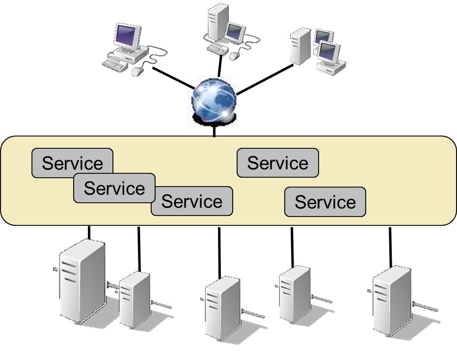
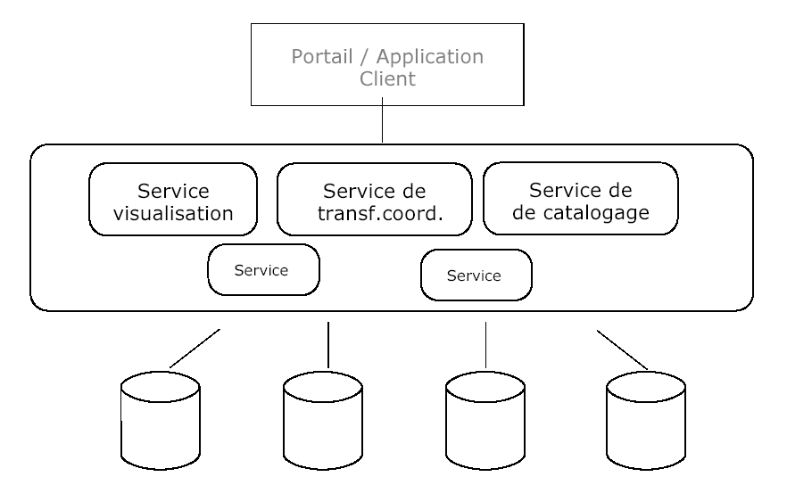

# 8. Géoservices (GeoWeb)

[📽 Slides du chapitre](https://regislon.github.io/cfgeo_B4/formats-interfaces/08-geoservices/slides.html)

## Objectifs

À la fin de ce chapitre, vous êtes capables de :

- Expliquer le fonctionnement d'un géoservice (requête GetCapabilities puis requête de données)
- Citer les avantages et les limites d'une architecture orientée services
- Distinguer les types de géoservices et les grands standards OGC (WMS, WMTS, WFS, CSW)
- Interroger un service WMS, WMTS ou WFS, en KVP ou en REST
- Situer les tuiles vectorielles, les OGC API et les catalogues STAC

## Services web et géoservices

### Définition

D'un point de vue technique, un **service web** est une technologie qui permet à des applications de **dialoguer à distance à travers Internet**, indépendamment des plateformes et des langages de programmation utilisés de part et d'autre. Le dialogue se fait via le protocole **HTTP(S)**, celui du web.

Un **géoservice** est un service web avec une composante géographique. La [loi fédérale sur la géoinformation (LGéo)](https://www.fedlex.admin.ch/eli/cc/2008/388/fr), art. 3, le définit comme une :

> application apte à être mise en réseau et simplifiant l'utilisation des géodonnées par des prestations de services informatisées y donnant accès sous une forme structurée.

Deux notions ressortent de cette définition :

- **la mise en réseau** : un géoservice permet à deux ordinateurs d'échanger des informations géographiques ;
- **la forme structurée** : l'échange suit un formalisme précis, défini par des **normes**. Les plus connues (WMS, WMTS, WFS, CSW, OGC API…) sont publiées par l'**OGC** (*Open Geospatial Consortium*) et sont indépendantes de tout logiciel : elles décrivent la manière d'appeler le service et la forme de la réponse.

### Principe de fonctionnement


*Figure : dialogue entre un client et un serveur de géoservice.*

1. Le client contacte le serveur et demande le document **Capabilities** (les métadonnées du service).
2. Le serveur renvoie ce document, au format **XML**, qui décrit ce que le service sait faire : couches disponibles, systèmes de coordonnées, formats, emprises…
3. Le client demande des données au serveur, en formulant une requête compatible avec ce qu'il a appris.
4. Le serveur livre les données demandées dans le format exigé (image, GML, GeoJSON…).

La plupart des services OGC répondent ainsi à deux types de requêtes :

- **`GetCapabilities`** : le « mode d'emploi » du service. On se renseigne d'abord sur ce qu'il peut fournir…
- **les requêtes de données** (`GetMap`, `GetTile`, `GetFeature`…) : … puis on pose une question qui correspond.

!!! tip "Dans la pratique"
    Vous n'écrivez presque jamais ces requêtes à la main : QGIS, ArcGIS Pro ou une application web les construisent pour vous dès que vous indiquez l'URL du service. Mais savoir les lire permet de **comprendre et diagnostiquer** un service qui ne fonctionne pas.

### KVP et REST

Une requête à un géoservice peut prendre plusieurs formes :

| Style | Principe | Exemple |
|---|---|---|
| **KVP** (*key-value pairs*) | Paramètres `clé=valeur` à la suite de l'URL, après un `?` et séparés par `&` | `...?SERVICE=WMS&REQUEST=GetCapabilities` |
| **REST** | Chaque ressource a sa propre URL, organisée comme un chemin de fichiers | `.../ch.swisstopo.pixelkarte-farbe/default/current/2056/20/58/70.jpeg` |
| SOAP | Messages XML envoyés en POST | Très peu utilisé, non traité ici |

WMS et WFS sont historiquement des services **KVP** ; WMTS propose les deux ; les **OGC API** récentes sont entièrement **REST**.

## Une nouvelle manière d'utiliser les géodonnées

### Du modèle traditionnel à l'architecture orientée services

Dans le modèle **traditionnel** :

- les données sont acquises (gratuitement ou non) ;
- elles sont stockées et gérées par l'utilisateur lui-même ;
- elles sont utilisées dans une application développée et maintenue par lui.

Dans une **architecture orientée services** (**SOA**, *Service-Oriented Architecture*), l'utilisateur n'a plus besoin de **posséder** une copie des données pour les utiliser : il accède à des services mis à disposition par d'autres, qu'il s'agisse de données ou de traitements.



*Figure : grâce à la standardisation, un client peut accéder à de multiples sources de données.*

Grâce à l'interopérabilité offerte par les géoservices, on peut construire des **SIG distribués** : les données restent chez leurs producteurs, les services les exposent de manière standardisée, et des géoportails ou des SIG bureautiques les combinent.


*Figure : architecture distribuée « multi-tiers ».*

Exemple suisse : [map.geo.admin.ch](https://map.geo.admin.ch) affiche des centaines de couches de la Confédération, servies par les géoservices de l'infrastructure fédérale de données géographiques ; les géoportails cantonaux en font autant pour les données cantonales et communales.

### Avantages et inconvénients

| Avantages | Inconvénients |
|---|---|
| Données **mises à jour en permanence** : les utilisateurs d'une base cadastrale centralisée voient chaque jour la version actuelle, sans gérer eux-mêmes les changements | **Dépendance au réseau** : sans connexion (ou avec une mauvaise connexion), l'application est inutilisable |
| **Rentabilisation** des développements : un même service (p. ex. transformation de coordonnées) sert dans de nombreux contextes | **Sécurité** : ouvrir un système au réseau crée une faille potentielle, parfois inacceptable pour des applications critiques |
| Intégration de données et services de **systèmes très différents**, moins de dépendance envers un fournisseur | **Pérennité** non garantie des services gérés par des tiers (URL qui change, service arrêté) |
| | La standardisation impose une **simplification** de la richesse des données échangées |

Ces architectures exigent aussi une **documentation** soignée : métadonnées des données et des services, et interfaces standardisées. Sans cela, impossible de mettre en commun des sources gérées par de nombreux intervenants.

## Types de géoservices



*Figure : un portail combine plusieurs types de services.*

| Type de service | Rôle | Standards / exemples |
|---|---|---|
| **Recherche** | Trouver des données ou des services | Recherche de geo.admin.ch, géocodage |
| **Catalogue** | Annoncer l'existence de données et de services, gérer leurs métadonnées | **CSW** (*Catalogue Service for the Web*), geocat.ch, **STAC** |
| **Visualisation** | Afficher les données sous forme de carte, pour une première évaluation | **WMS**, **WMTS** |
| **Téléchargement** (accès aux données) | Accéder aux objets eux-mêmes, avec géométrie et attributs | **WFS**, OGC API – Features, téléchargement de fichiers |
| **Transformation** (traitement) | Traiter les données à distance | Transformation de coordonnées (p. ex. REFRAME de swisstopo), WPS / OGC API – Processes |

!!! note "Catalogues en Suisse"
    [geocat.ch](https://www.geocat.ch) est le catalogue de métadonnées géographiques suisse. Il expose ses métadonnées notamment via le standard **CSW**, ce qui permet à un SIG de rechercher des données directement dans le catalogue.

## WMS – Web Map Service

Le **WMS** est un standard OGC qui permet de **produire dynamiquement des cartes** à partir de données géoréférencées. Le serveur WMS lit les données, les dessine avec une symbologie donnée et renvoie une **image** (PNG, JPEG…). Le client, lui, ne reçoit que des pixels : il ne connaît pas les objets eux-mêmes.

Usages typiques :

- voir à quoi ressemble un jeu de données ;
- superposer des couches provenant de **serveurs différents** (les formats avec transparence, comme le PNG, le permettent).


*Figure : les trois requêtes principales d'un WMS. Source : [17]*

| Requête | Réponse |
|---|---|
| `GetCapabilities` | Document XML décrivant le service et ses couches |
| `GetMap` | Une image de la carte pour une emprise, une taille et des couches données |
| `GetFeatureInfo` (optionnelle) | Les attributs des objets à l'endroit cliqué |

### Exemple : le WMS de la Confédération

Requête `GetCapabilities` :

```text
https://wms.geo.admin.ch/?SERVICE=WMS&VERSION=1.3.0&REQUEST=GetCapabilities
```

Requête `GetMap` pour la carte nationale en couleur autour de Berne, en MN95 :

```text
https://wms.geo.admin.ch/?SERVICE=WMS&VERSION=1.3.0&REQUEST=GetMap
    &LAYERS=ch.swisstopo.pixelkarte-farbe
    &STYLES=
    &CRS=EPSG:2056
    &BBOX=2596000,1197000,2603000,1203000
    &WIDTH=700&HEIGHT=600
    &FORMAT=image/png
```

*(L'URL doit être écrite sur une seule ligne ; elle est coupée ici pour la lisibilité.)*

| Paramètre | Signification |
|---|---|
| `SERVICE`, `VERSION`, `REQUEST` | Type de service, version de la norme, nom de la requête |
| `LAYERS` | Couche(s) demandée(s), séparées par des virgules |
| `STYLES` | Style de chaque couche (vide = style par défaut) |
| `CRS` | Système de coordonnées de la requête (ici MN95) |
| `BBOX` | Emprise : x min, y min, x max, y max (ici E et N en mètres) |
| `WIDTH`, `HEIGHT` | Taille de l'image en pixels |
| `FORMAT` | Format de l'image renvoyée |


*Figure : réponse de la requête GetMap ci-dessus. Source : © swisstopo, wms.geo.admin.ch*

!!! warning "Ordre des axes en WMS 1.3.0"
    En WMS 1.3.0, l'ordre des coordonnées dans `BBOX` suit la définition du système de coordonnées. Pour EPSG:2056, c'est E puis N, sans surprise ; mais pour EPSG:4326 (WGS84), c'est **latitude puis longitude**. Source fréquente d'images vides !

??? question "Testez-vous"
    Copiez la requête GetMap dans votre navigateur, puis modifiez `BBOX` pour afficher votre lieu de travail. Que se passe-t-il si `WIDTH`/`HEIGHT` n'ont pas les mêmes proportions que la `BBOX` ?

    *Réponse : l'image est déformée, car le serveur remplit exactement la taille demandée avec l'emprise demandée.*

## WMTS – Web Map Tile Service

Le WMS calcule une nouvelle image à chaque requête, ce qui est coûteux pour le serveur. Le **WMTS** est un standard OGC né de l'usage très répandu des **tuiles** : des images de taille fixe (souvent 256 × 256 pixels) **précalculées** pour une série d'échelles fixes. Le serveur n'a plus qu'à renvoyer des fichiers déjà prêts, ce qui est très rapide et facile à mettre en cache.


*Figure : la pyramide de tuiles prédéfinies d'un WMTS. Source : [18]*

### Vocabulaire

| Terme | Signification |
|---|---|
| `TileMatrixSet` | La pyramide complète, liée à un système de coordonnées (p. ex. `2056`, `3857`) |
| `TileMatrix` | Un niveau de la pyramide, correspondant à une échelle (niveau de zoom) |
| `TileRow` | Numéro de **ligne** de la tuile, compté selon l'axe **vertical (Y)**, depuis le haut |
| `TileCol` | Numéro de **colonne** de la tuile, compté selon l'axe **horizontal (X)**, depuis la gauche |

### GetCapabilities

En style REST :

```text
https://{URL-de-base}/{Version}/WMTSCapabilities.xml
```

Exemple pour les tuiles de geo.admin.ch en MN95 :

```text
https://wmts.geo.admin.ch/EPSG/2056/1.0.0/WMTSCapabilities.xml
```

La réponse est un document XML qui décrit les couches, les `TileMatrixSet` disponibles, l'origine et la résolution de chaque niveau, ainsi que le **modèle d'URL** des tuiles.

### GetTile

Paramètres d'une requête `GetTile` :

- `Layer` : nom de la couche (obligatoire) ;
- `Style` : style prédéfini mis à disposition par le service (obligatoire) ;
- `Dimensions` : zéro, une ou plusieurs dimensions supplémentaires, par exemple le temps (date de mise à jour, année d'une série historique) ;
- `TileMatrixSet`, `TileMatrix`, `TileRow`, `TileCol` : position de la tuile dans la pyramide (obligatoires) ;
- `Format` : format d'image renvoyé (obligatoire).

Sur geo.admin.ch, en style REST, ces paramètres sont placés dans le chemin de l'URL :

```text
https://wmts.geo.admin.ch/1.0.0/{Layer}/{Style}/{Time}/{TileMatrixSet}/{TileMatrix}/{TileCol}/{TileRow}.{Format}
```

Ce que l'on écrit souvent de façon abrégée :

```text
https://wmts.geo.admin.ch/1.0.0/ch.swisstopo.pixelkarte-farbe/default/current/2056/{z}/{x}/{y}.jpeg
```

avec `{z}` = `TileMatrix` (niveau de zoom), `{x}` = `TileCol` (colonne) et `{y}` = `TileRow` (ligne). Une tuile concrète :

```text
https://wmts.geo.admin.ch/1.0.0/ch.swisstopo.pixelkarte-farbe/default/current/2056/20/58/70.jpeg
```


*Figure : la tuile renvoyée (niveau 20, colonne 58, ligne 70). Source : © swisstopo, wmts.geo.admin.ch*

!!! warning "Attention à l'ordre des numéros"
    Dans l'URL de geo.admin.ch, la **colonne** (`TileCol`, X) vient **avant** la **ligne** (`TileRow`, Y). D'autres services utilisent un autre ordre : référez-vous toujours au modèle d'URL (`ResourceURL`) donné dans le GetCapabilities. De même, les numéros de niveaux et de tuiles valides dépendent du `TileMatrixSet` : ceux du système 2056 ne sont pas ceux du système 3857 (« Web Mercator », utilisé par la plupart des cartes web mondiales).

## WFS – Web Feature Service

Un **WFS** renvoie des **données vectorielles** : les objets eux-mêmes, avec leur géométrie et leurs attributs, et non une image. C'est donc un service de **téléchargement** : le client peut analyser, filtrer ou réutiliser les données.

Le standard définit trois niveaux d'opérations :

1. obtenir les métadonnées du service (`GetCapabilities`) et la structure des classes d'objets (`DescribeFeatureType`) ;
2. obtenir les objets eux-mêmes (`GetFeature`), éventuellement filtrés (emprise, attribut) ;
3. *(optionnel)* **modifier** les données : insérer, mettre à jour, supprimer des objets (`Transaction`).

Les deux premiers niveaux forment un WFS de base ; un service qui offre aussi le troisième est souvent appelé **WFS-T** (T pour *Transaction*). Il permet par exemple à des utilisateurs de terrain de saisir des objets directement dans une base centrale.

### GetCapabilities

```text
https://{serveur}/{chemin}?SERVICE=WFS&VERSION=2.0.0&REQUEST=GetCapabilities
```

Avec :

- `SERVICE` = nom du service, ici **WFS** ;
- `VERSION` = version de la norme (souvent 2.0.0, parfois 1.1.0) ;
- `REQUEST` = nom de la requête, ici **GetCapabilities**.

La réponse est un document XML décrivant le service et la liste des classes d'objets (*feature types*) disponibles.

### GetFeature

Exemple générique (serveur fictif) qui demande au plus 100 bâtiments dans une emprise, au format GeoJSON :

```text
https://geo.exemple.ch/wfs?SERVICE=WFS&VERSION=2.0.0&REQUEST=GetFeature
    &TYPENAMES=batiments
    &BBOX=2537000,1151000,2539000,1153000,urn:ogc:def:crs:EPSG::2056
    &COUNT=100
    &OUTPUTFORMAT=application/json
```

Le format de sortie par défaut d'un WFS est le **GML** (XML) ; d'autres formats, comme GeoJSON, sont proposés selon le serveur (voir la liste dans le GetCapabilities).

!!! note "Où trouver des WFS ?"
    De nombreux géoportails cantonaux et communaux publient leurs données en WFS ; les adresses figurent dans leurs pages « géoservices » et dans [geocat.ch](https://www.geocat.ch). Les adresses changent parfois : vérifiez toujours qu'un service est encore actif avant de l'utiliser dans un projet.

## Tuiles vectorielles (vector tiles)

Les **tuiles vectorielles** reprennent le principe des tuiles raster du WMTS (une grille, des niveaux de zoom), mais chaque tuile contient des **données vectorielles** (géométries et attributs) découpées selon la grille, au lieu d'une image.


*Figure : découpage d'un jeu de données vectoriel en tuiles. Source : [20]*

Le format le plus répandu est le **Mapbox Vector Tile** (MVT, extension `.pbf` ou `.mvt`), un format binaire compact. Le standard **OGC API – Tiles** définit une manière normalisée de diffuser des tuiles, raster ou vectorielles.

Caractéristiques principales :

- **le style est appliqué par le client** : la même tuile peut être affichée en couleur, en gris, avec ou sans étiquettes… sans rien recalculer côté serveur ;
- **affichage net à toutes les résolutions** (écrans haute densité, rotation et inclinaison de la carte) ;
- **volume souvent plus faible** que les tuiles raster équivalentes ;
- **interactivité** : le client connaît les objets et peut les interroger (clic, survol, filtre).

En contrepartie, le client doit faire plus de travail (dessin des objets) et les données sont généralisées selon le niveau de zoom : ce ne sont pas des données de référence pour des mesures précises.

swisstopo propose des **fonds de carte en tuiles vectorielles** ([vectortiles.geo.admin.ch](https://www.geo.admin.ch/de/vector-tiles-service-verfuegbare-dienste-und-daten/)), utilisables avec des styles prêts à l'emploi ou personnalisés.

## OGC API : la nouvelle génération

Les standards WMS, WFS, WMTS ou CSW (souvent regroupés sous le nom **WxS**) datent des années 2000 : ils reposent sur des requêtes KVP et des réponses XML. Depuis 2019, l'OGC publie une nouvelle famille de standards, les **[OGC API](https://ogcapi.ogc.org/)**, conçues selon les pratiques actuelles du web :

- architecture **REST** : chaque ressource (collection, objet, tuile) a sa propre URL ;
- réponses en **JSON**/**GeoJSON** (et HTML pour la consultation dans un navigateur) ;
- description de l'API au format **OpenAPI**, lisible par des outils de développement ;
- standards **modulaires** : un noyau commun, des extensions à la carte.

| OGC API | Rôle | Successeur de |
|---|---|---|
| **OGC API – Features** | Accès aux objets vectoriels | WFS |
| **OGC API – Tiles** | Diffusion de tuiles raster ou vectorielles | WMTS |
| **OGC API – Maps** | Génération de cartes (images) | WMS |
| **OGC API – Processes** | Exécution de traitements à distance | WPS |
| **OGC API – Records** | Catalogue de métadonnées | CSW |

Exemple de requêtes typiques d'une OGC API – Features (serveur fictif) :

```text
https://geo.exemple.ch/ogcapi/collections                        → liste des collections
https://geo.exemple.ch/ogcapi/collections/batiments/items?limit=10 → 10 bâtiments en GeoJSON
https://geo.exemple.ch/ogcapi/collections/batiments/items/42      → le bâtiment n° 42
```

!!! note
    Les services WxS restent très utilisés et ne vont pas disparaître rapidement. QGIS sait lire les deux familles.

## STAC : un catalogue pour les données spatio-temporelles

**[STAC](https://stacspec.org/)** (*SpatioTemporal Asset Catalog*) est une spécification ouverte pour **décrire et rechercher** des fichiers de géodonnées (images aériennes, MNT, nuages de points, mosaïques…) selon leur emprise et leur date. Elle repose sur GeoJSON et s'intègre à OGC API – Features.

Structure d'un catalogue STAC :

- **Catalog** : le point d'entrée ;
- **Collection** : un produit (p. ex. SWISSIMAGE 10 cm) ;
- **Item** : une unité géographique et temporelle (p. ex. une dalle de 1 km² pour une année) ;
- **Asset** : le fichier téléchargeable lui-même (GeoTIFF, LAZ…).

La Confédération diffuse ses données en téléchargement via une API STAC sur **data.geo.admin.ch** :

```text
https://data.geo.admin.ch/api/stac/v1/
https://data.geo.admin.ch/api/stac/v1/collections/ch.swisstopo.swissimage-dop10/items?bbox=7.43,46.94,7.45,46.95
```

La seconde requête renvoie, en GeoJSON, les dalles SWISSIMAGE qui touchent l'emprise demandée (en WGS84), avec pour chacune les liens de téléchargement des fichiers.

## À retenir

- Un **géoservice** (LGéo) donne accès à des géodonnées par le réseau, sous une **forme structurée** définie par des normes (OGC).
- Principe : **GetCapabilities** (que sait faire le service ?) puis **requête de données**.
- Les architectures orientées services offrent des données **à jour** et **partagées**, au prix d'une **dépendance au réseau** et aux fournisseurs.
- **WMS** → image calculée à la demande ; **WMTS** → tuiles précalculées (`TileRow` = ligne/Y, `TileCol` = colonne/X) ; **WFS** → objets vectoriels (WFS-T : modification).
- **Tuiles vectorielles** : géométries découpées en tuiles, stylées par le client.
- **OGC API** (Features, Tiles, Maps, Processes, Records) : successeurs REST/JSON des WxS. **STAC** : catalogue de fichiers, utilisé par data.geo.admin.ch.

## Sources

- [17] [Web Map Service (WMS) – wiki GeoRezo](https://georezo.net/wiki/main/standards/wms)
- [18] [QGIS comme client de données OGC – documentation QGIS](https://docs.qgis.org/latest/fr/docs/user_manual/working_with_ogc/ogc_client_support.html)
- [19] [GeoAdmin API 3.0 – services (WMTS, GetTile)](https://api3.geo.admin.ch/services/sdiservices.html)
- [20] [geometalab – Vector Tiles: The Web Mapping Technology of the Future?](https://geometalab.tumblr.com/post/169813788729/vector-tiles-the-web-mapping-technology-of-the)
- [Loi fédérale sur la géoinformation (LGéo, RS 510.62)](https://www.fedlex.admin.ch/eli/cc/2008/388/fr)
- [OGC API – site officiel](https://ogcapi.ogc.org/)
- [STAC – SpatioTemporal Asset Catalog](https://stacspec.org/)
- [Documentation de geo.admin.ch](https://docs.geo.admin.ch/)
- [Service de tuiles vectorielles de geo.admin.ch](https://www.geo.admin.ch/de/vector-tiles-service-verfuegbare-dienste-und-daten/)

---

← [Échange de données](../07-echange-de-donnees/README.md) · [Reformatage et ETL](../09-reformatage-etl/README.md) →
