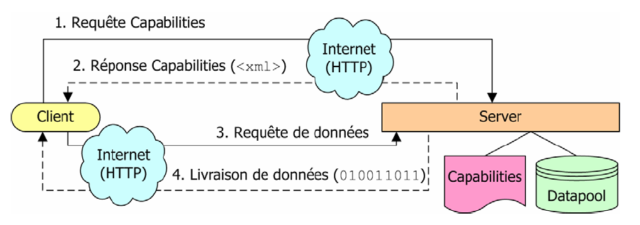
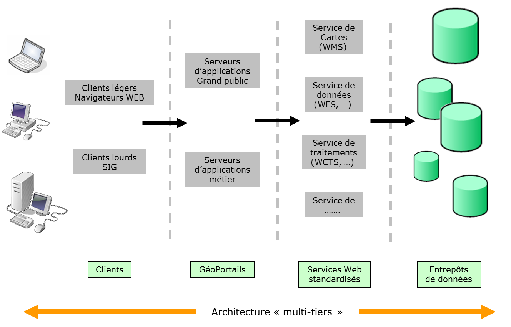
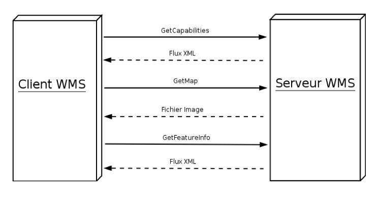
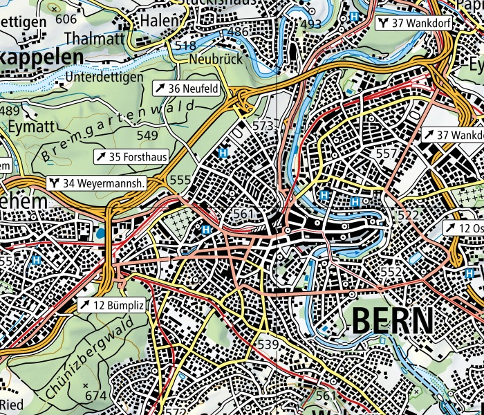
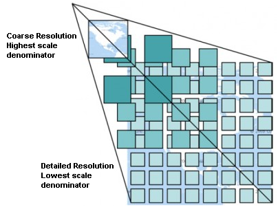
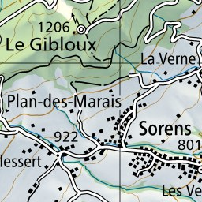
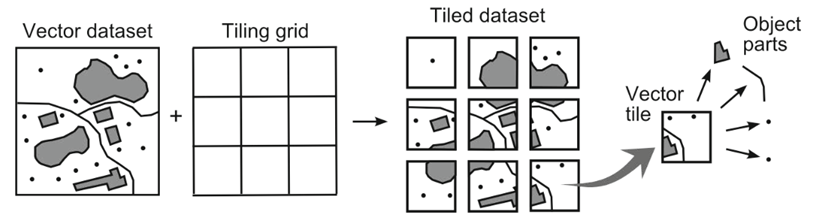

<!-- _class: lead -->
<!-- _paginate: false -->

# 8. Géoservices (GeoWeb)

Module B4 « Géomatique & TI » — Formats, interfaces

---

## Objectifs

- Expliquer le fonctionnement d'un géoservice
- Citer avantages et limites d'une architecture orientée services
- Interroger un service WMS, WMTS ou WFS
- Connaître les OGC API et les catalogues (STAC)

---

## Service web, géoservice

- **Service web** : des applications dialoguent à distance via HTTP(S), quels que soient plateforme et langage
- **Géoservice** : service web avec une composante géographique
- LGéo, art. 3 : application **mise en réseau** donnant accès aux géodonnées **sous une forme structurée**
- Forme structurée = **normes OGC** : WMS, WMTS, WFS, CSW, OGC API…

---

## Principe : Capabilities d'abord



1. `GetCapabilities` → 2. document XML (le « mode d'emploi »)
3. Requête de données → 4. données au format demandé

---

## KVP ou REST ?

- **KVP** : paramètres après `?`, séparés par `&`

```text
https://wms.geo.admin.ch/?SERVICE=WMS&VERSION=1.3.0&REQUEST=GetCapabilities
```

- **REST** : une URL par ressource, comme un chemin

```text
https://wmts.geo.admin.ch/1.0.0/ch.swisstopo.pixelkarte-farbe/default/current/2056/20/58/70.jpeg
```

---

## Architecture orientée services (SOA)



- Plus besoin de **posséder** une copie des données
- Les données restent chez le producteur
- Services standardisés → géoportails, SIG
- Ex. : map.geo.admin.ch, géoportails cantonaux

---

## Avantages et inconvénients

| ✅ Avantages | ❌ Inconvénients |
|---|---|
| Données toujours à jour | Dépendance au réseau |
| Un service réutilisé partout | Sécurité |
| Systèmes hétérogènes combinés | Pérennité des services tiers |
| | Simplification des données |

---

## Types de géoservices

| Type | Exemples |
|---|---|
| Recherche | recherche geo.admin.ch, géocodage |
| Catalogue | **CSW** (geocat.ch), **STAC** |
| Visualisation | **WMS**, **WMTS** |
| Téléchargement | **WFS**, OGC API – Features |
| Transformation | REFRAME, WPS / OGC API – Processes |

---

<!-- _class: lead -->

# WMS, WMTS, WFS

---

## WMS – Web Map Service



- Le serveur **dessine** une image à chaque requête
- Le client ne reçoit que des **pixels**
- `GetCapabilities`, `GetMap`, `GetFeatureInfo`
- Superposer des couches de serveurs différents (PNG transparent)

---

## WMS – une requête GetMap

```text
https://wms.geo.admin.ch/?SERVICE=WMS&VERSION=1.3.0&REQUEST=GetMap
  &LAYERS=ch.swisstopo.pixelkarte-farbe&STYLES=
  &CRS=EPSG:2056&BBOX=2596000,1197000,2603000,1203000
  &WIDTH=700&HEIGHT=600&FORMAT=image/png
```



- `LAYERS`, `CRS`, `BBOX`, taille, format
- ⚠️ EPSG:4326 en 1.3.0 : **lat, lon** !

*© swisstopo*

---

## WMTS – des tuiles précalculées



- Images de taille fixe (256 × 256 px)
- Échelles fixes → **pyramide**
- Pas de calcul à la volée : **rapide**, facile à mettre en cache
- `TileMatrixSet` = pyramide, `TileMatrix` = niveau

---

## WMTS – adresser une tuile

```text
https://wmts.geo.admin.ch/EPSG/2056/1.0.0/WMTSCapabilities.xml
```

```text
.../1.0.0/{Layer}/default/{Time}/2056/{TileMatrix}/{TileCol}/{TileRow}.jpeg
.../1.0.0/ch.swisstopo.pixelkarte-farbe/default/current/2056/{z}/{x}/{y}.jpeg
```



- `TileCol` = **colonne** (axe X), `TileRow` = **ligne** (axe Y)
- Ordre : voir `ResourceURL` du GetCapabilities

---

## WFS – Web Feature Service

- Renvoie les **objets** : géométrie + attributs (GML par défaut, parfois GeoJSON)
- `GetCapabilities`, `DescribeFeatureType`, `GetFeature`
- **WFS-T** : `Transaction` → insérer, modifier, supprimer

```text
https://geo.exemple.ch/wfs?SERVICE=WFS&VERSION=2.0.0
  &REQUEST=GetFeature&TYPENAMES=batiments&COUNT=100
```

*Serveur fictif — vérifiez qu'un service réel est encore actif.*

---

## WMS ou WFS ?

| | WMS / WMTS | WFS |
|---|---|---|
| Réponse | Image | Objets vectoriels |
| Usage | Visualiser | Analyser, réutiliser |
| Style | Choisi par le serveur | Choisi par le client |
| Volume | Constant | Dépend du nombre d'objets |

---

<!-- _class: lead -->

# Tuiles vectorielles et OGC API

---

## Tuiles vectorielles



- Grille de tuiles comme le WMTS, mais contenant des **géométries**
- Format courant : **Mapbox Vector Tile** (`.pbf`) ; standard : OGC API – Tiles
- **Style appliqué par le client**, net à toute résolution, interactif
- swisstopo : fonds de carte vectoriels (vectortiles.geo.admin.ch)

---

## OGC API : la nouvelle génération

- **REST** + **JSON/GeoJSON** + description **OpenAPI**

| OGC API | Remplace |
|---|---|
| Features | WFS |
| Tiles | WMTS |
| Maps | WMS |
| Processes | WPS |
| Records | CSW |

---

## OGC API – Features en pratique

```text
/collections                         → liste des collections
/collections/batiments/items?limit=10 → 10 objets en GeoJSON
/collections/batiments/items/42       → un objet
```

- Lisible dans un navigateur (HTML/JSON)
- QGIS lit WxS **et** OGC API

---

## STAC – SpatioTemporal Asset Catalog

- Catalogue de **fichiers** décrits par emprise et date
- Catalog → **Collection** → **Item** → **Asset** (fichier)
- data.geo.admin.ch : téléchargement des données fédérales

```text
https://data.geo.admin.ch/api/stac/v1/collections/
  ch.swisstopo.swissimage-dop10/items?bbox=7.43,46.94,7.45,46.95
```

---

## À retenir

- Géoservice = accès aux géodonnées **par le réseau**, sous **forme normalisée**
- **GetCapabilities** d'abord, requête de données ensuite
- **WMS** = image à la demande ; **WMTS** = tuiles (`TileCol` X, `TileRow` Y) ; **WFS** = objets
- **Tuiles vectorielles** : stylées par le client
- **OGC API** : successeurs REST/JSON ; **STAC** : catalogue de fichiers
