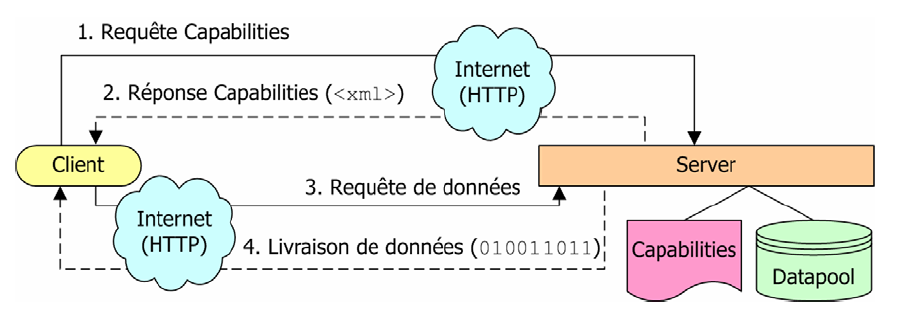
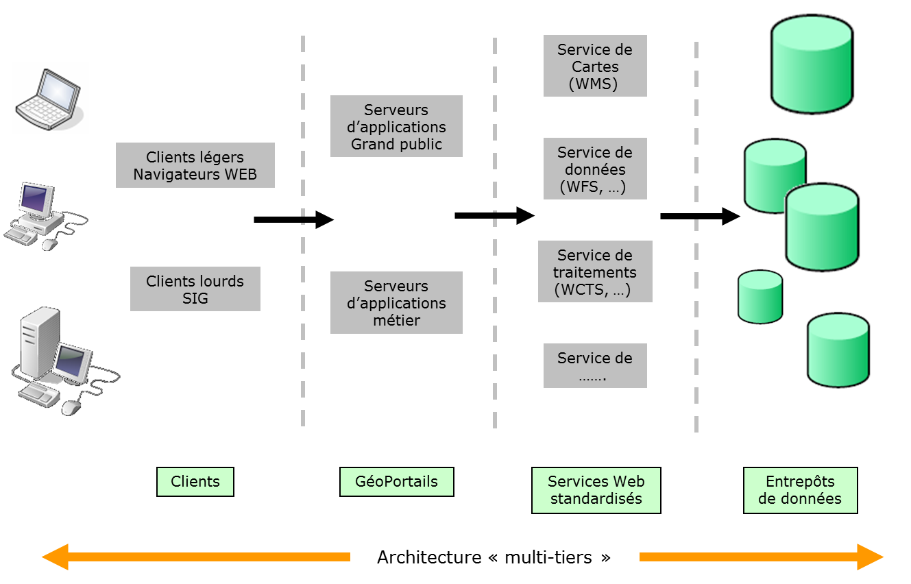
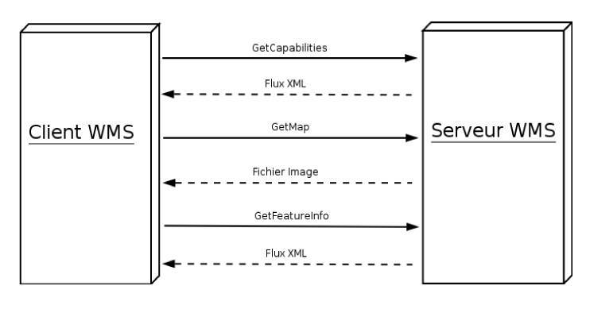
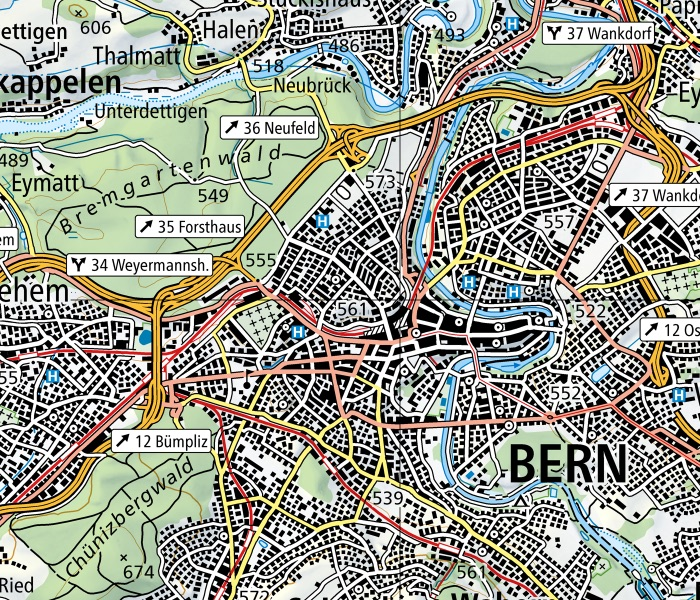
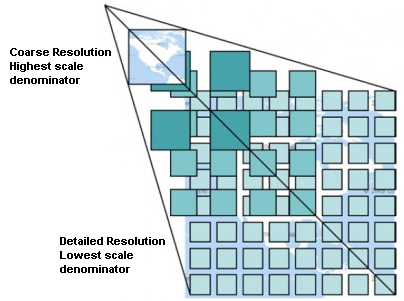
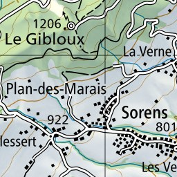
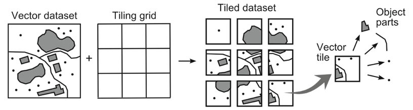

<!-- _footer: 'CFGéo B4 · 8. Géoservices (GeoWeb) · [📖 Lire le chapitre](./)' -->
<!-- _class: lead -->
<!-- _paginate: false -->

# 8. Géoservices (GeoWeb)

Module B4 « Géomatique & TI » — Formats, interfaces

---

<!-- _footer: 'CFGéo B4 · 8. Géoservices (GeoWeb) · [📖 Objectifs](./#objectifs)' -->
## Objectifs

- Expliquer le fonctionnement d'un géoservice (GetCapabilities, puis requête)
- Citer avantages et limites d'une architecture orientée services
- Distinguer les types de géoservices et les standards OGC (WMS, WMTS, WFS, CSW)
- Interroger un service WMS, WMTS ou WFS, en KVP ou en REST
- Situer les tuiles vectorielles, les OGC API et STAC
- Diffuser **sans serveur cartographique** et comparer aux géoservices
- Interroger un gros GeoParquet en SQL dans le navigateur (DuckDB)

---

<!-- _footer: 'CFGéo B4 · 8. Géoservices (GeoWeb) · [📖 Services web et géoservices](./#services-web-et-geoservices)' -->
## Service web, géoservice

- **Service web** : des applications dialoguent à distance via HTTP(S), quels que soient plateforme et langage
- **Géoservice** : service web avec une composante géographique
- LGéo, art. 3 : application **mise en réseau** donnant accès aux géodonnées **sous une forme structurée**
- Forme structurée = **normes OGC** : WMS, WMTS, WFS, CSW, OGC API…

---

<!-- _footer: 'CFGéo B4 · 8. Géoservices (GeoWeb) · [📖 Principe de fonctionnement](./#principe-de-fonctionnement)' -->
## Principe : Capabilities d'abord



1. `GetCapabilities` → 2. document XML (le « mode d'emploi »)
3. Requête de données → 4. données au format demandé

---

<!-- _footer: 'CFGéo B4 · 8. Géoservices (GeoWeb) · [📖 KVP et REST](./#kvp-et-rest)' -->
## KVP ou REST ?

- **KVP** (*key-value pairs*, paires clé=valeur) : paramètres après `?`, séparés par `&`

```text
https://wms.geo.admin.ch/?SERVICE=WMS&VERSION=1.3.0&REQUEST=GetCapabilities
```

- **REST** : une URL par ressource, comme un chemin

```text
https://wmts.geo.admin.ch/1.0.0/ch.swisstopo.pixelkarte-farbe/default/current/2056/20/58/70.jpeg
```

---

<!-- _footer: 'CFGéo B4 · 8. Géoservices (GeoWeb) · [📖 Architecture orientée services](./#du-modele-traditionnel-a-larchitecture-orientee-services)' -->
## Architecture orientée services (SOA)



- **Traditionnel** : acquérir, stocker, gérer soi-même les données
- **SOA** : plus besoin de **posséder** une copie des données
- Les données restent chez le producteur → **SIG distribués**
- Services standardisés → géoportails, SIG
- Ex. : map.geo.admin.ch, géoportails cantonaux

---

<!-- _footer: 'CFGéo B4 · 8. Géoservices (GeoWeb) · [📖 Avantages et inconvénients](./#avantages-et-inconvenients)' -->
## Avantages et inconvénients

| ✅ Avantages | ❌ Inconvénients |
|---|---|
| Données toujours à jour | Dépendance au réseau |
| Un service réutilisé partout | Sécurité |
| Systèmes hétérogènes combinés | Pérennité des services tiers |
| | Simplification des données |

---

<!-- _footer: 'CFGéo B4 · 8. Géoservices (GeoWeb) · [📖 Types de géoservices](./#types-de-geoservices)' -->
## Types de géoservices

| Type | Exemples |
|---|---|
| Recherche | recherche geo.admin.ch, géocodage |
| Catalogue | **CSW** (geocat.ch), **STAC** |
| Visualisation | **WMS**, **WMTS** |
| Téléchargement | **WFS**, OGC API – Features |
| Transformation | REFRAME, WPS / OGC API – Processes |

---

<!-- _footer: 'CFGéo B4 · 8. Géoservices (GeoWeb) · [📖 WMS – Web Map Service](./#wms-web-map-service)' -->
<!-- _class: lead -->

# WMS, WMTS, WFS

---

<!-- _footer: 'CFGéo B4 · 8. Géoservices (GeoWeb) · [📖 WMS – Web Map Service](./#wms-web-map-service)' -->
## WMS – Web Map Service



- Le serveur **dessine** une image à chaque requête
- Le client ne reçoit que des **pixels**
- `GetCapabilities`, `GetMap`, `GetFeatureInfo`
- Superposer des couches de serveurs différents (PNG transparent)

---

<!-- _footer: 'CFGéo B4 · 8. Géoservices (GeoWeb) · [📖 Exemple : le WMS de la Confédération](./#exemple-le-wms-de-la-confederation)' -->
## WMS – une requête GetMap

```text
https://wms.geo.admin.ch/?SERVICE=WMS&VERSION=1.3.0&REQUEST=GetMap
  &LAYERS=ch.swisstopo.pixelkarte-farbe&STYLES=
  &CRS=EPSG:2056&BBOX=2596000,1197000,2603000,1203000
  &WIDTH=700&HEIGHT=600&FORMAT=image/png
```



- `LAYERS`, `CRS`, `BBOX`, taille, format
- ⚠️ EPSG:4326 en 1.3.0 : **lat, lon** !
- ❓ `WIDTH`/`HEIGHT` ≠ proportions de la `BBOX` ?

*© swisstopo*

---

<!-- _footer: 'CFGéo B4 · 8. Géoservices (GeoWeb) · [📖 WMTS : vocabulaire](./#vocabulaire)' -->
## WMTS – des tuiles précalculées



- Images de taille fixe (256 × 256 px)
- Échelles fixes → **pyramide**
- Pas de calcul à la volée : **rapide**, facile à mettre en cache
- `TileMatrixSet` = pyramide (`2056`, `3857`), `TileMatrix` = niveau
- `TileCol` = colonne (X), `TileRow` = ligne (Y)

---

<!-- _footer: 'CFGéo B4 · 8. Géoservices (GeoWeb) · [📖 WMTS : GetTile](./#gettile)' -->
## WMTS – adresser une tuile

```text
https://wmts.geo.admin.ch/EPSG/2056/1.0.0/WMTSCapabilities.xml
```

```text
.../1.0.0/{Layer}/{Style}/{Time}/{TileMatrixSet}/{TileMatrix}/{TileCol}/{TileRow}.{Format}
```



- Ordre : voir `ResourceURL` du GetCapabilities ; numéros **2056** ≠ **3857**


---

<!-- _footer: 'CFGéo B4 · 8. Géoservices (GeoWeb) · [📖 Fil rouge : la tuile d’Yverdon en WMS et en WMTS](./#fil-rouge-la-tuile-dyverdon-en-wms-et-en-wmts)' -->
## 🧵 La tuile d'Yverdon en WMS et en WMTS

- **WMS** : `BBOX=2538000,1180000,2539000,1181000` (MN95) → le serveur **dessine** l'image de la tuile, à la taille demandée
- **WMTS** : on calcule l'**adresse** de la tuile précalculée qui contient Yverdon : `…/3857/15/16987/11555.jpeg`
- Changer le zoom → autre tuile ; changer l'emprise WMS → autre image

▶ [Démo : construire la requête](./#fil-rouge-la-tuile-dyverdon-en-wms-et-en-wmts)

---

<!-- _footer: 'CFGéo B4 · 8. Géoservices (GeoWeb) · [📖 Fil rouge : WMS et WMTS dans GeoLibre](./#fil-rouge-la-tuile-dyverdon-en-wms-et-en-wmts)' -->
## À tester : GeoLibre (navigateur)

**WMS** : *Add Data › WMS Layer*
`https://wms.geo.admin.ch/` → **Retrieve layers** = GetCapabilities (~900 couches)
→ `ch.kantone.cadastralwebmap-farbe` → GetMap à chaque déplacement

**WMTS** : modèle d'URL REST, en **3857** (Web Mercator)
`…/ch.swisstopo.pixelkarte-farbe/default/current/3857/{z}/{x}/{y}.jpeg`

F12 › *Réseau* : voir passer les requêtes

⚠️ À ouvrir dans **Chrome** (pas Firefox)

---

<!-- _footer: 'CFGéo B4 · 8. Géoservices (GeoWeb) · [📖 WFS – Web Feature Service](./#wfs-web-feature-service)' -->
## WFS – Web Feature Service

- Renvoie les **objets** : géométrie + attributs (GML par défaut, parfois GeoJSON)
- `GetCapabilities`, `DescribeFeatureType`, `GetFeature`
- **WFS-T** : `Transaction` → insérer, modifier, supprimer

```text
https://geo.exemple.ch/wfs?SERVICE=WFS&VERSION=2.0.0
  &REQUEST=GetFeature&TYPENAMES=batiments&COUNT=100
```

Où trouver des WFS ? Géoportails cantonaux, [geocat.ch](https://www.geocat.ch) — *serveur fictif ci-dessus ; vérifiez qu'un service réel est encore actif.*

---

<!-- _footer: 'CFGéo B4 · 8. Géoservices (GeoWeb) · [📖 WFS – Web Feature Service](./#wfs-web-feature-service)' -->
## WMS ou WFS ?

| | WMS / WMTS | WFS |
|---|---|---|
| Réponse | Image | Objets vectoriels |
| Usage | Visualiser | Analyser, réutiliser |
| Style | Choisi par le serveur | Choisi par le client |
| Volume | Constant | Dépend du nombre d'objets |

---

<!-- _footer: 'CFGéo B4 · 8. Géoservices (GeoWeb) · [📖 Tuiles vectorielles (vector tiles)](./#tuiles-vectorielles-vector-tiles)' -->
<!-- _class: lead -->

# Tuiles vectorielles

---

<!-- _footer: 'CFGéo B4 · 8. Géoservices (GeoWeb) · [📖 Tuiles vectorielles (vector tiles)](./#tuiles-vectorielles-vector-tiles)' -->
## Tuiles vectorielles



- Grille de tuiles comme le WMTS, mais contenant des **géométries**
- Format courant : **Mapbox Vector Tile** (`.pbf`) ; standard : OGC API – Tiles
- **Style appliqué par le client**, net à toute résolution, interactif
- Limites : plus de travail pour le client, données **généralisées** selon le zoom
- swisstopo : fonds de carte vectoriels (vectortiles.geo.admin.ch)

---

<!-- _footer: 'CFGéo B4 · 8. Géoservices (GeoWeb) · [📖 Diffuser sans serveur cartographique](./#diffuser-sans-serveur-cartographique)' -->
<!-- _class: lead -->

# Diffuser sans serveur cartographique

---

<!-- _footer: 'CFGéo B4 · 8. Géoservices (GeoWeb) · [📖 Diffuser sans serveur cartographique](./#diffuser-sans-serveur-cartographique)' -->
## Des fichiers, pas de serveur

- De simples **fichiers** sur un stockage web (S3, Azure, GitHub Pages…)
- Le client lit **seulement ce qu'il faut** : requêtes HTTP **partielles** + index interne

| Format | Lu à distance | Vu au |
|---|---|---|
| COG, Zarr | tuiles, blocs | ch. 2 |
| FlatGeobuf, GeoParquet, PMTiles | objets, colonnes, tuiles | ch. 3 |
| COPC | points de la zone | ch. 4 |
| GeoJSON, JSON-FG | tout le fichier (petits volumes) | ch. 5 |

**STAC** sert de catalogue (le « GetCapabilities » des fichiers)

---

<!-- _footer: 'CFGéo B4 · 8. Géoservices (GeoWeb) · [📖 Notre propre site, un exemple de diffusion sans serveur](./#notre-propre-site-un-exemple-de-diffusion-sans-serveur)' -->
## 🧪 Ce site est déjà un « service » sans serveur

```sql
SELECT name, einwohnerzahl
FROM 'https://raw.githubusercontent.com/regislon/cfgeo_B4/main/…/communes_vd.parquet'
ORDER BY einwohnerzahl DESC LIMIT 5;
```

Lausanne 144'873 · **Yverdon-les-Bains 30'292** · Montreux 26'955…

- DuckDB ne lit que **2 colonnes**, pas les géométries
- À tester dans [shell.duckdb.org](https://shell.duckdb.org) · FlatGeobuf → GeoLibre · PMTiles → pmtiles.io
- ⚠️ GitHub Pages compresse les fichiers → lectures partielles via **raw.githubusercontent.com**

---

<!-- _footer: 'CFGéo B4 · 8. Géoservices (GeoWeb) · [📖 Overture Maps : une base de données mondiale, sans API](./#overture-maps-une-base-de-donnees-mondiale-sans-api)' -->
## Overture Maps : le monde en GeoParquet

- Bâtiments, routes, lieux, adresses… **ni WMS, ni WFS, ni API** : des **fichiers GeoParquet** sur Amazon S3 et Azure
- Bâtiments : **512 fichiers, 277 Go**
- Une requête **DuckDB** extrait le canton de Vaud : **665'727 bâtiments en 3 min 22 s** (portable)
- DuckDB lit le **pied** de chaque fichier (min/max de `bbox` par groupe de lignes) et ne télécharge que les groupes utiles
- Puis jointure avec les communes → **216'994 bâtiments, 6,7 Mo**
- Licences : bâtiments **ODbL** (OSM, Microsoft) · lieux **CDLA 2.0 / Apache 2.0**

---

<!-- _footer: 'CFGéo B4 · 8. Géoservices (GeoWeb) · [📖 Du « big data » dans le navigateur avec DuckDB](./#du-big-data-dans-le-navigateur-avec-duckdb)' -->
## ▶ DuckDB dans le navigateur

- Base de données d'analyse en **WebAssembly** : SQL sur un Parquet distant
- `SELECT avg(height) …` → **14 requêtes partielles, 426 ko** lus sur 6,7 Mo (6 %)
- Stockage **par colonnes** + **groupes de lignes** triés par commune
- Requêtes prêtes à l'emploi **ou** votre propre SQL

▶ [Démo : interroger 216'994 bâtiments](./#du-big-data-dans-le-navigateur-avec-duckdb)

---

<!-- _footer: 'CFGéo B4 · 8. Géoservices (GeoWeb) · [📖 Du « big data » dans le navigateur avec DuckDB](./#du-big-data-dans-le-navigateur-avec-duckdb)' -->
## 🧵 Overture ou swissBUILDINGS3D ?

Tuile 2538-1180, même règle (centroïde dans la tuile) :

| Overture | swissBUILDINGS3D |
|---|---|
| **564** bâtiments | **392** bâtiments |

- OSM découpe en parties (annexes, garages, abris) · règles de saisie et dates différentes
- Des « bâtiments » de **plus de 120 m** : à vérifier !
- ➜ pas la même **définition** d'un bâtiment : question **sémantique** (ch. 7)

---

<!-- _footer: 'CFGéo B4 · 8. Géoservices (GeoWeb) · [📖 En direct : interroger le fichier mondial sur Amazon S3](./#en-direct-interroger-le-fichier-mondial-sur-amazon-s3)' -->
## ▶ En direct sur Amazon S3

- Lieux (*places*) d'Overture autour d'Yverdon, **directement** dans le fichier mondial
- Fichier de **713 Mo** → DuckDB lit **≈ 5 Mo (0,7 %)** en ~3 s
- **2'790 lieux** sur la carte : restaurants, commerces, services…

▶ [Démo : interroger Overture en direct](./#en-direct-interroger-le-fichier-mondial-sur-amazon-s3)

---

<!-- _footer: 'CFGéo B4 · 8. Géoservices (GeoWeb) · [📖 Services ou fichiers ?](./#services-ou-fichiers)' -->
## Services ou fichiers ?

| | Géoservice | Fichiers *cloud-native* |
|---|---|---|
| Infrastructure | serveur cartographique | stockage web |
| Coût | serveur, licences, exploitation | stockage et trafic |
| Mise à jour | immédiate, par objet | nouveau fichier (version) |
| Filtrage, calcul | par le serveur | par le client |
| Droits d'accès | fins | tout ou rien |
| Standards | OGC (WMS, WFS, OGC API) | formats ouverts + STAC |
| Idéal pour | données changeantes, accès contrôlé | gros volumes stables, analyses |

swisstopo combine les deux ; Overture ne publie que des fichiers

---

<!-- _footer: 'CFGéo B4 · 8. Géoservices (GeoWeb) · [📖 OGC API : la nouvelle génération](./#ogc-api-la-nouvelle-generation)' -->
<!-- _class: lead -->

# OGC API et STAC

---

<!-- _footer: 'CFGéo B4 · 8. Géoservices (GeoWeb) · [📖 OGC API : la nouvelle génération](./#ogc-api-la-nouvelle-generation)' -->
## OGC API : la nouvelle génération

- Les **WxS** (années 2000) : KVP + XML
- Depuis 2019 : **REST** + **JSON/GeoJSON** + description **OpenAPI**, standards **modulaires**

| OGC API | Remplace |
|---|---|
| Features | WFS |
| Tiles | WMTS |
| Maps | WMS |
| Processes | WPS |
| Records | CSW |

---

<!-- _footer: 'CFGéo B4 · 8. Géoservices (GeoWeb) · [📖 OGC API : la nouvelle génération](./#ogc-api-la-nouvelle-generation)' -->
## OGC API – Features en pratique

```text
/collections                         → liste des collections
/collections/batiments/items?limit=10 → 10 objets en GeoJSON
/collections/batiments/items/42       → un objet
```

- Lisible dans un navigateur (HTML/JSON)
- Les WxS restent très utilisés ; QGIS lit WxS **et** OGC API

---

<!-- _footer: 'CFGéo B4 · 8. Géoservices (GeoWeb) · [📖 STAC : un catalogue pour les données spatio-temporelles](./#stac-un-catalogue-pour-les-donnees-spatio-temporelles)' -->
## STAC – SpatioTemporal Asset Catalog

- Catalogue de **fichiers** décrits par emprise et date
- Catalog → **Collection** → **Item** → **Asset** (fichier)
- data.geo.admin.ch : téléchargement des données fédérales

```text
https://data.geo.admin.ch/api/stac/v1/collections/
  ch.swisstopo.swissimage-dop10/items?bbox=7.43,46.94,7.45,46.95
```

→ les dalles SWISSIMAGE de l'emprise (WGS84), avec leurs liens de téléchargement

---

<!-- _footer: 'CFGéo B4 · 8. Géoservices (GeoWeb) · [📖 STAC : un catalogue pour les données spatio-temporelles](./#stac-un-catalogue-pour-les-donnees-spatio-temporelles)' -->
## À tester : STAC dans GeoLibre

- *Add Data › STAC Layer*
- `https://data.geo.admin.ch/api/stac/v1/` → *Connect*
- Liste des **collections** swisstopo, recherche limitée à l'emprise de la carte
- Même JSON que la requête brute, mis en forme par le logiciel
- STAC + **Zarr** : démo de prévisions météo (chapitre 2)

⚠️ À ouvrir dans **Chrome** (pas Firefox)

---

<!-- _footer: 'CFGéo B4 · 8. Géoservices (GeoWeb) · [📖 Exercices](./#exercices)' -->
<!-- _class: exercice -->

# Exercice : Un même territoire, quatre accès

[Consignes](https://regislon.github.io/cfgeo_B4/formats-interfaces/exercices/ex12-quatre-acces/)

---

<!-- _footer: 'CFGéo B4 · 8. Géoservices (GeoWeb) · [📖 Et demain ?](./#et-demain)' -->
## Et demain ?

- **SWISSGEO** : le Géoportail fédéral (plus de 1'000 jeux de données, mai 2026) doit fusionner progressivement avec geodienste.ch et d'autres portails
- Des interfaces pour les **agents IA** : serveurs **MCP** (prototype swisstopo) → voir ch. 7

---

<!-- _footer: 'CFGéo B4 · 8. Géoservices (GeoWeb) · [📖 Testez-vous](./#testez-vous)' -->
## ❓ Testez-vous

▶ [Quiz du chapitre](./#testez-vous)

---

<!-- _footer: 'CFGéo B4 · 8. Géoservices (GeoWeb) · [📖 À retenir](./#a-retenir)' -->
## À retenir

- Géoservice = accès aux géodonnées **par le réseau**, sous **forme normalisée**
- **GetCapabilities** d'abord, requête de données ensuite
- SOA : données **à jour** et **partagées**, mais **dépendance** au réseau et aux fournisseurs
- **WMS** = image à la demande ; **WMTS** = tuiles (`TileCol` X, `TileRow` Y) ; **WFS** = objets
- **Tuiles vectorielles** : stylées par le client
- **OGC API** : successeurs REST/JSON ; **STAC** : catalogue de fichiers
- **Sans serveur** : fichiers *cloud-native* lus par morceaux (Overture = GeoParquet seulement)
- **DuckDB** : SQL sur Parquet distant, même dans le navigateur
- Services et fichiers sont **complémentaires**
